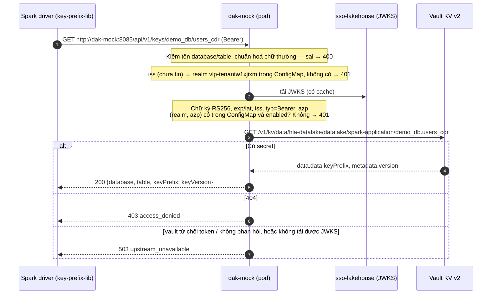

# dak-mock — Mock DAK cho use case lấy key (chạy trên Kubernetes nội bộ)

Service Spring Boot giả lập DAK, **chỉ** phục vụ các API mà sql-engine và SparkApplication gọi để lấy key:

```
GET /api/v1/keys/{database}/{table}      Authorization: Bearer <access token Keycloak của team>        key cả bảng
GET /api/v1/keys/by-column?...           Authorization: Bearer <client nội bộ hoặc client team>        key theo cột (mục 2.1)
```

Hợp đồng API đầy đủ: [docs/key-access/DAK_API_SPEC.md](../docs/key-access/DAK_API_SPEC.md). Phía client (`key-prefix-lib`, nguồn `source=dak`):
[docs/key-access/DAK_KEY_ACCESS_SQL_ENGINE_PLAN.md](../docs/key-access/DAK_KEY_ACCESS_SQL_ENGINE_PLAN.md).

## 1. Môi trường triển khai

| Thành phần                    | Giá trị                                                                                                                                  |
| ----------------------------- | ---------------------------------------------------------------------------------------------------------------------------------------- |
| Keycloak                      | `https://sso-lakehouse.cyberspace.vn` (IP `10.221.148.42`, cert do CA nội bộ cấp — mục 8)                                                |
| Realm (tenant)                | `vlp-tenantw1xjixm`                                                                                                                      |
| Issuer                        | `https://sso-lakehouse.cyberspace.vn/realms/vlp-tenantw1xjixm`                                                                           |
| JWKS                          | `https://sso-lakehouse.cyberspace.vn/realms/vlp-tenantw1xjixm/protocol/openid-connect/certs`                                             |
| Token endpoint (bên gọi dùng) | `https://sso-lakehouse.cyberspace.vn/realms/vlp-tenantw1xjixm/protocol/openid-connect/token`                                             |
| Namespace                     | `vlp-tenantw1xjixm-wsw7vtwvi-teamtscauiy` (workspace `wsw7vtwvi`, team `teamtscauiy`; cùng namespace với sql-engine và SparkApplication) |
| Service                       | `dak-mock:8085` (HTTP, ClusterIP)                                                                                                        |
| Vault                         | `http://vault.cyberspace.vn`, KV v2 mount `kv`                                                                                           |

Tất cả chạy trong cluster: build image → push registry nội bộ → `kubectl apply`. Không có bước chạy local.

## 2. Mock làm gì và không làm gì

| Có                                                                                                    | Không (cố ý bỏ qua)                                                                 |
| ----------------------------------------------------------------------------------------------------- | ----------------------------------------------------------------------------------- |
| Xác minh access token bằng **JWKS của realm Keycloak** (RS256, `iss`, `exp`, `typ`, `azp`)            | Grant theo bảng, phiếu duyệt cho `/{database}/{table}`                              |
| Ánh xạ `(realm, client_id)` → (tenant, workspace, team) từ ConfigMap; client **nội bộ** không có team | Giao diện quản trị của DAK (tạo client, phiếu PYC, cảnh báo hết hạn)                |
| Đọc `keyPrefix` từ **Vault KV v2 bằng token tĩnh**, cùng path với luồng column/cdr cũ                 | Database: mock không có DB; cấu hình ở ConfigMap, YC và danh sách khoá ở bộ nhớ     |
| `GET /api/v1/keys/by-column` (mục 2.1): key theo cột, YC, grant theo cột cho client team              | Đọc đúng `vault_version` đã lưu (mock đọc version mới nhất), rate limit, kiểm `aud` |
| Endpoint quản trị `/mock-admin/**` đóng vai người có quyền bên DAK (mục 2.2)                          | Rate limit (`429`) của `by-path` và `by-column`                                      |
| `GET /api/v1/keys/by-path` (mục 2.3): key giải mã toàn bộ file/thư mục theo đường dẫn, `204` khi chưa có key |                                                                                     |
| Phiếu chuẩn hoá silver (mục 2.4): gửi → duyệt → duyệt một lần, đặt lịch hằng ngày ở Airflow → theo dõi dag run gần nhất                |                                                                                     |
| Mã lỗi, body lỗi, `X-Request-Id`, `Cache-Control: no-store` đúng spec                                 |                                                                                     |

Đường `/{database}/{table}` vẫn không phân quyền: **mọi team có token hợp lệ đều lấy được mọi key bảng có trong Vault**. Chỉ
dùng cho môi trường test.

### 2.1. `GET /api/v1/keys/by-column`

Thiết kế đầy đủ: [docs/dak-mock-api/DAK_MOCK_BY_COLUMN_PLAN.md](../docs/dak-mock-api/DAK_MOCK_BY_COLUMN_PLAN.md). Tóm tắt:

```http
GET /api/v1/keys/by-column?database=demo_db&table=users_cdr&columns=msisdn,imei&onMissing=request&tag=internal
Authorization: Bearer <token>
X-Dak-Caller: <tên engine/job>     (tuỳ chọn, chỉ để audit; sai định dạng thì bị bỏ qua)
```

| Người gọi                        | `tag`      | Kết quả                                                                                   |
| -------------------------------- | ---------- | ----------------------------------------------------------------------------------------- |
| Client nội bộ (`kind: internal`) | `internal` | Không cần grant; `onMissing=request` mở YC cho cột chưa có key                            |
| Client nội bộ                    | không gửi  | `400 invalid_tag`                                                                         |
| Client team                      | không gửi  | Phải có grant còn hạn trên **mọi** cột (`dak.grants`), không thì `403` cả lô; không mở YC |
| Client team                      | `internal` | `403 access_denied`                                                                       |

Luôn `200` khi qua được kiểm tham số, token và quyền; mỗi cột có `state`: `READY` (kèm `keyPrefix`, `keyVersion`), `PENDING`
(kèm `requestCode`), `MISSING` (kèm `reason`: `not_requested` hoặc `yc_limit_reached`), `REJECTED` (kèm `requestCode`,
`reasonText`), `DISABLED`. `complete=true` khi mọi cột `READY`. Tối đa 100 cột và 4096 ký tự sau khi gộp trùng.

Key cột lưu ở `kv/data/hla-datalake/datalake/column-keys/{database}/{table}/{column}` (đổi được bằng `dak.vault.column-path-template`)
và chỉ được **tạo** bằng `cas=0`: không bao giờ ghi đè key đã có. Có hai cách để một cột có key: tạo tay secret trước (mục 5.1), hoặc để
mock tạo khi `fulfill` YC (cần quyền `create`).

### 2.2. Endpoint quản trị `/mock-admin/**`

Bật khi có Secret `dak-mock-admin-token`; mọi request phải có header `X-Mock-Admin-Token`, sai hoặc thiếu thì `404`.

| Endpoint                                                       | Việc                                                                  |
| -------------------------------------------------------------- | --------------------------------------------------------------------- |
| `GET /mock-admin/yc`                                           | Liệt kê YC của cột                                                    |
| `POST /mock-admin/yc/{requestCode}/fulfill`                    | Tạo key (ngẫu nhiên 32 byte, hoặc body `{"keyValue":"..."}`), đóng YC |
| `POST /mock-admin/yc/{requestCode}/reject`                     | Body `{"reasonText":"..."}`. Lời gọi sau cho cột đó nhận `REJECTED`   |
| `POST /mock-admin/columns/{database}/{table}/{column}/disable` | Khoá cột đã có key: lời gọi sau nhận `DISABLED`                       |
| `POST /mock-admin/columns/{database}/{table}/{column}/enable`  | Mở khoá: cột trả lại đúng key cũ                                      |
| `POST /mock-admin/path-keys`                                   | Body `{"path":"...","keyValue":"..."}` (`keyValue` tuỳ chọn): tạo key theo đường dẫn — vai trò luồng mã hoá file của DAK |
| `POST /mock-admin/path-keys/disable`, `.../enable`            | Body `{"path":"..."}`: khoá/mở khoá key đã có của đường dẫn → `by-path` trả `403 key_disabled` / trả lại key |
| `POST /mock-admin/column-keys`                                 | Body `{"database","table","column","keyValue"}`: tạo key cột trực tiếp, không qua YC |

YC và danh sách khoá nằm trong bộ nhớ: **pod restart là mất** (YC mở lại với mã mới, cột hết bị khoá). Key cột trong Vault không mất.

### 2.3. `GET /api/v1/keys/by-path`

Theo [API-LAY-KEY-DUONG-DAN-COT.md](../docs/key-access/API-LAY-KEY-DUONG-DAN-COT.md) mục 2, với hai điểm đã thống nhất với DAK
([TRA-LOI-DAK-BY-PATH.md](../docs/key-access/TRA-LOI-DAK-BY-PATH.md)): `path` tương đối theo gốc của nguồn, và **chưa có key thì trả rỗng `204`,
không mở YC** (đường dẫn không có key nghĩa là file không mã hoá). DAK thật **chưa code** đường này. Dùng bởi job mode `decrypt-encrypt` của
[silver-ingest-app](../silver-ingest-app/README.md).

```http
GET /api/v1/keys/by-path?path=ebs_3g_4g/dt=20261012/batch=1520&tag=internal
Authorization: Bearer <token của client nội bộ>
```

| Trường hợp | Kết quả |
| --- | --- |
| Có key | `200 {"path": "...", "keyPrefix": "...", "keyVersion": 1}` |
| Chưa có key | `204` rỗng, không mở YC |
| `path` rỗng, có `..`, ký tự điều khiển, quá 1024 ký tự | `400 invalid_path` (kiểm trước khi xác thực) |
| `tag` thiếu hoặc khác `internal` | `400 invalid_tag` |
| Client không phải nội bộ | `403 access_denied` |
| Key đang bị khoá | `403 key_disabled` (không im lặng `204`, tránh đọc dữ liệu mã hoá như nguyên trạng) |

Key theo đường dẫn do **luồng mã hoá file** tạo; ở mock là `POST /mock-admin/path-keys` (mục 2.2). DAK so khớp **nguyên chuỗi**, mock cũng
vậy (không chuẩn hoá, kể cả hoa thường), nên `path` khi tạo key phải đúng chuỗi job gửi. DAG silver của dataset gửi **tên dataset** (vd `nims`): một key cho cả
dataset, mọi lô dùng chung. Một đường dẫn một key, kể cả khi đó là thư mục. Key lưu ở `kv/data/hla-datalake/datalake/path-keys/{pathHash}` (`pathHash` = SHA-256 hex của đường dẫn, đổi bằng
`dak.vault.path-key-template`), chỉ được tạo bằng `cas=0`. Token Vault của mock cần quyền `read` và `create` trên path này.

### 2.4. Phiếu chuẩn hoá silver `/mock-portal/silver-requests`

Mọi phiếu (VTT lẫn VTNET) là **phiếu định kỳ cho cả một dataset**: `path` là **tên dataset** (`f001-mpre-call` của VTT; `ebs_3g_4g`, `nims` của VTNET), phiếu có
`scheduleTime` (giờ chạy hằng ngày) và **không có `batchId`**. Admin duyệt **một lần**: mock ghi cấu hình đã duyệt vào **Airflow Variable** `silver_ingest_<nguồn>_<dataset>`
và bật DAG (`is_paused=false`); DAG của dataset ([airflow/dags/](../airflow/dags/), do DAG factory `silver_ingest_factory.py` dựng) lấy lịch từ Variable đó và chạy mỗi ngày
cho ngày hôm trước. Phiếu ở `SCHEDULED` cho tới khi admin `stop` (tắt DAG, xoá Variable). Xem phiếu thấy dag run gần nhất (`lastRun`).

Dùng chung tài khoản portal giả, token quản trị và cấu hình Airflow (`dak.deid.submitter`, `dak.deid.airflow`) với phiếu khử định danh; `submitter=noop` thì chỉ log
(và phiếu vẫn thành `SCHEDULED`). User Airflow của mock cần quyền Variables (đọc/tạo/sửa/xoá), sửa DAGs và đọc DAG runs.

Thân JSON (`POST /mock-portal/silver-requests`, header `X-Mock-Portal-Token`):

| Trường | Bắt buộc | Quy tắc |
| --- | --- | --- |
| `source` | có | `VTT` hoặc `VTNET` |
| `path` | có | **Đúng tên một dataset của nguồn** (VTT: `f001-mpre-call`; VTNET: `ebs_3g_4g`, `nims`), không phải một ngày hay một lô. Dạng chuẩn: không `/` đầu/cuối, không `//`, không `..`, chỉ `[A-Za-z0-9_.=+-]` và `/` |
| `batchId` | **không được có** | Mỗi lần chạy tự lấy mã ngày nạp (`yyyyMMdd`) làm partition `batch_id` |
| `scheduleTime` | có | Giờ chạy hằng ngày `HH:mm` (`00:00`–`23:59`, giờ `Asia/Ho_Chi_Minh`); DAK đổi thành cron `<phút> <giờ> * * *`. Mỗi lần chạy nạp **ngày hôm trước** |
| `table` | có | Bảng đích trong database silver, **người gửi chọn**: `[a-z0-9_]{1,128}`, bắt đầu bằng tiền tố của nguồn (`vtt_`, `vtnet_`) để không ghi vào bảng của nguồn khác |
| `outputMode` | không | `overwrite-partitions` (mặc định của DAG) hoặc `append` |
| `encryptColumns` | không | Chỉ dataset `decrypt-encrypt` (`nims`): danh sách 0–100 tên cột, không trùng; job mã hoá bằng cdr-crypto. **Rỗng hoặc không gửi = chỉ giải mã file**. Dataset `passthrough` (`f001-mpre-call`, `ebs_3g_4g`) không được có |
| `keyField` | khi có cột mã hoá | Cột giữ plaintext làm nguyên liệu key, không nằm trong `encryptColumns`; không có cột thì bỏ trống |
| `purpose` | có | Tối đa 500 ký tự |

Sai thì `400 invalid_request` kèm `problems[]` (mọi lỗi một lượt, trường lạ bị từ chối). Chống trùng: **cả dataset chỉ có một phiếu chưa kết thúc (kể cả `SCHEDULED`), của mọi
team**, vì một dataset chỉ có một lịch và một cấu hình ở Airflow: phiếu thứ hai thì `409 duplicate_request`. Mã phiếu `SLV-<năm>-<6 số>`.

| Endpoint | Việc |
| --- | --- |
| `GET /mock-portal/silver-requests`, `GET .../{code}`, `POST .../{code}/cancel` | Người gửi xem phiếu của team, huỷ phiếu chưa duyệt |
| `GET /mock-admin/silver-requests`, `GET .../{code}` | Admin xem mọi phiếu |
| `POST /mock-admin/silver-requests/{code}/approve` | Duyệt MỘT lần rồi ghi Variable và bật DAG (`SCHEDULED`). Lỗi thì `SUBMIT_FAILED` kèm thông điệp cố định |
| `POST /mock-admin/silver-requests/{code}/stop` | Phiếu `SCHEDULED`: tắt DAG, xoá Variable → `STOPPED`. Lỗi gọi Airflow thì `503` và phiếu vẫn `SCHEDULED` |
| `POST /mock-admin/silver-requests/{code}/run` | Chạy bù MỘT ngày cho phiếu `SCHEDULED`: body `{"date":"yyyyMMdd"}`; DAK trigger một dag run `conf.date` cho DAG của dataset, **lịch và phiếu không đổi**. Trả `{requestCode, dagId, dagRunId, date}`; mỗi lần gọi là một dag run mới (cùng ngày thì thay partition của ngày đó). `date` sai thì `400`, phiếu chưa `SCHEDULED` thì `409`, lỗi gọi Airflow thì `503`. User Airflow của mock cần quyền tạo dag run |
| `POST /mock-admin/silver-requests/{code}/reject` | Body `{"reasonText":"..."}` |
| `POST /mock-admin/silver-requests/{code}/retry-submit` | Gửi lại phiếu `SUBMIT_FAILED` |

**Phiếu mẫu** ([k8s/silver/samples/](k8s/silver/samples/), `SilverSampleFilesTest` kiểm các mẫu này với parser thật):

| File | Nội dung |
| --- | --- |
| `valid-vtt-request.json` | Dataset `f001-mpre-call` của VTT (passthrough), chạy 01:30 hằng ngày |
| `valid-vtnet-request.json` | Dataset `nims` (decrypt-encrypt), chạy 03:00 hằng ngày: có `encryptColumns`, `keyField` |
| `valid-vtnet-no-columns-request.json` | `nims` không mã hoá cột nào (`encryptColumns` rỗng): job chỉ giải mã file |
| `valid-vtnet-passthrough-request.json` | Dataset `ebs_3g_4g` (passthrough), chạy 02:30: không có cột mã hoá |
| `valid-vtnet-append-request.json` | `nims`, 04:30, `outputMode=append` |
| `invalid-vtt-with-columns.json` | Dataset passthrough của VTT có `encryptColumns`/`keyField` → `400` |
| `invalid-vtt-day-in-path.json` | VTT: `path` là một ngày/giờ thay vì dataset → `400` |
| `invalid-vtnet-columns-without-key-field.json` | Có `encryptColumns` mà thiếu `keyField` → `400` |
| `invalid-vtnet-passthrough-with-columns.json` | Dataset passthrough có `encryptColumns`/`keyField` → `400` |
| `invalid-vtnet-day-in-path.json` | `path` là một ngày/lô thay vì dataset → `400` |
| `invalid-vtnet-with-batch-id.json` | Có `batchId` → `400` |
| `invalid-vtnet-missing-schedule-time.json` | Thiếu `scheduleTime` → `400` |
| `invalid-vtnet-unknown-dataset.json` | `path` không phải dataset đã biết → `400` |
| `invalid-table-of-another-source.json` | Phiếu VTT đặt bảng `vtnet_…` → `400` |
| `invalid-many-errors.json` | Nhiều lỗi cùng lúc (nguồn lạ, `path` tuyệt đối, `batchId`, bảng sai, `overwrite`, trường lạ, thiếu `purpose`) → `400` liệt kê đủ |

Gửi thử (đã `kubectl port-forward deploy/dak-mock 8085`; token portal và token admin đọc từ bàn phím):

```bash
read -rs -p "Portal token: " PT; echo
curl -s -X POST localhost:8085/mock-portal/silver-requests -H "X-Mock-Portal-Token: $PT" \
  -H 'Content-Type: application/json' --data @dak-mock/k8s/silver/samples/valid-vtnet-no-columns-request.json
read -rs -p "Admin token: " AT; echo
curl -s -X POST localhost:8085/mock-admin/silver-requests/SLV-2026-000001/approve -H "X-Mock-Admin-Token: $AT"   # SCHEDULED
curl -s localhost:8085/mock-portal/silver-requests/SLV-2026-000001 -H "X-Mock-Portal-Token: $PT"               # state, lastRun
curl -s -X POST localhost:8085/mock-admin/silver-requests/SLV-2026-000001/stop -H "X-Mock-Admin-Token: $AT"      # STOPPED
unset PT AT
```

Trạng thái phiếu: `PENDING_APPROVAL` → `SCHEDULED` → `STOPPED`, hoặc `REJECTED`, `CANCELLED`, `SUBMIT_FAILED`. Mỗi ngày DAG chạy một dag run và `lastRun` (`SUCCEEDED`, `FAILED`,
`RUNNING`) cho biết lần gần nhất; một ngày lỗi **không** làm phiếu thành lỗi. Với dataset có cột mã hoá, lần chạy đầu của bảng mới: `by-column` (`onMissing=request`) mở YC cho
cột chưa có key và trả `PENDING`; job **chờ** và gọi lại theo exponential backoff, dag run vẫn đang chạy. Admin duyệt YC cột (`GET /mock-admin/yc`, `POST
/mock-admin/yc/<mã>/fulfill`) → lần gọi sau cột `READY` → job ghi bảng. Hết thời gian chờ của job (hoặc YC bị từ chối) → job exit 5 → dag run của ngày đó `failed`.

## 3. Cấu trúc code

```
dak-mock/
├── Dockerfile                               build 2 bước, chạy user 1000:1000
├── k8s/dak-mock.yaml                        ConfigMap + Deployment + Service
├── pom.xml                                  Spring Boot 3.4, Java 17 — project độc lập, KHÔNG thuộc reactor Spark
└── src/main/java/vai/lakehouse/dakmock/
    ├── config/DakProperties.java            cấu hình `dak.*` (realm, client, grant, Vault, YC, admin), kiểm tra lúc khởi động
    ├── config/ClientKind.java               loại client: team | internal
    ├── web/RequestIdFilter.java             X-Request-Id + Cache-Control: no-store cho MỌI response
    ├── web/KeyController.java               GET /api/v1/keys/{database}/{table}: kiểm tên → xác minh token → lấy key
    ├── web/ColumnKeyController.java         GET /api/v1/keys/by-column: kiểm tham số → xác minh token → ColumnKeyService
    ├── web/MockAdminController.java         /mock-admin/**: YC, fulfill, reject, khoá/mở khoá cột
    ├── auth/TokenVerifier.java              xác minh JWT bằng JWKS của realm, tra client đã đăng ký
    ├── key/KeyService.java                  lấy key bảng cho team + ghi log audit (không ghi prefix)
    ├── key/VaultKeyReader.java              đọc {vault}/v1/{kvMount}/data/{path}; tạo secret mới bằng cas=0
    ├── column/ColumnKeyRequest.java         parse + chuẩn hoá tham số by-column, giới hạn 100 cột / 4096 ký tự
    ├── column/ColumnKeyService.java         tag × loại client, grant theo cột, trạng thái từng cột, audit
    ├── column/ColumnKeyStore.java           key cột ở Vault (chỉ tạo, không ghi đè) + danh sách cột bị khoá
    ├── column/YcRegistry.java               YC trong bộ nhớ, giới hạn YC mở, REJECTED dính theo cột
    ├── web/DakApiException.java             lỗi theo bảng mã lỗi của spec (400/401/403/404/500/503)
    └── web/ApiExceptionHandler.java         chuyển lỗi thành {"error","message","requestId"}
```



Các điểm bảo mật trong code: khoá ký chỉ lấy từ `jwks-uri` của ConfigMap (header `jku`/`x5u` của token bị bỏ qua); chỉ
nhận RS256 (từ chối `alg: none`, HMAC); đăng ký client khoá theo `(realm, client_id)`; bảng không có key trả 403 (không dò
được bảng); không log token, secret, prefix.

## 4. Cấu hình (ConfigMap `dak-mock-config`)

Trong [`k8s/dak-mock.yaml`](k8s/dak-mock.yaml). ConfigMap được mount vào `/config` và ghi đè `application.yml` trong jar;
danh sách `realms`/`clients` trong ConfigMap **thay thế** toàn bộ danh sách mặc định.

```yaml
dak:
  realms:
    - realm: vlp-tenantw1xjixm
      tenant: vlp-tenantw1xjixm
      issuer: https://sso-lakehouse.cyberspace.vn/realms/vlp-tenantw1xjixm
      jwks-uri: https://sso-lakehouse.cyberspace.vn/realms/vlp-tenantw1xjixm/protocol/openid-connect/certs
  clients:
    - realm: vlp-tenantw1xjixm
      client-id: <client-id-cua-team> # PHẢI SỬA: client vận hành tạo cho team
      workspace: wsw7vtwvi
      team: teamtscauiy
      # enabled: false                     # khoá client -> token của client này bị 401
  vault:
    addr: http://vault.cyberspace.vn
    kv-mount: kv
    path-template: hla-datalake/datalake/spark-application/{database}.{table}
    key-field: keyPrefix
```

- Mỗi client của team là một phần tử trong `clients`. Client phải được tạo trong realm `vlp-tenantw1xjixm` theo checklist
  [docs/key-access/DAK_API_SPEC.md mục 2.3](../docs/key-access/DAK_API_SPEC.md#23-yêu-cầu-với-client-của-team) (confidential, bật Service accounts,
  tắt Standard flow/Direct access).
- `path-template` trùng path của luồng column/cdr cũ với **tên key hai phần** `<database>.<table>` (chữ thường).
- Pod không khởi động nếu thiếu Secret token Vault, `path-template` thiếu `{database}`/`{table}`, client trỏ tới realm không có,
  hoặc trùng `(realm, client-id)`.

### 4.1. Kiểm `issuer` trước khi deploy

`issuer` phải khớp **từng ký tự** với claim `iss` trong token, nếu không mọi request bị 401. Kiểm từ trong cluster bằng pod
tạm (mục 7) — nếu bản Keycloak dùng context path `/auth` thì `issuer` sẽ có `/auth` và phải sửa cả `jwks-uri`:

```sh
curl -s https://sso-lakehouse.cyberspace.vn/realms/vlp-tenantw1xjixm/.well-known/openid-configuration \
  | grep -o '"issuer":"[^"]*"\|"jwks_uri":"[^"]*"'
```

## 5. Chuẩn bị

### 5.1. Secret trong Vault cho từng bảng

```bash
# Dùng token có quyền GHI (không phải token chỉ đọc của mock)
vault kv put kv/hla-datalake/datalake/spark-application/demo_db.users_cdr keyPrefix="<giá trị prefix>"
```

Token mà mock dùng cần quyền **đọc** key bảng, và **đọc + tạo** key cột (mock ghi key cột bằng `cas=0`, không cần `update`):

```hcl
path "kv/data/hla-datalake/datalake/spark-application/*" {
  capabilities = ["read"]
}
path "kv/data/hla-datalake/datalake/column-keys/*" {
  capabilities = ["read", "create"]
}
```

Key cột có hai cách tạo:

```bash
# Cách 1: tạo tay trước, mỗi cột một secret. Cột đã có secret thì by-column trả READY ngay, không mở YC.
# <database>, <table>, <column> chữ thường, chỉ a-z, 0-9, _
vault kv put kv/hla-datalake/datalake/column-keys/demo_db/users_cdr/name keyPrefix="$(openssl rand -base64 32)"
vault kv put kv/hla-datalake/datalake/column-keys/demo_db/users_cdr/city keyPrefix="$(openssl rand -base64 32)"
```

Cách 2: để mock tạo khi người quản trị `fulfill` YC (mục 2.2); cần quyền `create` ở policy trên. Dù cách nào, **đừng ghi đè** secret đã
có: key đã dùng để mã hoá mà đổi giá trị thì dữ liệu cũ không giải mã được.

### 5.2. Secret token Vault trên k8s

```bash
NS=vlp-tenantw1xjixm-wsw7vtwvi-teamtscauiy
read -rs -p "Vault token (policy mục 5.1): " T; echo
kubectl create secret generic dak-mock-vault-token -n "$NS" --from-literal=token="$T"; unset T

# Tuỳ chọn: bật endpoint quản trị /mock-admin/**
kubectl create secret generic dak-mock-admin-token -n "$NS" --from-literal=token="$(openssl rand -hex 24)"
```

## 6. Build và deploy

### 6.1. Test và build image

Có hai cách build image, cùng cho ra image giống nhau (JRE 17, user 1000:1000, jar thuộc root chỉ đọc):

**Cách A — build trọn trong Docker** (`Dockerfile`: Maven + JDK 17 build jar rồi copy sang image JRE):

```bash
mvn -f dak-mock/pom.xml test                                   # ~520 test, không cần Keycloak/Vault/Kubernetes thật
docker build -t hub.vtcc.vn:8989/dak-mock:0.1.0 dak-mock       # build context là thư mục dak-mock
docker push hub.vtcc.vn:8989/dak-mock:0.1.0
```

Bước build tải dependency từ Maven Central; nếu máy build chỉ đi qua mirror nội bộ thì thêm `settings.xml` vào bước build.
`.dockerignore` loại `target/` và `.env` khỏi build context.

**Cách B — build jar bên ngoài Docker** (máy build không tải được Maven Central trong Docker, hoặc đã có jar từ CI):

```bash
# Cần JDK 17 và Maven 3.9+ trên máy build (mirror nội bộ cấu hình ở ~/.m2/settings.xml như bình thường)
mvn -f dak-mock/pom.xml package                                # test + jar: dak-mock/target/dak-mock-0.1.0-SNAPSHOT.jar
# (bỏ test: thêm -DskipTests; build offline khi ~/.m2 đã đủ dependency: thêm -o)

# Đóng gói jar vào image runtime, KHÔNG build lại trong Docker (Dockerfile.jar + Dockerfile.jar.dockerignore):
docker build -f dak-mock/Dockerfile.jar -t hub.vtcc.vn:8989/dak-mock:0.1.0 dak-mock
docker push hub.vtcc.vn:8989/dak-mock:0.1.0
```

Cần Docker BuildKit (mặc định từ Docker 23; bản cũ đặt `DOCKER_BUILDKIT=1`) để `Dockerfile.jar.dockerignore` có hiệu lực. Jar phải đúng tên
`dak-mock-0.1.0-SNAPSHOT.jar`; đổi `<version>` trong `pom.xml` thì sửa tên này trong `Dockerfile.jar` và `Dockerfile.jar.dockerignore`.

Không cần Docker để chạy thử: `java -jar dak-mock/target/dak-mock-0.1.0-SNAPSHOT.jar` (đặt `VAULT_TOKEN`, và `MOCK_ADMIN_TOKEN` nếu dùng
`/mock-admin`; cấu hình thêm bằng `SPRING_CONFIG_ADDITIONAL_LOCATION=file:<thư mục chứa application.yml>/`).

### 6.2. Deploy

```bash
# Sửa client-id/team trong ConfigMap trước (mục 4)
kubectl apply -f dak-mock/k8s/dak-mock.yaml
kubectl rollout status -n "$NS" deploy/dak-mock
kubectl logs -n "$NS" deploy/dak-mock | grep "Started DakMockApplication"
```

Sửa ConfigMap sau khi đã deploy: `kubectl apply` lại rồi `kubectl rollout restart -n "$NS" deploy/dak-mock`.

| Mục trong manifest             | Giá trị                                                                                                                                               |
| ------------------------------ | ----------------------------------------------------------------------------------------------------------------------------------------------------- |
| `resources`                    | requests `250m`/`512Mi`, limits `1` CPU/`2Gi`; JVM lấy 75% memory limit làm heap                                                                      |
| Pod `securityContext`          | `runAsNonRoot`, `runAsUser/runAsGroup/fsGroup: 1000`, `seccompProfile: RuntimeDefault`                                                                |
| Container `securityContext`    | `allowPrivilegeEscalation: false`, `capabilities.drop: [ALL]`, `runAsNonRoot`, `runAsUser: 1000`, `readOnlyRootFilesystem: true` (`/tmp` là emptyDir) |
| `automountServiceAccountToken` | `false`                                                                                                                                               |
| Probe                          | `tcpSocket` cổng `http`                                                                                                                               |

Pod phải gọi được `sso-lakehouse.cyberspace.vn` (JWKS) và `vault.cyberspace.vn`. Nếu namespace có NetworkPolicy chặn egress
thì mở 2 đích này.

## 7. Kiểm tra trong cluster

Mở pod tạm có `curl`, cùng namespace (đặt securityContext để qua được Pod Security "restricted"; nếu cluster không kéo được
image từ Docker Hub thì thay bằng image có curl ở registry nội bộ):

```bash
kubectl run dak-check -n "$NS" --rm -it --restart=Never --image=curlimages/curl:8.10.1 --overrides='{
  "spec": {
    "securityContext": {"runAsNonRoot": true, "runAsUser": 1000, "seccompProfile": {"type": "RuntimeDefault"}},
    "containers": [{"name": "dak-check", "image": "curlimages/curl:8.10.1", "command": ["sh"], "stdin": true, "tty": true,
      "securityContext": {"allowPrivilegeEscalation": false, "capabilities": {"drop": ["ALL"]}}}]}}'
```

Trong pod:

```sh
# 1. Xin token của team (secret đọc từ bàn phím, đưa vào curl qua stdin)
printf 'Client secret: '; stty -echo; read CS; stty echo; echo
TOKEN=$(printf '%s' "$CS" | curl -s \
  https://sso-lakehouse.cyberspace.vn/realms/vlp-tenantw1xjixm/protocol/openid-connect/token \
  -d grant_type=client_credentials -d client_id=<client-id-cua-team> --data-urlencode client_secret@- \
  | sed -n 's/.*"access_token":"\([^"]*\)".*/\1/p'); unset CS

# 2. Gọi mock
curl -s -i http://dak-mock:8085/api/v1/keys/demo_db/users_cdr -H "Authorization: Bearer $TOKEN"

# 3. Key theo cột (TOKEN của client nội bộ): lần đầu nhận PENDING kèm requestCode
curl -s "http://dak-mock:8085/api/v1/keys/by-column?database=demo_db&table=users_cdr&columns=name,city&onMissing=request&tag=internal" \
  -H "Authorization: Bearer $TOKEN"

# 4. Đóng vai người có quyền bên DAK: xem YC rồi tạo key (token quản trị đọc từ bàn phím)
printf 'Admin token: '; stty -echo; read AT; stty echo; echo
curl -s http://dak-mock:8085/mock-admin/yc -H "X-Mock-Admin-Token: $AT"
curl -s -X POST http://dak-mock:8085/mock-admin/yc/<requestCode>/fulfill -H "X-Mock-Admin-Token: $AT"
# Gọi lại bước 3 -> cột đó READY
```

Pod tạm tự xoá khi thoát (`--rm`).

| Tình huống                                                                             | Response                                                                          |
| -------------------------------------------------------------------------------------- | --------------------------------------------------------------------------------- |
| Token hợp lệ, Vault có secret                                                          | `200 {"database":"demo_db","table":"users_cdr","keyPrefix":"...","keyVersion":1}` |
| Tên bảng sai (`demo-db`)                                                               | `400 invalid_table`                                                               |
| Thiếu token, hết hạn, sai chữ ký, `iss` không khớp ConfigMap, client chưa khai/bị khoá | `401 invalid_token`                                                               |
| Vault không có secret cho bảng                                                         | `403 access_denied`                                                               |
| Secret không có field `keyPrefix` hoặc rỗng                                            | `500 internal_error`                                                              |
| Vault từ chối token / không phản hồi, hoặc không tải được JWKS                         | `503 upstream_unavailable`                                                        |

Lý do chi tiết chỉ nằm trong log, kèm `requestId`:

```bash
kubectl logs -n "$NS" deploy/dak-mock | grep <requestId>
kubectl logs -n "$NS" deploy/dak-mock | grep KEY_FETCH          # dòng audit, không có prefix
```

Lỗi hay gặp:

| Log                                                                                | Nguyên nhân                                                   |
| ---------------------------------------------------------------------------------- | ------------------------------------------------------------- |
| `401 invalid_token: issuer is not in the realm registry`                           | `issuer` trong ConfigMap không khớp `iss` của token (mục 4.1) |
| `401 invalid_token: client ... is not registered or is disabled`                   | `client-id` của team chưa khai trong ConfigMap                |
| `503 upstream_unavailable: cannot load signing keys ... PKIX path building failed` | JVM không tin cert của `sso-lakehouse` — xem mục 8            |
| `503 upstream_unavailable: Vault rejected the DAK token`                           | Token Vault sai, hết hạn hoặc thiếu quyền đọc path            |

## 8. Keycloak nội bộ: hostAliases và CA nội bộ

`sso-lakehouse.cyberspace.vn` dùng cert do **CA nội bộ** cấp, nên JVM trong image không tin sẵn. Deployment đã cấu hình:

| Mục                              | Cách làm                                                                                                                                 |
| -------------------------------- | ---------------------------------------------------------------------------------------------------------------------------------------- |
| `hostAliases`                    | Ghim `sso-lakehouse.cyberspace.vn` → `10.221.148.42`, không phụ thuộc DNS của cluster                                                    |
| initContainer `build-truststore` | Dựng `/opt/truststore/truststore.p12` = `cacerts` của JDK (vẫn tin CA công khai) + mọi cert trong ConfigMap `keycloak-ca` (key `ca.pem`) |
| `JAVA_TOOL_OPTIONS`              | Thêm `-Djavax.net.ssl.trustStore=/opt/truststore/truststore.p12` (và type, password) cho JVM của mock                                    |

Việc của bạn: tạo ConfigMap `keycloak-ca` **trước khi** apply (dùng chung cho dak-mock, SparkApplication và sql-engine cùng
namespace):

```bash
# internal-ca.pem: CA nội bộ dạng PEM, lấy từ team hạ tầng. Có thể chứa nhiều cert (root + intermediate).
kubectl create configmap keycloak-ca -n "$NS" --from-file=ca.pem=internal-ca.pem
```

Nên dùng CA (root/intermediate) chứ không dùng cert của chính server: cert server đổi khi gia hạn, CA thì không.

Kiểm tra:

```bash
kubectl logs -n "$NS" deploy/dak-mock -c build-truststore      # phải có "Certificate was added to keystore"
```

Thiếu ConfigMap thì pod đứng ở `Init`/`ContainerCreating`; `ca.pem` không có cert nào thì initContainer lỗi. Đổi CA: sửa ConfigMap
rồi `kubectl rollout restart -n "$NS" deploy/dak-mock`.

Spark (sql-engine, SparkApplication) cũng gọi Keycloak để xin token nên cần cùng cấu hình này cho **driver** — xem
[docs/column-crypto/COLUMN_CRYPTO_SQL_ENGINE_GUIDE.md mục 4.7](../docs/column-crypto/COLUMN_CRYPTO_SQL_ENGINE_GUIDE.md).

## 9. Nối với Spark

Spark chạy cùng namespace nên dùng `http://dak-mock:8085`. Mock chạy HTTP nên phải bật `allowInsecureHttp`.

SparkApplication: [k8s/spark-application-cdr.yaml](../k8s/spark-application-cdr.yaml) và
[k8s/spark-application-column.yaml](../k8s/spark-application-column.yaml) đã trỏ sẵn tới mock:

```yaml
- name: CRYPTO_PREFIX_SOURCE
  value: "dak"
- name: DAK_ADDR
  value: "http://dak-mock:8085"
- name: DAK_ALLOW_INSECURE_HTTP
  value: "true"
- name: DAK_TOKEN_URL
  value: "https://sso-lakehouse.cyberspace.vn/realms/vlp-tenantw1xjixm/protocol/openid-connect/token"
- name: DAK_CLIENT_ID
  value: "<client_id của team>" # PHẢI SỬA, trùng client-id trong ConfigMap của mock
# DAK_CLIENT_SECRET lấy từ Secret spark-dak-client (key clientSecret)
```

sql-engine (Spark conf trên màn hình tạo engine):

```properties
spark.columncrypto.source=dak
spark.columncrypto.dak.addr=http://dak-mock:8085
spark.columncrypto.dak.tokenUrl=https://sso-lakehouse.cyberspace.vn/realms/vlp-tenantw1xjixm/protocol/openid-connect/token
spark.columncrypto.dak.clientId=<client_id của team>
spark.columncrypto.dak.clientSecret=<client secret>
spark.columncrypto.dak.allowInsecureHttp=true
```

(sql-engine cùng namespace `vlp-tenantw1xjixm-wsw7vtwvi-teamtscauiy` nên dùng `http://dak-mock:8085`; nếu engine nằm ở
namespace khác thì dùng `http://dak-mock.vlp-tenantw1xjixm-wsw7vtwvi-teamtscauiy.svc.cluster.local:8085`.)

Thử: `SELECT cdr_decrypt('demo_db.users_cdr', 'name', name, created_at) FROM demo_db.users_cdr LIMIT 5` (key theo cột: engine
dùng client nội bộ với `spark.cdrcrypto.dak.tag=internal`, xem mục 2.1). Luồng lấy key chỉ chạy khi
câu SQL có hàm crypto được phân tích, không chạy lúc engine khởi động.

## 10. Lưu ý khi mở bằng IDE

`dak-mock` là project Maven riêng (Java 17). Nếu IDE mở thư mục gốc như project Spark (Java 11) sẽ báo lỗi cú pháp giả ở các
`record`. Import `dak-mock/pom.xml` như một project riêng.

## 11. Flow phiếu khử định danh (PYC)

Team có tài khoản DAK nội bộ upload phiếu (database, table, cột, `dagId`, mục đích) trên portal, admin duyệt, DAK đọc key bảng từ Vault,
đưa cho job bằng Secret `deid-key-<năm>-<6 số>` (job chỉ nhận TÊN Secret) rồi trigger DAG Airflow. Thiết kế, hợp đồng API và kế hoạch:
[docs/dak-deid-flow/](../docs/dak-deid-flow/README.md). Mock đóng vai portal bằng HTTP:

| Endpoint | Ai dùng | Ghi chú |
| --- | --- | --- |
| `POST /mock-portal/deid-requests` (multipart `file`), `GET`, `POST .../{code}/cancel`, `GET /mock-portal/deid-dags` | user của team, header `X-Mock-Portal-Token` | Phiếu thuộc team; team khác nhận `404` |
| `GET /mock-admin/deid-requests[/{code}]`, `POST .../{code}/approve`, `.../reject`, `.../retry-submit` | admin, header `X-Mock-Admin-Token` | `approve` lỗi giao key/gửi job vẫn `200`, lỗi nằm ở `state=SUBMIT_FAILED` + `submitError`. |

Xem phiếu đang chạy sẽ làm mới trạng thái job từ Airflow; job xong thì Secret key bị xoá (không có tiến trình nền).

**Cấu hình** (khối `dak.deid`, mẫu trong `k8s/dak-mock.yaml`): `submitter` là `noop` (mặc định, chỉ log, không cần hạ tầng) hoặc `airflow`.
`submitter=kubernetes` không được hỗ trợ (DAG của Airflow tự tạo SparkApplication). Với `airflow`: `kubernetes.namespace` là namespace tạo Secret
key và PHẢI là namespace nơi DAG tạo SparkApplication; `airflow.base-url`, `allowed-dag-ids`, `auth`; với `auth: basic` thêm `username` và mật khẩu qua env `AIRFLOW_PASSWORD`
(`client-credentials`: `token-url`, `client-id`, `scope`, env `AIRFLOW_CLIENT_SECRET`; `bearer`: env `AIRFLOW_TOKEN`). Tài khoản portal giả (có token) khai ở Secret `dak-mock-portal-users`.

**Triển khai thật:** làm theo các bước ở đầu `k8s/dak-mock.yaml` (RBAC `k8s/dak-mock-deid-rbac.yaml`, Secret portal/airflow), key bảng phải có sẵn
trong Vault, DAG phải nhận `conf` như [sample_dag_deid_pseudonymize_table.py](../airflow/dags/sample_dag_deid_pseudonymize_table.py).
Quét Secret key sót: `kubectl get secret -l dak.vai/kind=deid-key -n <namespace>`.

**File mẫu** (trong `k8s/deid/`): `portal-users.example.yml` (mẫu Secret `dak-mock-portal-users`, token là chỗ trống để bạn điền, hướng dẫn tạo ở đầu file) và
`samples/` gồm phiếu hợp lệ (`valid-request.json`, `valid-request-with-env.json` có nhập env và bảng kết quả, `valid-request-with-date-range.json` có khoảng ngày giờ, `valid-single-column.json`) và phiếu lỗi để thử thông báo
(`invalid-many-errors.json`, `invalid-unknown-field.json`, `invalid-env.json`, `invalid-env-output-same-as-source.json`, `invalid-date-range.json`, `invalid-overwrite-partitions-without-range.json`, `invalid-broken-json.json`). `DeidSampleFilesTest` kiểm các mẫu này với
parser thật. Chạy thử bằng `curl` (đã `kubectl port-forward deploy/dak-mock 8085`):

```bash
P=http://localhost:8085
# Team upload phiếu (token portal của alice) -> 201, phiếu PENDING_APPROVAL, mã PYC-<năm>-<6 số>
curl -s -H "X-Mock-Portal-Token: $TOKEN_ALICE" -F file=@dak-mock/k8s/deid/samples/valid-request.json $P/mock-portal/deid-requests
# Admin duyệt (token admin = Secret dak-mock-admin-token): giao key + trigger DAG; lỗi giao key/gửi job nằm ở state=SUBMIT_FAILED
curl -s -X POST -H "X-Mock-Admin-Token: $ADMIN_TOKEN" $P/mock-admin/deid-requests/PYC-2026-000001/approve
# Team xem phiếu (làm mới trạng thái job từ Airflow)
curl -s -H "X-Mock-Portal-Token: $TOKEN_ALICE" $P/mock-portal/deid-requests/PYC-2026-000001
```

### 11.1. Checklist để chạy full luồng (portal → duyệt → Secret key → Airflow → Spark)

Mỗi dòng dưới đây là một thứ phải có thật; thiếu một dòng thì phiếu dừng ở `SUBMIT_FAILED` (thông điệp ở bảng 11.2). Làm theo thứ tự, kiểm từng bước bằng lệnh đi kèm.

**A. Thông tin về Airflow** (điền vào khối `dak.deid.airflow` của ConfigMap trong `k8s/dak-mock.yaml`, mục `submitter: airflow`):

Airflow 2.8 của bạn có `api.auth_backends = basic_auth, session`, nên REST API **không nhận Bearer token Keycloak**. Mock vì vậy dùng `auth: basic` (HTTP Basic với một user Airflow riêng cho DAK). `client-credentials` chỉ dùng được khi Airflow đã thêm backend nhận Bearer token Keycloak.

| Điền | Giá trị cần lấy | Lấy ở đâu / kiểm thế nào |
| --- | --- | --- |
| `submitter` | `airflow` | Mặc định `noop` (chỉ log, không gọi gì) |
| `airflow.base-url` | URL gốc của webserver Airflow, **không** có `/api/v1`, vd `http://airflow-webserver.vlp-tenantw1xjixm-wsw7vtwvi-data.svc.cluster.local:8080` | Service của `airflow-webserver` (namespace `…-data`). Từ pod mock: `curl -s $BASE/health` phải trả JSON |
| `airflow.allowed-dag-ids` | Danh sách `dag_id` người dùng được chọn trong phiếu, vd `[deid_pseudonymize_table]` | Là **điều kiện bảo mật**: mọi DAG trong danh sách đều nhận tên Secret chứa key. Chỉ liệt kê DAG khử định danh |
| `airflow.auth` | `basic` | Xem đoạn trên |
| `airflow.username` | User Airflow riêng cho DAK, vd `dak-trigger` | Tạo trong pod webserver: `airflow users create --username dak-trigger --firstname DAK --lastname Mock --role User --email dak-trigger@example.invalid --password '<mật khẩu mạnh>'`. Role `User` đủ đọc DAG và tạo dag run; có thể tạo role riêng chỉ hai quyền đó |
| env `AIRFLOW_PASSWORD` | Mật khẩu của user trên | Secret `dak-mock-airflow`, key `password` (lệnh ở đầu `k8s/dak-mock.yaml`) |
| `kubernetes.namespace` | Namespace tạo Secret key, **phải trùng namespace nơi DAG tạo SparkApplication** (`NAMESPACE` trong DAG) | Hiện là `vlp-tenantw1xjixm-wsw7vtwvi-teamtscauiy` |

Kiểm bằng tay trước khi chạy mock (từ trong cluster):

```bash
curl -s -o /dev/null -w "%{http_code}\n" -u "dak-trigger:<mật khẩu>" "$BASE/api/v1/dags/deid_pseudonymize_table"   # 200
```

`401` là sai mật khẩu hoặc user chưa tồn tại; `403` là user thiếu quyền (xem role). Hướng dẫn tạo user và cấu hình từng bước: mục 11.3.

**B. Các thông tin khác**

| Việc | Chi tiết |
| --- | --- |
| Tài khoản portal | Secret `dak-mock-portal-users` từ `k8s/deid/portal-users.example.yml` (token mỗi tài khoản, `team`). Không có thì portal tắt (404) |
| Token admin | Secret `dak-mock-admin-token` (đầu `k8s/dak-mock.yaml`). Không có thì `/mock-admin/**` tắt (404) |
| Token Vault | Secret `dak-mock-vault-token` phải đọc được key bảng ở `dak.vault.path-template` (mặc định `kv/data/hla-datalake/datalake/spark-application/{database}.{table}`) |
| **Key bảng trong Vault** | Mỗi bảng được khử định danh phải có sẵn: `vault kv put kv/hla-datalake/datalake/spark-application/<database>.<table> keyPrefix="$(openssl rand -base64 32)"`. Phải là base64 chuẩn của **đúng 32 byte**, nếu không phiếu báo `table key has unsupported format`. Tạo bằng pod `k8s/vault-cli-pod.yaml` |
| RBAC | `kubectl apply -f dak-mock/k8s/dak-mock-deid-rbac.yaml` (ServiceAccount `dak-mock`, quyền `secrets create/delete`) rồi rollout lại Deployment |
| Mạng | Pod mock tới được: Airflow webserver (cổng 8080), Keycloak (đã có `hostAliases` và truststore CA nội bộ), Vault, Kubernetes API. Namespace có NetworkPolicy thì mở egress các đích này |
| DAG | Theo [sample_dag_deid_pseudonymize_table.py](../airflow/dags/sample_dag_deid_pseudonymize_table.py): `DAG_ID` nằm trong `allowed-dag-ids`, `NAMESPACE` trùng `kubernetes.namespace`, đọc `conf` (`requestCode, database, table, pseudoColumns, outputDb, outputTable, keySecretName`) và mount Secret `keySecretName` vào `/etc/pseudonym-keys`. Image `pseudonymize-table-app`, `hadoopConfigMap`, `serviceAccount: spark-application-sa` phải có ở namespace đó |

**C. Chạy thử đầu-cuối** (theo thứ tự; dừng ở bước nào lỗi thì sửa bước đó):

1. `kubectl rollout status deploy/dak-mock` rồi `kubectl logs deploy/dak-mock | grep "Started DakMockApplication"` (cấu hình sai thì app không khởi động và log nói rõ khoá nào sai).
2. Upload `samples/valid-request.json` bằng token portal (lệnh ở mục 11) → `201`, `state=PENDING_APPROVAL`.
3. Admin `approve` → `state=JOB_SUBMITTED`, có `jobRef.kind=AirflowDagRun` và `keyVersion`. Kiểm: `kubectl get secret -n <ns> -l dak.vai/kind=deid-key` thấy Secret `deid-key-…`; trên Airflow thấy dag run `deid-<năm>-<6 số>` của DAG đã chọn.
4. Xem phiếu nhiều lần → `RUNNING` → `SUCCEEDED` (hoặc `FAILED`); khi job xong Secret key bị xoá. Bảng đích là `outputDatabase`.`outputTable` của phiếu.

### 11.2. Phiếu `SUBMIT_FAILED`: đọc `submitError` rồi sửa

`submitError` chỉ là một trong các thông điệp cố định sau (không chứa token hay key). Sửa xong gọi `retry-submit`, không cần upload lại.

| `submitError` | Nguyên nhân thường gặp | Cách sửa |
| --- | --- | --- |
| `table key not found` | Bảng chưa có key trong Vault ở `path-template` | Tạo key bảng (mục B) |
| `table key has unsupported format` | Key không phải base64 chuẩn của 32 byte | Ghi lại key đúng định dạng (không ghi đè key đã dùng để mã hoá dữ liệu thật) |
| `vault unavailable` | Vault không tới được, token Vault hết hạn hoặc thiếu quyền | Kiểm `VAULT_TOKEN`, mạng tới Vault |
| `kubernetes denied the request` | ServiceAccount thiếu quyền `secrets create/delete` ở namespace | Áp `dak-mock-deid-rbac.yaml`, kiểm `kubernetes.namespace`, rollout lại |
| `kubernetes unavailable` | Mock không gọi được Kubernetes API (hoặc xoá Secret cũ bị lỗi) | Kiểm `automountServiceAccountToken: true`, NetworkPolicy |
| `airflow dag not allowed` | `dagId` của phiếu không còn trong `allowed-dag-ids` | Thêm DAG vào allowlist rồi `retry-submit` |
| `airflow dag not found` | Airflow không có DAG đó (chưa deploy, bị pause/parse lỗi) | Kiểm DAG hiện trong UI Airflow |
| `airflow denied the request` | Airflow trả 401/403: sai `username`/`AIRFLOW_PASSWORD`, hoặc user thiếu quyền tạo dag run | Kiểm user và role trên Airflow (lệnh `curl` ở mục A) |
| `airflow unavailable` | Sai `base-url`, Airflow hoặc Keycloak không tới được, 5xx | Kiểm `base-url`, mạng, `hostAliases`/CA Keycloak |
| `invalid job parameters` | Tham số phiếu ngoài bộ ký tự cho phép (không xảy ra với phiếu qua upload hợp lệ) | Huỷ phiếu và upload lại |
| `internal error while delivering/submitting …` | Lỗi không lường trước | Xem log mock (chỉ ghi loại lỗi, không ghi nội dung) |

### 11.3. Dùng `auth: basic` (user Airflow riêng cho DAK) — từng bước

**User này không phải user Keycloak.** Đó là một user lưu trong database của chính Airflow (bảng người dùng của Flask-AppBuilder), có mật khẩu và role riêng.
Keycloak chỉ lo đăng nhập giao diện web của Airflow; REST API ở chế độ Basic chỉ kiểm user + mật khẩu này. Airflow của bạn có
`api.auth_backends = basic_auth,session` nên Basic dùng được ngay, không phải đổi cấu hình Airflow.

**Bước 1. Tạo user trong Airflow** (chạy trong pod webserver; đổi namespace nếu khác):

```bash
AF_NS=vlp-tenantw1xjixm-wsw7vtwvi-data
read -rs -p "Mật khẩu cho user dak-trigger: " DAK_PW; echo        # nhập mật khẩu mạnh, không để lộ trong lịch sử shell
kubectl -n "$AF_NS" exec deploy/airflow-webserver -c webserver -- \
  airflow users create --username dak-trigger --firstname DAK --lastname Mock \
  --role User --email dak-trigger@example.invalid --password "$DAK_PW"
kubectl -n "$AF_NS" exec deploy/airflow-webserver -c webserver -- airflow users list | grep dak-trigger
```

- `--role User` đủ để đọc DAG và tạo dag run. Muốn chặt hơn, tạo role riêng ở giao diện Airflow (*Security → List Roles*) chỉ có `can read` trên `DAGs` và `DAG Runs`
  cùng `can create` trên `DAG Runs`, rồi gán role đó cho user. Với role giới hạn theo DAG, cấp quyền trên `DAG:deid_pseudonymize_table`.
- Đổi mật khẩu sau này: `airflow users reset-password --username dak-trigger` (rồi cập nhật Secret ở bước 2).
- Không đặt `--role Admin` hay `Op`: DAK chỉ cần tạo dag run và đọc trạng thái.

**Bước 2. Đưa mật khẩu cho dak-mock** (Secret, không ghi vào ConfigMap):

```bash
NS=vlp-tenantw1xjixm-wsw7vtwvi-teamtscauiy
kubectl create secret generic dak-mock-airflow -n "$NS" --from-literal=password="$DAK_PW"
unset DAK_PW
```

Deployment đã đọc Secret này vào env `AIRFLOW_PASSWORD` (`optional: true`, nên chưa tạo Secret thì pod vẫn chạy với `submitter: noop`).

**Bước 3. Sửa khối `dak.deid` trong ConfigMap `dak-mock-config`** (`k8s/dak-mock.yaml`):

```yaml
deid:
  submitter: airflow
  kubernetes:
    namespace: vlp-tenantw1xjixm-wsw7vtwvi-teamtscauiy   # namespace tạo Secret key, trùng namespace DAG tạo SparkApplication
  airflow:
    base-url: http://airflow-webserver.vlp-tenantw1xjixm-wsw7vtwvi-data.svc.cluster.local:8080   # không có /api/v1; kiểm cổng
    allowed-dag-ids: [deid_pseudonymize_table]
    auth: basic
    username: dak-trigger
```

**Bước 4. Áp dụng và khởi động lại:**

```bash
kubectl apply -f dak-mock/k8s/dak-mock-deid-rbac.yaml
kubectl apply -f dak-mock/k8s/dak-mock.yaml
kubectl rollout restart -n "$NS" deploy/dak-mock
kubectl logs -n "$NS" deploy/dak-mock | grep -E "Started DakMockApplication|Invalid DAK mock configuration"
```

Thiếu `username` hoặc mật khẩu thì app **không khởi động** và log nói rõ khoá nào thiếu (`dak.deid.airflow.username is required when auth=basic`, `dak.deid.airflow.password ... (set env AIRFLOW_PASSWORD)`).

**Bước 5. Kiểm trước khi upload phiếu** (từ pod trong cluster có `curl`, ví dụ `vault-cli`):

```bash
curl -s -o /dev/null -w "%{http_code}\n" -u "dak-trigger:<mật khẩu>" \
  http://airflow-webserver.vlp-tenantw1xjixm-wsw7vtwvi-data.svc.cluster.local:8080/api/v1/dags/deid_pseudonymize_table
```

| Mã | Ý nghĩa | Sửa |
| --- | --- | --- |
| `200` | Đúng | Làm tiếp mục 11.1 phần C |
| `401` | Sai mật khẩu, user không tồn tại, hoặc Airflow không dùng backend `basic_auth` cho user này | `airflow users list`, đặt lại mật khẩu, kiểm `airflow config get-value api auth_backends` có `basic_auth` |
| `403` | User thiếu quyền | Gán role đủ quyền (bước 1) |
| `404` | DAG chưa có hoặc sai `dag_id` | Kiểm DAG hiện trong giao diện Airflow |

Sau đó phiếu `SUBMIT_FAILED` với `airflow denied the request` nghĩa là Airflow trả `401/403` cho user này (bảng ở mục 11.2).
Chuyển sang Bearer Keycloak sau này chỉ cần đổi `auth: client-credentials` và thêm `token-url`, `client-id`, `scope`, `AIRFLOW_CLIENT_SECRET`, khi Airflow đã bật backend nhận Bearer token.

### 11.4. Env của job do người gửi phiếu nhập (kể cả bảng kết quả)

Người gửi phiếu nhập mục **`env`** trong file phiếu để cấu hình job khử định danh; **bảng kết quả cũng nhập ở đây** (`OUTPUT_DB`, `OUTPUT_TABLE`), phiếu không có ô riêng cho nó.
Admin **chỉ duyệt hoặc từ chối**, không sửa env. Env chỉ áp dụng cho **driver** của job. Thiết kế đầy đủ và lý do: [JOB_ENV_PLAN.md](../docs/dak-deid-flow/JOB_ENV_PLAN.md).

```json
{
  "database": "demo_db",
  "table": "users_cdr_2",
  "columns": [{ "column": "name", "mode": "HASH" }],
  "dagId": "deid_pseudonymize_table",
  "env": { "OUTPUT_DB": "demo_db", "OUTPUT_TABLE": "users_cdr_2_pseudonymized", "OUTPUT_MODE": "overwrite" },
  "purpose": "Share data with partner X for churn analysis"
}
```

**Env được nhập (danh sách mặc định)** và giá trị khi không nhập:

| Tên | Giá trị hợp lệ | Nếu không nhập |
| --- | --- | --- |
| `OUTPUT_DB` | chữ thường, số, `_`, 1 đến 128 ký tự | `dak.deid.output-database`, để trống thì là database nguồn |
| `OUTPUT_TABLE` | như trên | mock đặt theo `output-table-template`, vd `users_cdr_2_deid_20261026_1` |
| `OUTPUT_MODE` | `overwrite`, `append` hoặc `overwrite-partitions` | `overwrite-partitions` nếu phiếu có khoảng ngày giờ, ngược lại `overwrite` |
| `OUTPUT_FORMAT` | `delta`, `hive`, `iceberg` | `delta` |
| `ENABLE_HIVE_SUPPORT` | `true` hoặc `false` | `true` |
| `INPUT_FROM` | `yyyyMMdd` hoặc `yyyyMMddHH` | không đặt: không giới hạn đầu |
| `INPUT_TO` | như trên | không đặt: không giới hạn cuối |
| `INPUT_HOURS` | `18` hoặc `6-18` (giờ 0 đến 23) | không đặt: mọi giờ |

Ba env cuối giới hạn dữ liệu nguồn theo hai cột partition `date` (`yyyyMMdd`) và `hour` (`HH`) của bảng; job `pseudonymize-table-app` phải là bản có lọc bảng theo khoảng ngày giờ
(commit `feat(pseudonymize-table-app): filter a table source by date and hour range`), bản cũ thoát exit 2. Chi tiết ở `docs/dak-deid-flow/API_CONTRACT.md` mục 2.2.

Giao diện lấy danh sách này bằng `GET /mock-portal/deid-job-env`. Danh sách cấu hình ở `dak.deid.job-env` (mẫu comment trong `application.yml` và `k8s/dak-mock.yaml`): mỗi mục có `name`, `pattern`
(khớp toàn bộ giá trị), `default-value` tuỳ chọn; khai danh sách thì **thay hẳn** danh sách mặc định. Thêm env mới cần sửa **cả cấu hình mock và bảng `JOB_ENV` trong DAG**.

**Quy tắc khi gửi phiếu** (sai thì `400 invalid_file`, `problems[]` có `field` dạng `env.<TÊN>` và `code=invalid_env`, thông điệp không lặp lại giá trị đã nhập):
- `env` là object, tối đa 10 mục; giá trị là chuỗi, tối đa 256 ký tự, không có ký tự xuống dòng hay điều khiển, và đúng quy tắc của tên đó (viết hoa/thường phải đúng, mock không tự sửa).
- Tên ngoài danh sách bị từ chối với thông điệp chung `env name is not allowed`. Các env quyết định job xử lý bảng nào và lấy key ở đâu (`DB_NAME`, `TABLE_NAME`, `PSEUDO_COLUMNS`, `INPUT_*` (trừ `INPUT_FROM`, `INPUT_TO`, `INPUT_HOURS`), `CRYPTO_*`, `VAULT_*`,
  `DAK_*`, `JAVA_*`, `SPARK_*`, tên có `SECRET`/`TOKEN`/`PASSWORD`/`KEY`...) **không bao giờ** được đưa vào danh sách: cấu hình như vậy làm mock không khởi động.
- Khoảng ngày giờ: ngày có thật, giờ 00 đến 23, `INPUT_FROM` không sau `INPUT_TO` (thiếu giờ thì FROM là 00 và TO là 23), `INPUT_HOURS` hai số thì số đầu không lớn hơn số sau,
  `OUTPUT_MODE=overwrite-partitions` chỉ hợp lệ khi có ít nhất một trong ba env này (cùng luật với job). Thông điệp cố định, không lặp lại giá trị.
- Bảng kết quả không được trùng bảng nguồn (so `OUTPUT_DB` + `OUTPUT_TABLE`; thiếu `OUTPUT_DB` thì dùng `dak.deid.output-database` hoặc database nguồn). Kiểm lại lúc duyệt.

**Lúc duyệt:** mock điền giá trị mặc định cho env còn thiếu và lưu **env cuối cùng** vào phiếu (`env`, kèm `outputDatabase`/`outputTable` chỉ để xem). Phiếu `PENDING_APPROVAL` chỉ có env người gửi nhập,
phiếu đã duyệt có đủ env. `retry-submit` giữ nguyên. Chống trùng phiếu **không tính env**: hai phiếu đang xử lý của cùng team, cùng bảng nguồn, cùng tập cột vẫn bị `409 duplicate_request`.
Log `AUDIT` ghi `envNames` và `envCount`, không ghi giá trị.

**Gửi cho Airflow:** `conf` gồm `requestCode`, `database`, `table`, `pseudoColumns`, `keySecretName` và `env` (env cuối cùng). Hai khoá `outputDb`/`outputTable` cũ **không còn**, DAG đọc `env.OUTPUT_DB` và
`env.OUTPUT_TABLE`. Mock kiểm lại env với danh sách hiện hành trước khi gọi mạng. **DAG mới và mock mới phải lên cùng lúc**; trong lúc chuyển nên tạm dừng nhận phiếu.

**DAG** nằm ở [airflow/dags/sample_dag_deid_pseudonymize_table.py](../airflow/dags/sample_dag_deid_pseudonymize_table.py): bảng `JOB_ENV` (tên, mặc định, quy tắc) phải khớp `dak.deid.job-env`; test Java
`JobEnvDagDriftTest` đọc thẳng file DAG nên lệch là đỏ (nhưng không kiểm được DAG đã triển khai trên Airflow). Test DAG không cần Airflow:

```bash
python3 -B -m unittest discover -s airflow/tests -v     # cần Python 3 và jinja2
```

**Hai rủi ro cần biết** (không giới hạn database đích, như đã chốt):
1. `OUTPUT_TABLE` là bảng đã có cùng `OUTPUT_MODE=overwrite`: job thay toàn bộ nội dung bảng đó, và mock không biết bảng đã tồn tại hay chưa. Admin nên đọc `OUTPUT_DB`, `OUTPUT_TABLE`, `OUTPUT_MODE` trên phiếu trước khi duyệt.
2. `OUTPUT_MODE=append`: chạy lại job sau khi lỗi giữa chừng có thể ghi trùng dữ liệu; `overwrite` thì chạy lại luôn ra cùng kết quả.

