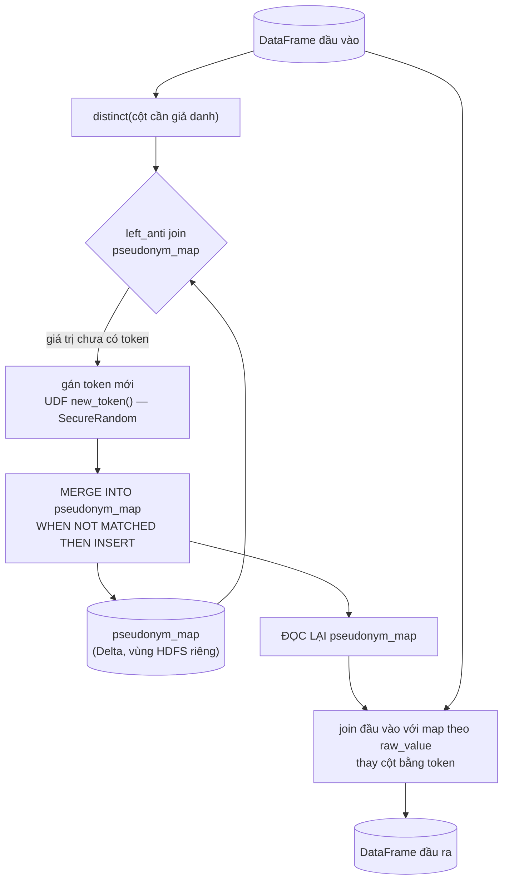
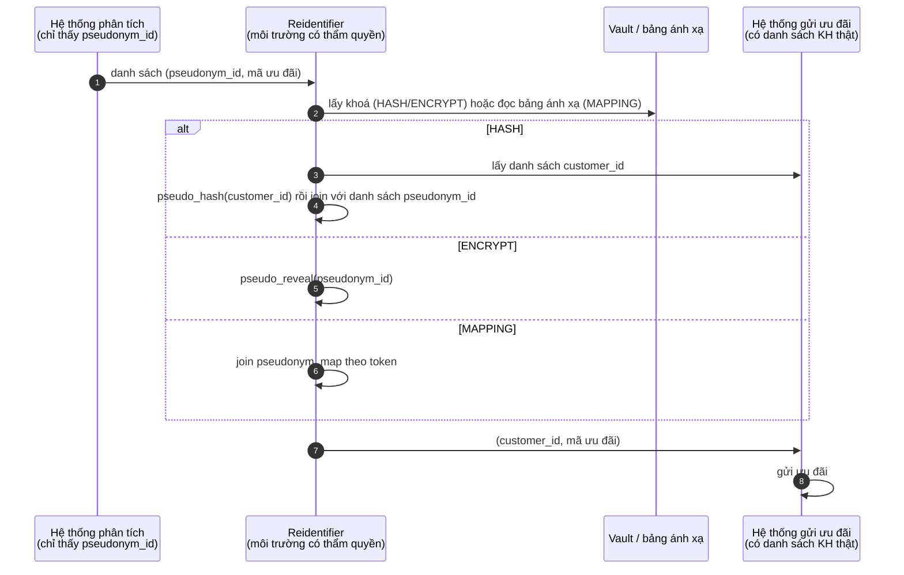

# Plan: thư viện giả danh hoá (Pseudonymization) dạng UDF — `pseudonym-udf`

Hiện thực mục **2.3. Giả danh hoá** trong tài liệu khử định danh: thay trường định danh (số thuê
bao, IMEI, mã khách hàng) bằng một định danh giả, để vẫn liên kết được các bản ghi của cùng một chủ
thể (phân tích dọc) mà không biết danh tính thật. Logic bọc dưới dạng **UDF**, dùng được từ cả
DataFrame API (Spark job) lẫn SQL function (sql-engine) — cùng mô hình với `cdr-crypto-udf`.

App sinh dữ liệu + kiểm chứng "khử định danh thành công hay chưa": xem
[`docs/pseudonym-verify-app/PLAN.md`](./pseudonym-verify-app/PLAN.md).

---

## 0. Đối chiếu với tài liệu nguồn

Tài liệu nêu **3 cách** tạo định danh giả (mục a: "băm có salt hoặc mã hoá"; mục c: "salt, khoá bí
mật hoặc bảng ánh xạ") — lib hiện thực **cả 3**, mỗi cách là 1 chế độ (`mode`):

| Tài liệu nguồn                                                | Trong plan                                                                                                                  |
| ------------------------------------------------------------- | --------------------------------------------------------------------------------------------------------------------------- |
| a) "thuật toán băm (hashing) có salt"                         | Chế độ **`HASH`**: HMAC-SHA256 với khoá bí mật 256-bit (mục 3.2)                                                             |
| a) "hoặc mã hoá" + chú thích ¹ "AES-256"                       | Chế độ **`ENCRYPT`**: AES-256-SIV — mã hoá **tất định**, giải mã lại được bằng khoá (mục 3.3)                                |
| c) "bảng ánh xạ (nếu có)"                                     | Chế độ **`MAPPING`**: token ngẫu nhiên + bảng ánh xạ Delta lưu riêng (mục 3.4)                                              |
| b) liên kết bản ghi cùng chủ thể, phân tích dọc                | Cả 3 chế độ cho **cùng 1 giá trị → cùng 1 định danh giả** (tất định)                                                        |
| c) bảo vệ tuyệt đối salt/khoá/bảng ánh xạ, lưu riêng, kiểm soát truy cập | Khoá trong Vault/Secret qua `key-prefix-lib`; bảng ánh xạ ở vùng HDFS riêng có phân quyền; hàm tái định danh tách riêng (mục 5) |
| d) Ví dụ MyViettel, trạm BTS, Viettel++                        | Policy mẫu (mục 4.2), luồng cá nhân hoá ưu đãi Viettel++ (mục 6); app kiểm chứng đo lại cả 3 ví dụ                          |
| d) Viettel++: "Mã khách hàng được thay thế bằng một `pseudonym_id`" | Policy có tuỳ chọn `output` để đổi tên cột, vd `customer_id` → `pseudonym_id` (mục 4.2)                                    |

3 điểm **lệch có chủ đích** so với tài liệu (giữ lại vì làm đúng theo tài liệu sẽ vi phạm chính mục c):

| Tài liệu nguồn                                   | Vì sao không theo                                                                                                                                                         |
| ------------------------------------------------ | ------------------------------------------------------------------------------------------------------------------------------------------------------------------------- |
| d) SQL `sha256()` / `HASHBYTES()`                 | Không khoá: không gian SĐT/IMEI nhỏ, liệt kê được (~10⁹ số di động VN) → băm lại toàn bộ là đảo ngược 100%. Ghép salt vào câu SQL thì salt lộ trong query/`EXPLAIN`/log. |
| chú thích ¹ "RSA-2048"                           | RSA chuẩn (OAEP) cho kết quả ngẫu nhiên → cùng 1 SĐT ra 2 giá trị → mất tính liên kết (mục b). RSA không padding thì không an toàn.                                      |
| d) Python: Faker, AnonymizeDF, SSB-Pseudonymization | Project là Spark 3.5.1 / Scala 2.12; UDF Python tốn serialize JVM↔Python. Viết bằng Scala.                                                                              |

> Dữ liệu đã giả danh **vẫn là dữ liệu cá nhân**: ai giữ khoá hoặc bảng ánh xạ là tái định danh
> được — đúng như mục c, an toàn phụ thuộc hoàn toàn vào việc bảo vệ chúng.

## 1. Quyết định thiết kế

| #   | Vấn đề                      | Quyết định                                                                                                                                                                                                                                                       |
| --- | --------------------------- | ---------------------------------------------------------------------------------------------------------------------------------------------------------------------------------------------------------------------------------------------------------------- |
| D1  | Chọn chế độ nào             | Khai báo theo **từng cột** trong policy. Mặc định `HASH`. Dùng `ENCRYPT` khi cần lấy lại giá trị gốc mà không muốn giữ bảng ánh xạ. Dùng `MAPPING` khi muốn định danh giả **không suy ra được từ giá trị gốc dù lộ khoá** (không có khoá nào để brute-force). |
| D2  | Định dạng output            | `HASH`: `k1_<32 hex>` (16 byte đầu của HMAC). `ENCRYPT`: `e1_<base64url>`. `MAPPING`: `t_<32 hex>` (16 byte ngẫu nhiên). Tiền tố cho biết định danh giả sinh bằng cách nào và thế hệ khoá nào.                                                                |
| D3  | Đầu vào                     | Băm/mã hoá/tra **nguyên trạng** giá trị. `null` vào → `null` ra. Lib không đổi định dạng: dữ liệu đầu vào phải đồng nhất định dạng (xem rủi ro ở mục 9).                                                                                                      |
| D4  | Khoá                        | 1 khoá HMAC (32 byte) cho `HASH`, 1 khoá AES-256-SIV (64 byte) cho `ENCRYPT`. Cùng khoá trên mọi bảng → join được giữa các bảng (hành trình MyViettel trải trên nhiều bảng).                                                                                 |
| D5  | Nguồn khoá                  | Tái dùng `key-prefix-lib` (`PrefixSource`: K8s Secret / Vault / DAK), namespace conf `spark.pseudonym.*`. Khoá không bao giờ nằm trong Spark conf, code hay plan.                                                                                            |
| D6  | UDF hay built-in            | **UDF** (`ScalaUDF`). Spark 3.5 không có HMAC/AES-SIV built-in; ghép `sha2(concat('<key>', col))` thì khoá thành `Literal` hiện trong `EXPLAIN`. Với UDF, khoá nằm trong closure, plan chỉ hiện tên hàm.                                                      |
| D7  | Cột nào được xử lý          | Chỉ các cột khai báo trong policy; các cột khác giữ nguyên.                                                                                                                                                                                                    |
| D8  | Tái định danh               | `HASH`: tra **xuôi** (giá trị gốc → định danh giả). `ENCRYPT`: `pseudo_reveal` giải mã. `MAPPING`: join ngược bảng ánh xạ. Cả 3 chỉ chạy trong môi trường có thẩm quyền (D9).                                                                                 |
| D9  | Kiểm soát truy cập (mục c)  | `PseudonymExtension` (sinh định danh giả) chỉ nạp ở job ETL/engine hạn chế; `PseudonymRevealExtension` (giải mã) nạp riêng ở môi trường tái định danh. **Không** nạp lên sql-engine của analyst: ai gọi được `pseudo_hash` tuỳ ý là có "oracle", chỉ cần liệt kê ~10⁹ SĐT là đảo ngược được — tương đương lộ khoá. |

## 2. Cấu trúc module

Module mới `pseudonym-udf` (Maven, thêm vào `<modules>` của root `pom.xml`). Phụ thuộc — **tất cả `provided`**,
jar không shade gì:
- `key-prefix-lib`, Spark.
- `delta-spark` 3.2.0, cho `MAPPING`.
- Google Tink 1.9.0, cho `ENCRYPT`. **Spark 3.5.1 đã ship đúng bản này** (dependency của `spark-network-common`,
  có trong `/opt/spark/jars`), nên không cần shade và không đụng protobuf.
- snakeyaml, cho policy.
- ScalaTest (`test`).

```
pseudonym-udf/
├── pom.xml
└── src/
    ├── main/scala/vai/lakehouse/pseudonym/
    │   ├── PseudonymMode.scala          # HASH | ENCRYPT | MAPPING
    │   ├── Encoding.scala               # hex / base64url
    │   ├── PseudonymConf.scala          # namespace spark.pseudonym.* -> nguồn khoá, version, mapping path
    │   ├── PseudonymKey.scala           # khoá + version, parse/validate, toString che giá trị
    │   ├── HmacPseudonymizer.scala      # HASH — thuần JVM, không Spark
    │   ├── AesSivPseudonymizer.scala    # ENCRYPT — encrypt + decrypt, thuần JVM
    │   ├── MappingTable.scala           # MAPPING — sinh token, MERGE vào bảng Delta, join
    │   ├── KeyProvider.scala            # đọc khoá qua PrefixSource + cache
    │   ├── PseudonymPolicy.scala        # cột -> (mode, output) + parse YAML
    │   ├── Pseudonymizer.scala          # DataFrame API: apply(df, policy)
    │   ├── Reidentifier.scala           # tái định danh có thẩm quyền (mục 6)
    │   └── sql/
    │       └── PseudonymExtension.scala        # PseudonymExtension: pseudo_hash, pseudo_encrypt;
    │                                           # PseudonymRevealExtension: pseudo_reveal — nạp riêng
    └── test/scala/vai/lakehouse/pseudonym/
        ├── HmacPseudonymizerSpec.scala
        ├── AesSivPseudonymizerSpec.scala
        ├── MappingTableSpec.scala
        ├── PseudonymKeySpec.scala
        ├── PseudonymPolicySpec.scala
        ├── PseudonymizerSpec.scala
        ├── ReidentifierSpec.scala
        └── sql/PseudonymExtensionSpec.scala
```

Tách lõi crypto (`HmacPseudonymizer`, `AesSivPseudonymizer`) khỏi Spark giống `CdrCipherCore`: test
nhanh, tái dùng được ngoài Spark.

## 3. Lõi — 3 chế độ

### 3.1. `PseudonymKey`

```scala
/** toString KHÔNG in giá trị khoá. */
final class PseudonymKey private (val name: String, val version: Int, private[pseudonym] val bytes: Array[Byte]) {
  override def toString: String = s"PseudonymKey($name, v$version, ***)"
}

object PseudonymKey {
  /** `encoded` dạng "base64:<...>" hoặc "hex:<...>" — đúng giá trị lưu trong Vault/Secret. */
  def parse(name: String, version: Int, encoded: String, expectedBytes: Int): PseudonymKey
}
```

- `HASH` cần đúng 32 byte, `ENCRYPT` cần đúng 64 byte (AES-256-SIV = 2 khoá AES-256: 1 cho S2V/CMAC,
  1 cho CTR). Từ chối sai độ dài, khoá toàn 0, thiếu tiền tố. Message lỗi **không** chứa giá trị
  khoá (cùng quy ước với `PrefixSource`).
- Sinh khoá: `openssl rand -base64 32` (HASH) / `openssl rand -base64 64` (ENCRYPT) → lưu
  `base64:<...>` vào Vault. Không dùng mật khẩu do người đặt.

### 3.2. `HASH` — `HmacPseudonymizer`

`k1_` + hex(16 byte đầu của `HMAC-SHA256(key, value)`).

```scala
final class HmacPseudonymizer(key: PseudonymKey) extends Serializable {
  // Mac không thread-safe -> 1 instance/thread; @transient vì Mac không serialize được sang executor.
  @transient private lazy val mac: ThreadLocal[Mac] = ThreadLocal.withInitial(() => {
    val m = Mac.getInstance("HmacSHA256")
    m.init(new SecretKeySpec(key.bytes, "HmacSHA256"))
    m
  })

  def pseudonymize(value: String): String =
    if (value == null) null
    else s"k${key.version}_" + Hex.lower(mac.get().doFinal(value.getBytes(UTF_8)), 0, OutputBytes)
}
```

- `OutputBytes = 16` (128-bit): xác suất trùng với 10⁹ giá trị ≈ 10¹⁸/2¹²⁹ ≈ 1.5·10⁻²¹ — bỏ qua được.
- Một chiều: không có hàm giải. Tái định danh = tính xuôi trên danh sách giá trị gốc rồi so (mục 6).

### 3.3. `ENCRYPT` — `AesSivPseudonymizer`

`e1_` + base64url(AES-256-SIV(key, value)), dùng `com.google.crypto.tink.subtle.AesSiv` (RFC 5297).

- **Tại sao SIV, không phải GCM hay ECB:** GCM (như `aes_encrypt` mặc định của Spark và
  `column-crypto-lib`) dùng IV ngẫu nhiên → cùng SĐT ra 2 bản mã → mất tính liên kết (mục b). ECB
  tất định nhưng giá trị dài > 16 byte lộ khối trùng nhau. SIV là chế độ được chuẩn hoá cho **mã hoá
  tất định**: cùng input → cùng output, có kiểm tra toàn vẹn khi giải mã.
- `decrypt("e1_...")` trả lại đúng giá trị gốc; sai khoá hoặc bản mã bị sửa → lỗi xác thực (không trả
  rác).
- Output dài hơn `HASH` (16 byte tag + độ dài plaintext, rồi base64).

### 3.4. `MAPPING` — `MappingTable`

Mỗi giá trị gốc được gán 1 token ngẫu nhiên `t_<32 hex>` (16 byte `SecureRandom`); cặp
`(raw_value, token)` lưu trong **bảng ánh xạ** — bảng Delta ở vùng HDFS riêng (dùng
`delta-spark` 3.2.0 project đã có).

```
pseudonym_map (Delta)
  raw_value  STRING  NOT NULL  -- khoá duy nhất
  token      STRING  NOT NULL
  created_at TIMESTAMP
```



- **Phải MERGE xong rồi mới join với bảng đọc lại**, không join trực tiếp với DataFrame chứa token
  vừa sinh: `new_token()` là UDF không tất định, Spark có thể tính lại khi retry task → cùng 1 giá
  trị nhận 2 token khác nhau. Bảng đã ghi là nguồn sự thật duy nhất.
- `MERGE ... ON raw_value`: 2 job chạy song song cùng chèn 1 giá trị → Delta báo conflict cho 1
  job → job đó retry và thấy token đã có. Không bao giờ có 2 token cho 1 giá trị.
- Bảng ánh xạ chứa **giá trị gốc** → nhạy cảm ngang dữ liệu gốc: vùng HDFS riêng, phân quyền
  Ranger chỉ cho SA của job ETL và người có thẩm quyền tái định danh (mục c).
- Phần UDF của chế độ này chỉ là `new_token()`; phần còn lại là thao tác DataFrame (anti join, MERGE,
  join). Trên SQL, job ETL dùng `JOIN pseudonym_map` thay vì gọi hàm.

## 4. Tầng Spark

### 4.1. `KeyProvider`

```scala
trait KeyProvider extends Serializable {
  def hmacKey: PseudonymKey     // PrefixSource.read("pseudonym.hmac.v<N>")
  def aesSivKey: PseudonymKey   // PrefixSource.read("pseudonym.aes-siv.v<N>")
}
```

- Tên đi qua `PrefixFiles.requireValidDatasetName` sẵn có. Version đang dùng:
  `spark.pseudonym.hmac.version`, `spark.pseudonym.aes-siv.version` (mặc định `1`; không bí mật).
- Bọc `CachedPrefixSource` như `CdrCrypto.sharedPrefixSource`. Chỉ **driver** gọi Vault; executor nhận
  khoá trong closure của UDF.
- Đường dẫn bảng ánh xạ: `spark.pseudonym.mapping.path`.

### 4.2. Policy — `PseudonymPolicy`

```scala
final case class ColumnRule(mode: PseudonymMode, output: Option[String])   // output = đổi tên cột
final case class TablePolicy(table: String, columns: Map[String, ColumnRule])
```

YAML (cùng kiểu `column-crypto.yaml`), theo 3 ví dụ trong tài liệu nguồn:

```yaml
tables:
  # Hành trình khách hàng trên MyViettel: số thuê bao -> chuỗi định danh giả
  myviettel.app_event:
    isdn: { mode: HASH }
  # Hiệu quả trạm BTS: IMEI -> định danh giả
  network.bts_connection:
    imei: { mode: HASH }
  # Viettel++: mã khách hàng -> pseudonym_id
  loyalty.loyalty_txn:
    customer_id: { mode: HASH, output: pseudonym_id }
  crm.subscriber:
    isdn:        { mode: HASH }
    imei:        { mode: HASH }
    customer_id: { mode: HASH, output: pseudonym_id }
```

Đổi `mode` sang `ENCRYPT` hoặc `MAPPING` không cần đổi gì khác. Cột cùng loại định danh trên các bảng
**phải dùng cùng mode** (cùng `HASH` hoặc cùng `MAPPING`…), nếu không sẽ không join được — validate
khi nạp policy nếu cấu hình trong cùng 1 file.

### 4.3. DataFrame API — `Pseudonymizer`

```scala
object Pseudonymizer {
  /** Khoá + bảng ánh xạ dựng từ SparkConf của driver (spark.pseudonym.*). */
  def apply(df: DataFrame, policy: TablePolicy): DataFrame
}

/** Tiêm khoá/bảng ánh xạ tường minh (test, app kiểm chứng). */
final class Pseudonymizer(keys: KeyProvider, mappingTablePath: Option[String] = None) {
  def pseudonymize(df: DataFrame, policy: TablePolicy): DataFrame
}
```

1. **Validate** trên driver: cột trong policy phải có trong `df`; `output` không được trùng tên cột
   khác; cột kiểu số thì cast sang string trước.
2. Mỗi cột trong policy: tính định danh giả theo `mode`, ghi vào cột `output` (mặc định cùng tên),
   **xoá cột gốc** nếu đổi tên — output không bao giờ chứa đồng thời cột gốc và cột giả.
3. UDF `HASH`/`ENCRYPT` tất định (**không** gọi `asNondeterministic`); `new_token()` của `MAPPING`
   khai báo `asNondeterministic`.

### 4.4. SQL function

```sql
-- Nạp PseudonymExtension (chỉ trên engine ETL/hạn chế)
SELECT pseudo_hash(isdn) AS isdn, event_type, event_ts FROM raw.app_event;
SELECT pseudo_encrypt(customer_id) AS pseudonym_id, points FROM raw.loyalty_txn;

-- Nạp PseudonymRevealExtension (chỉ môi trường tái định danh)
SELECT pseudo_reveal(pseudonym_id) AS customer_id FROM ...;
```

- Đăng ký giống `CdrCryptoExtension`: `injectFunction` → `ScalaUDF(..., udfDeterministic = true)`.
- DataFrame API và SQL dùng **chung** lõi (mục 3) → luôn ra cùng kết quả.

## 5. Bảo vệ khoá và bảng ánh xạ (mục c)

| Việc         | Quy ước                                                                                                                                                                                     |
| ------------ | ------------------------------------------------------------------------------------------------------------------------------------------------------------------------------------------- |
| Lưu riêng    | Khoá: Vault (`VaultPrefixSource`/`DakPrefixSource`) hoặc K8s Secret mount. Bảng ánh xạ: thư mục HDFS riêng, **không** nằm dưới thư mục dữ liệu phân tích.                                  |
| Ai truy cập  | Đọc khoá / bảng ánh xạ: SA của job ETL + người có thẩm quyền tái định danh. Analyst **không**. Phân quyền HDFS bằng Ranger.                                                                |
| Xoay khoá    | Xoay = mọi định danh giả `HASH`/`ENCRYPT` đổi → đứt chuỗi phân tích dọc. Chỉ xoay khi nghi lộ khoá, kèm giả danh lại toàn bộ lịch sử. Tiền tố `k<N>_`/`e<N>_` để phát hiện 2 thế hệ trộn lẫn. |
| Không làm    | Không đặt khoá trong `sparkConf`, env của manifest commit vào git, log, message lỗi, tên file.                                                                                             |

## 6. Tái định danh có thẩm quyền — luồng ưu đãi Viettel++

Tài liệu nêu Viettel++ dùng `pseudonym_id` "phục vụ việc cá nhân hoá ưu đãi mà không cần sử dụng đến
thông tin cá nhân trực tiếp trong hệ thống phân tích". Phân tích chỉ ra **danh sách `pseudonym_id`**
cần nhận ưu đãi; việc gửi ưu đãi cho đúng người do hệ thống gửi ưu đãi (có danh sách khách hàng thật
và có thẩm quyền) làm, qua `Reidentifier`:



```scala
object Reidentifier {
  /** targets(pseudonym_id, ...) -> targets(customer_id, ...). Chỉ chạy được khi có khoá / quyền đọc map. */
  def reidentify(targets: DataFrame, column: String, mode: PseudonymMode,
                 knownValues: => DataFrame /* chỉ cần cho HASH */): DataFrame
}
```

Hệ thống phân tích không bao giờ thấy `customer_id`; hệ thống gửi ưu đãi không cần thấy dữ liệu hành vi.

## 7. Test (`pseudonym-udf`)

| Spec                     | Nội dung                                                                                                                                                                                         |
| ------------------------ | ------------------------------------------------------------------------------------------------------------------------------------------------------------------------------------------------ |
| `HmacPseudonymizerSpec`  | RFC 4231 test vectors (chứng minh đúng HMAC-SHA256); golden vectors (khoá cố định → output ghim cứng, chặn đổi format vô tình); 16 thread song song = kết quả tuần tự; `null` → `null`.         |
| `AesSivPseudonymizerSpec`| Output khớp byte-for-byte với primitive `AesSiv` của Tink gọi trực tiếp; `decrypt(encrypt(x)) == x` (kể cả unicode, chuỗi dài, rỗng); tất định; sai khoá / sửa 1 ký tự bản mã → lỗi xác thực. |
| `MappingTableSpec`       | Spark + Delta local: giá trị mới nhận token, giá trị cũ giữ token cũ qua nhiều lần chạy; 2 job song song cùng giá trị → vẫn 1 token; retry task không sinh token thứ 2.                           |
| `PseudonymKeySpec`       | Từ chối sai độ dài, khoá toàn 0, thiếu tiền tố; `toString`/message lỗi không chứa khoá.                                                                                                          |
| `PseudonymPolicySpec`    | Parse YAML; cột không tồn tại → fail; `output` trùng tên cột → fail.                                                                                                                             |
| `PseudonymizerSpec`      | Spark `local[*]`: cột đổi tên đúng, cột gốc biến mất; đúng format theo mode; `df.queryExecution.toString` không chứa khoá.                                                                         |
| `ReidentifierSpec`       | Cả 3 mode: danh sách `pseudonym_id` → đúng `customer_id` gốc 100%.                                                                                                                              |
| `PseudonymExtensionSpec` | SQL == DataFrame API; `pseudo_reveal` không có khi chỉ nạp `PseudonymExtension`.                                                                                                                 |

Mục tiêu coverage ≥ 80%, chạy bằng `scalatest-maven-plugin` đã có trong root pom.

## 8. Đóng gói và triển khai

- Build: `./mvnw -pl pseudonym-udf -am package` → `pseudonym-udf-1.0-SNAPSHOT.jar` (~100 KB, jar thuần).
- Executor **bắt buộc** có `key-prefix-lib.jar` + `pseudonym-udf.jar` trên `spark.jars` (UDF thật,
  giống `cdr-crypto-udf`). Chế độ `MAPPING` cần thêm `delta-spark` trên classpath.
- Docker: thêm target vào `Dockerfile` (cùng cách làm của lib crypto). `spark-app` **không** nhúng lib này.
- Manifest mẫu `pseudonym-verify-app/k8s/*.yaml` (nạp 2 jar qua `spark.jars`) + mẫu Secret khoá
  `pseudonym-verify-app/k8s/pseudonym-keys-secret.yaml`; `Dockerfile.jar-carrier` mang `pseudonym-udf.jar` vào prod.
- Chế độ `MAPPING` cần session có Delta (`spark.sql.extensions=io.delta.sql.DeltaSparkSessionExtension`,
  `spark.sql.catalog.spark_catalog=org.apache.spark.sql.delta.catalog.DeltaCatalog`).

## 9. Rủi ro

| Rủi ro                                                                 | Giảm thiểu                                                                                                                         |
| ---------------------------------------------------------------------- | ---------------------------------------------------------------------------------------------------------------------------------- |
| Lộ khoá (`HASH`) → đảo ngược toàn bộ (không gian SĐT nhỏ)              | Khoá chỉ trong Vault/Secret, quyền đọc tối thiểu; check P7 (khoá không lọt vào plan/log/data). `MAPPING` không có rủi ro này.      |
| Lộ khoá (`ENCRYPT`) → giải mã trực tiếp toàn bộ                       | Như trên; `pseudo_reveal` tách extension riêng.                                                                                   |
| Lộ bảng ánh xạ (`MAPPING`) = lộ toàn bộ                               | Vùng HDFS riêng + Ranger; không đặt dưới thư mục phân tích.                                                                        |
| Analyst gọi được `pseudo_hash` → oracle                                | D9: không nạp extension lên sql-engine của analyst.                                                                               |
| Cùng 1 người nhưng giá trị gốc khác định dạng (`0912…` / `+84912…`) → nhiều định danh giả | Lib xử lý nguyên trạng (D3) → dữ liệu phải được đồng nhất định dạng ở bước trước khi giả danh hoá.                               |
| Bảng ánh xạ lớn dần (1 dòng/giá trị từng xuất hiện), join tốn kém     | Chỉ đọc 2 cột `raw_value`, `token`; chạy `OPTIMIZE` định kỳ cho bảng Delta; theo dõi kích thước bảng trong report của app kiểm chứng. |
| Đổi thuật toán/format sau khi phát hành làm đứt dữ liệu cũ             | Golden vectors trong test; mọi thay đổi format phải đi kèm version mới.                                                           |

## 10. Thứ tự triển khai

1. Module skeleton + root `pom.xml` (Tink `provided`, dùng bản Spark ship sẵn).
2. `PseudonymKey` + spec.
3. `HmacPseudonymizer` (`HASH`) + spec — TDD.
4. `AesSivPseudonymizer` (`ENCRYPT`) + spec.
5. `MappingTable` (`MAPPING`) + spec Delta local.
6. `KeyProvider`, `PseudonymPolicy`, `Pseudonymizer` + spec.
7. `PseudonymExtension`, `PseudonymRevealExtension` + spec.
8. `Reidentifier` + spec (luồng Viettel++).
9. Dockerfile target + manifest mẫu.
10. Chạy `pseudonym-verify-app` (mặc định kiểm `HASH`, `ENCRYPT`; thêm `MAPPING` vào `PSEUDO_MODES`
    nếu định dùng chế độ này) → verdict `PASS`, rồi mới dùng trên dữ liệu thật.

## 11. Câu hỏi cần chốt

1. Mỗi bảng thật dùng mode nào (`HASH` / `ENCRYPT` / `MAPPING`)?
2. Engine nào được nạp `PseudonymExtension`, engine nào được nạp `PseudonymRevealExtension`?
3. Hệ thống gửi ưu đãi Viettel++ sẽ gọi `Reidentifier` ở đâu (Spark job riêng hay service)?
