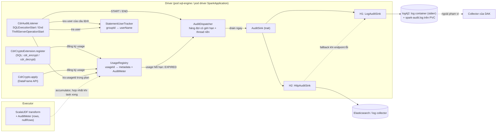
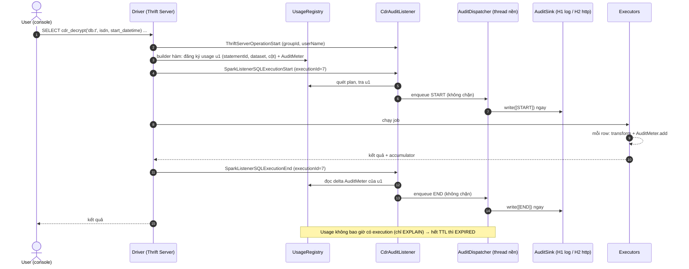

# Plan: audit log cho `cdr_encrypt` / `cdr_decrypt` (module `cdr-crypto-udf`)

Trạng thái: **đang triển khai** — tiến độ, kết quả kiểm tra và lịch sử thay đổi thiết kế ở
[CDR_CRYPTO_AUDIT_LOG_PROGRESS.md](CDR_CRYPTO_AUDIT_LOG_PROGRESS.md). Liên quan: [PARTNER_CDR_CRYPTO_UDF_PLAN.md](PARTNER_CDR_CRYPTO_UDF_PLAN.md).
Môi trường: Spark 3.5.1, Scala 2.12, Hadoop 3.3.4.

## 1. Mục tiêu và phạm vi

Mỗi khi `cdr_encrypt` / `cdr_decrypt` được dùng (qua SQL hoặc `CdrCrypto.encryptColumns/decryptColumns`), ghi lại
**ai, khi nào, trên dataset nào, cột nào, bao nhiêu dòng, thành công hay lỗi**. Hai nơi chạy:

- **sql-engine** (Spark Thrift Server): người dùng gọi hàm ngẫu nhiên, bất kỳ lúc nào trong console tương tác, nên log phải xuất hiện **ngay**.
- **Driver của SparkApplication CRD** (`spark-app`): job batch dùng DataFrame API hoặc SQL.

Sau khi trao đổi với team (2026-10-19), **không ghi ra HDFS nữa**. Có hai hướng, chưa chốt hướng nào (mục 11):

| Hướng                                 | Log đi đâu                                                                             | Ai lấy log về hệ thống audit                  |
| ------------------------------------- | -------------------------------------------------------------------------------------- | --------------------------------------------- |
| **H1 — Log ra pod**                   | log của pod sql-engine / pod driver SparkApplication (qua log4j2)                      | Team DAK tự thu thập (ngoài phạm vi plan này) |
| **H2 — Ghi vào hệ thống lưu trữ log** | Elasticsearch, hoặc bất kỳ log collector nào nhận HTTP (Fluent Bit, Vector, Logstash…) | Module tự đẩy; hệ thống audit đọc từ đó       |

Phần lõi (mô hình event, cách bắt lời gọi hàm, cách xác định user, hàng đợi) **dùng chung cho cả hai hướng** và chỉ viết một lần (mục 2–5).
Khác biệt chỉ nằm ở `AuditSink` (mục 6 cho H1, mục 7 cho H2). Hai sink có thể bật cùng lúc (`sinks=log,http`).

Ngoài phạm vi: audit lấy key từ Vault/DAK (đã có audit phía DAK, `requestId`), `column_encrypt`/`column_decrypt`, UI tra cứu,
việc thu thập log từ pod (H1) và vận hành Elasticsearch/collector (H2).

## 2. Quyết định thiết kế cốt lõi (chung)

**Không log từng row.** Hàm chạy theo từng row (hàng tỷ lần với 150 GB); log mỗi lần gọi sẽ làm chậm job vài chục lần
và sinh log lớn hơn dữ liệu. "Mỗi lần gọi hàm" được hiểu là **mỗi lần hàm được dùng trong một SQL execution** (một câu query
hoặc một action trên DataFrame), kèm số dòng đã xử lý. Cần xác nhận cách hiểu này (mục 11).

**Mỗi execution có dùng hàm CDR sinh hai event, ghép bằng `executionId`:**

| Event   | Thời điểm                                                        | Nguồn                            | Mục đích                                                                             |
| ------- | ---------------------------------------------------------------- | -------------------------------- | ------------------------------------------------------------------------------------ |
| `START` | Ngay khi execution bắt đầu, **trước khi** executor xử lý dữ liệu | `SparkListenerSQLExecutionStart` | Có dấu vết kể cả khi driver chết hoặc query chạy rất lâu; ghi ai/hàm nào/dataset nào |
| `END`   | Ngay khi execution kết thúc                                      | `SparkListenerSQLExecutionEnd`   | Trạng thái (thành công/lỗi), thời lượng, số dòng / NULL / lỗi theo từng hàm          |

Cả hai event được đẩy vào hàng đợi và ghi **bất đồng bộ, ngay lập tức** trên một thread nền của driver. Query không bao giờ phải
chờ ghi audit. Hệ quả: đây là audit **best-effort, gần realtime**; lỗi ghi audit chỉ cảnh báo, không làm fail query. Nếu về sau có yêu
cầu "không có audit thì không được giải mã" (fail-closed), cần thêm bước ghi đồng bộ lúc dựng plan — ngoài phạm vi plan này (mục 12).

Event thứ ba, hiếm: `EXPIRED` — một lần dùng hàm đã vào plan nhưng không bao giờ có execution tương ứng (chỉ chạy `EXPLAIN`, hoặc
đường chạy không qua SQL execution như `df.rdd`). Xem mục 4.3.

Chỉ **driver** ghi audit. Executor không gửi gì ra ngoài; số đếm đi về driver qua accumulator.

## 3. Nội dung một event (chung — đây là hợp đồng dữ liệu với bên đọc)

Một event là **một object JSON trên một dòng**. Cùng một schema cho H1 (một message log) và H2 (một document).

```json
{"auditVersion":1,"eventId":"0b1f...","event":"START","ts":"2026-10-19T08:15:30.123Z",
 "appId":"spark-application-...","executionId":7,"user":"alice","userSource":"thrift","statementId":"c3a1...",
 "tenant":"tenantw1xjixm","workspace":"wsw7vtwvi","team":"teamtscauiy","engineId":"sql-engine-1",
 "usages":[{"usageId":"u9f3a1c","function":"cdr_decrypt","dataset":"demo_db.sub_rel_product",
            "valueExpr":"isdn","keyFieldExpr":"start_datetime","dakRequestCode":"REQ-2026-000003"}]}
{"auditVersion":1,"eventId":"7d02...","event":"END","ts":"2026-10-19T08:23:02.456Z",
 "appId":"spark-application-...","executionId":7,"status":"SUCCEEDED","durationMs":452333,
 "tenant":"tenantw1xjixm","workspace":"wsw7vtwvi","team":"teamtscauiy","engineId":"sql-engine-1",
 "usages":[{"usageId":"u9f3a1c","rows":1200000000,"nullRows":3400}]}
```

- `eventId` (UUID) cố định cho từng event để bên đọc dedupe khi giao hàng at-least-once (H2 dùng nó làm `_id`).
- `status`: `SUCCEEDED` | `FAILED`, suy ra từ `SparkListenerSQLExecutionEnd.errorMessage` (mục 4.2).
- `rows`/`nullRows` chỉ tính task thành công: accumulator thường của Spark bỏ phần cộng của task lỗi, nên không có `failedRows`;
  lỗi thể hiện bằng `status=FAILED` của END.
- `EXPIRED` mang thêm `rows`/`nullRows` của usage: khác 0 nghĩa là hàm **đã thực sự chạy** ngoài SQL execution (ví dụ `df.rdd`).
- `user` là tên đăng nhập JDBC (Keycloak) của người chạy query; `userSource` cho biết lấy từ đâu (mục 4.2).
  `tenant`, `workspace`, `team`, `engineId` cố định theo từng engine/job (mỗi engine thuộc đúng một team, chỉ user của team đăng nhập được),
  đọc từ cấu hình và có mặt trong **mọi** event để mỗi dòng tự đứng được khi bị tách khỏi ngữ cảnh. DAK chỉ nhận diện team qua client
  `client_credentials` nên không thấy từng người; log này là nơi duy nhất gắn query với người dùng cụ thể.
- Một execution có thể chứa nhiều lần dùng hàm (ví dụ giải mã `isdn` và `imsi`) → mảng `usages`, tối đa `maxUsagesPerEvent` phần tử;
  nhiều hơn thì tách thành nhiều event cùng `executionId`, có `part`/`parts`. Một event luôn nhỏ hơn 8 KB
  (container runtime của Kubernetes cắt dòng log dài hơn 16 KB thành nhiều mảnh).
- `dropped` (số event bị bỏ do hàng đợi đầy) được ghi kèm event kế tiếp khi khác 0.
- Đổi schema theo kiểu tương thích ngược (chỉ thêm trường); đổi phá vỡ thì tăng `auditVersion`.

**Tuyệt đối không ghi:** `value`, `fieldValue`, `keyInput`, `keyPrefix`, token, credential của sink, ciphertext, nội dung câu SQL.
Chỉ ghi tên cột / biểu thức dạng text (`Expression.sql` sau khi thay mọi literal bằng `'***'`, cắt tối đa 200 ký tự), số đếm và metadata.

## 4. Kiến trúc (chung)

### 4.1 Thành phần



- `AuditEvent` (case class, `toJson` tự viết, không thêm dependency JSON): dữ liệu bất biến, dùng chung cho `START`/`END`/`EXPIRED`.
- `UsageRegistry`: map `usageId → Usage(metadata, AuditMeter, createdAt)`, thread-safe, có TTL và giới hạn kích thước (mục 5).
- `CdrAuditListener`: `SparkListener` đăng ký một lần cho mỗi SparkContext; xử lý `SparkListenerSQLExecutionStart` và `SparkListenerSQLExecutionEnd` qua `onOtherEvent`.
  Cũng nhận event của Thrift Server (`SparkListenerThriftServerOperationStart`) để biết user của từng câu lệnh (mục 4.2).
- `StatementUserTracker`: map `statementId (groupId) → userName` do listener cập nhật từ event của Thrift Server, có TTL và giới hạn kích thước;
  entry bị xoá khi `END` được phát. Không có event Thrift (ví dụ `spark-app`) thì tracker rỗng và `user` rơi về `sparkUser`.
- `AuditDispatcher`: hàng đợi có giới hạn + **một** thread nền (daemon). Mỗi lần thức dậy nó gom mọi event đang chờ (đợi tối đa `coalesceMs`)
  và gọi `sink.write(batch)`. Lỗi của sink được bắt tại đây: log WARN có đếm, không ném lên listener hay query.
- `AuditSink`: `write(events: Seq[AuditEvent]): Unit`, `close()`. `CompositeAuditSink` gọi lần lượt các sink trong `sinks`; sink này lỗi không chặn sink kia.
- `CdrAudit` (object, một lần/tiến trình, giống `sharedPrefixSource`): đọc cấu hình, tạo registry/tracker/dispatcher/sink, đăng ký listener và shutdown hook một lần.
  Shutdown hook / `onApplicationEnd`: drain nốt hàng đợi, chờ tối đa `shutdownFlushTimeoutSec`.

### 4.2 Cách biết một execution có dùng hàm CDR, và dùng như thế nào

Listener chỉ nhận `executionId` và mô tả plan, không biết hàm nào được gọi. Cách ghép:

1. Lúc builder hàm chạy (driver, trong thread của người dùng), tạo `usageId` ngẫu nhiên ngắn, đăng ký `Usage` vào registry cùng:
   `statementId` (`spark.jobGroup.id` của thread — Thrift Server đặt nó bằng id câu lệnh trước khi gọi `sql()`),
   hàm, dataset, `valueExpr`, `keyFieldExpr`, `dakRequestCode`. `user` **không** lấy ở bước này (xem "Xác định user" bên dưới).
2. UDF giữ nguyên như khi tắt audit và được bọc trong expression `AuditTag(child, usageId)`: tính toán và sinh code y như `child`;
   `sql` (Spark dùng để tự đặt tên cột khi query không có `AS`) giữ nguyên của `child`; chỉ `toString` (Spark dùng khi in plan) thêm
   `[cdr_audit:u…]`. `usageId` = `u` + 12 ký tự hex. Đường DataFrame bọc `new Column(AuditTag(udf(...)(...).expr, usageId))`.
   - Không nhét `usageId` vào tên UDF: Phase 0 cho thấy tên cột tự sinh khi đó thành `cdr_decrypt#u…(name)`, đổi theo từng lần chạy (ảnh hưởng view, công cụ BI).
   - Với `AuditTag`, tên cột kết quả giống hệt khi tắt audit (test `CdrAuditIntegrationSpec`).
3. Khi `SparkListenerSQLExecutionStart` đến, listener **bỏ qua execution con** (`rootExecutionId` khác `executionId`, ví dụ phần SELECT bên trong CTAS),
   quét `physicalPlanDescription` bằng regex `cdr_audit:(u[0-9a-f]{12})`, tra từng `usageId` trong registry để dựng event `START`.
   Không có `usageId` nào → bỏ qua (execution không dùng hàm CDR, không tốn gì).
4. Khi `SparkListenerSQLExecutionEnd` đến, dựng event `END` cho các `usageId` đã gắn với `executionId` đó, kèm delta của `AuditMeter`
   (`rows`/`nullRows`) so với lần `END` trước của cùng usage. Usage vẫn giữ trong registry (DataFrame dùng lại cho action khác sẽ trỏ về
   cùng usage) cho đến khi rảnh quá `usageTtlSec`.
   `status`: `errorMessage` rỗng hoặc không có → `SUCCEEDED`; có nội dung → `FAILED` (Spark 3.5.1 trả `Some("")` khi thành công).

**Xác định user.** sql-engine là Spark Thrift Server, người dùng đăng nhập JDBC bằng tài khoản Keycloak. Trang JDBC/ODBC Server trong Spark UI của
sql-engine đã được kiểm tra thực tế (2026-10-19): cột User hiện **tên Keycloak của từng người**, nên thông tin này có sẵn trong Thrift Server. Cách lấy,
theo thứ tự ưu tiên:

1. **Event của Thrift Server (chính):** `SparkListenerThriftServerOperationStart(id, sessionId, statement, groupId, startTime, userName)` được đưa lên cùng
   listener bus, trước `SparkListenerSQLExecutionStart` của cùng câu lệnh. Listener lưu `groupId → userName` vào `StatementUserTracker`; khi dựng `START`
   thì tra bằng `Usage.statementId` (= `groupId`). Bắt event theo tên class và đọc field bằng reflection, nên module không phụ thuộc `spark-hive-thriftserver`.
2. **`UserGroupInformation.getCurrentUser` của thread builder:** chỉ đúng khi Thrift Server bật `hive.server2.enable.doAs=true`; dùng làm dự phòng.
3. **`sparkUser`:** cho `spark-app` và khi hai cách trên không có.

`userSource` (`thrift` | `ugi` | `sparkUser`) được ghi kèm để bên audit biết độ tin cậy. Không dùng giá trị người dùng tự khai qua tham số JDBC hoặc `SET`, vì sửa được.

Giới hạn: `userName` là tên mà bộ xác thực JDBC của sql-engine chấp nhận, không phải claim trong token. Cần xác nhận bộ xác thực **ràng buộc tên đăng nhập với danh tính
trong token Keycloak** (ví dụ `preferred_username`); nếu không, tên có thể bị khai giả (mục 11).

Đánh đổi: khi bật audit, `EXPLAIN` / Spark UI hiện `UDF(isdn, start_datetime)[cdr_audit:u…]` — cần ghi vào tài liệu cho người dùng.
Tên cột kết quả không đổi. Cách này phụ thuộc định dạng chuỗi plan của Spark nên được giữ bằng test hồi quy `SparkAuditContractSpec` (Phase 0).

### 4.3 Vòng đời của một execution



Các trường hợp không có `SQLExecutionStart` (ví dụ `df.rdd.count`) hoặc chỉ `EXPLAIN`: usage nằm im trong registry đến hết TTL
(`usageTtlSec`), rồi phát sinh `EXPIRED` để bên audit biết có một lần dựng plan không đi kèm execution. Registry cũng dọn các usage này nên bộ nhớ driver không phình ra.

## 5. Cấu hình chung (namespace `spark.cdrcrypto.audit.*`, theo thứ tự ưu tiên của `ChainedConfigSource`)

| Key                                          | Mặc định           | Ý nghĩa                                                                                                                                        |
| -------------------------------------------- | ------------------ | ---------------------------------------------------------------------------------------------------------------------------------------------- |
| `enabled`                                    | `false`            | Bật audit. Tắt thì không tạo meter, không bọc `AuditTag`, không đăng ký listener — không đổi hành vi hiện tại                        |
| `sinks`                                      | (bắt buộc khi bật) | `log` (H1), `http` (H2), hoặc `log,http` (cả hai)                                                                                              |
| `tenant` / `workspace` / `team` / `engineId` | (bắt buộc khi bật) | Định danh cố định của engine/job, ghi vào mọi event; đặt khi triển khai (giá trị có sẵn trong tên namespace `vlp-<tenant>-<workspace>-<team>`) |
| `coalesceMs`                                 | `0`                | Thời gian tối đa chờ gom thêm event trước khi gọi sink; `0` = ghi ngay                                                                         |
| `maxQueueSize`                               | `10000`            | Hàng đợi đầy thì bỏ event cũ nhất và tăng bộ đếm `dropped`                                                                                     |
| `maxUsagesPerEvent`                          | `5`                | Vượt thì tách event thành nhiều phần (mục 3); 5 giữ event dưới 8 KB                                                                                                   |
| `usageTtlSec`                                | `3600`             | Usage không có execution sau thời gian này sẽ phát `EXPIRED` và bị xoá khỏi registry                                                           |
| `maxUsages`                                  | `10000`            | Giới hạn kích thước registry; vượt thì `EXPIRED` các usage cũ nhất sớm hơn TTL                                                                 |
| `statementUserTtlSec`                        | `3600`             | Thời gian giữ `groupId → userName` trong `StatementUserTracker` nếu câu lệnh không bao giờ phát `END`                                          |
| `shutdownFlushTimeoutSec`                    | `10`               | Thời gian chờ drain khi tắt                                                                                                                    |

Cấu hình riêng của từng sink: mục 6.2 (H1) và 7.2 (H2). Bật `enabled=true` mà thiếu `sinks`, định danh engine, hoặc cấu hình bắt buộc của sink đã chọn →
ném `IllegalArgumentException` ngay lúc khởi tạo extension (fail fast), giống cách `verifyCompatibility` đang làm — khi nạp qua `spark.sql.extensions`.
Nạp bằng `SparkSession.Builder.withExtensions` (chưa có SparkContext) thì lỗi cấu hình hiện ở lần dùng hàm đầu tiên.

Đặt cấu hình:

- **sql-engine:** Spark conf của engine (cùng màn hình đang đặt `spark.sql.extensions`, `spark.cdrcrypto.*`).
- **SparkApplication CRD:** `spec.sparkConf`; định danh engine có thể lấy từ namespace qua biến môi trường của driver.

## 6. Hướng H1 — log ra pod (qua log4j2)

### 6.1 Thiết kế

- `LogAuditSink` ghi mỗi event thành **một message** `CDR_AUDIT {json}`. `CDR_AUDIT ` là dấu hiệu cố định để bên đọc lọc dòng audit ra khỏi log Spark;
  phần sau là JSON đúng schema mục 3.
- Hai chế độ (`log.mode`):
  - `logger` (**mặc định**): ghi qua SLF4J logger riêng `vai.lakehouse.cdrcrypto.audit` ở level INFO. Cách này khớp với cấu hình log4j2 có sẵn của
    sql-engine (mục 6.4): message chứa chữ `AUDIT` nên **tự đi vào appender `audit` của nền tảng** (file trên PVC), đồng thời ra log container qua
    appender `console`. Không phải sửa gì trên engine.
  - `direct`: ghi thẳng `System.out`, mỗi dòng một lần `write` (đã gồm `\n`) trong khối `synchronized` để dòng không bị xen kẽ. Dùng cho môi trường không có
    cấu hình log4j2 như trên, hoặc khi logger bị chặn theo level. Chỉ ra log container, **không** vào file audit trên PVC.
- Dòng thực tế có thêm tiền tố của layout log4j2, ví dụ:
  - console (log container): `26/10/19 15:15:30 INFO audit: CDR_AUDIT {...}`
  - file audit: `2026-10-19T15:15:30,123 INFO  [thread] audit - CDR_AUDIT {...}`

  Vì vậy bên đọc phải **tìm `CDR_AUDIT ` ở bất kỳ vị trí nào trong dòng** rồi parse JSON phía sau, và lấy thời gian từ trường `ts` (UTC) trong JSON,
  không lấy từ layout (console không có năm đầy đủ và theo `TZ=Asia/Ho_Chi_Minh`).
- Sink này không cần mạng, credential hay dependency mới (SLF4J/log4j2 có sẵn trong Spark). Lỗi ghi gần như không xảy ra; nếu có thì dispatcher chỉ đếm và log WARN.

### 6.2 Cấu hình riêng

| Key | Mặc định | Ý nghĩa |
|---|---|---|
| `log.mode` | `logger` | `logger` (SLF4J/log4j2) hoặc `direct` (`System.out`) |
| `log.loggerName` | `vai.lakehouse.cdrcrypto.audit` | Tên logger ở chế độ `logger` |
| `log.prefix` | `CDR_AUDIT` | Tiền tố trong message, code tự thêm một dấu cách trước JSON. Phải chứa `AUDIT` thì mới đi vào appender `audit` của nền tảng |

### 6.3 Hợp đồng bàn giao cho DAK (viết thành tài liệu riêng ở bước H1-3)

Phần thu thập do DAK làm, nhưng module phải nói rõ DAK cần lấy gì và ở đâu:

- **Pod và container:**
  - sql-engine: StatefulSet `sql-engine-<engineId>` (ví dụ `sql-engine-en-sqlzqfu6n7`, pod `sql-engine-en-sqlzqfu6n7-0`), container **`engine-server`**, `replicas: 1`.
  - SparkApplication: pod driver, container `spark-kubernetes-driver` (chưa kiểm chứng, Phase 0 f).
  - Executor không có dòng audit.
- **Nguồn thu** (chọn một hoặc kết hợp):
  1. **Log container** (`kubectl logs`, hoặc collector dạng DaemonSet): dòng audit đi qua **stderr** (appender `console` có `target = SYSTEM_ERR`).
     Mất khi pod bị xoá; kubelet chỉ giữ log của lần chạy ngay trước đó của container.
  2. **File audit trên PVC:** `/opt/spark/logs/audit/spark-audit.log` trên PVC `en-<engineId>-logs` (ví dụ `en-sqlzqfu6n7-logs`, mount `/opt/spark/logs`).
     Chỉ chứa message có chữ `AUDIT`; xoay theo ngày thành `spark-audit-YYYY-MM-DD-N.log.gz`; **giữ 7 ngày**; còn lại sau khi pod restart (PVC `Retain`).
     DAK cần một sidecar hoặc job đọc PVC.
  3. **Appender Fluentd của nền tảng** (đang comment trong template log4j2): Socket `localhost:5170`, `JsonLayout`, lọc `.*AUDIT.*`. Nếu nền tảng bật nó cùng một
     Fluentd sidecar, dòng audit được đẩy đi ngay dưới dạng JSON mà module không phải đổi gì.
- **Nhận diện dòng:** chứa `CDR_AUDIT `, phần sau là JSON schema mục 3. File audit có thể chứa message khác có chữ `AUDIT`, nên phải lọc đúng `CDR_AUDIT `. Dedupe theo `eventId`.
- **Khối lượng:** khoảng 2 dòng mỗi query, mỗi dòng dưới 8 KB.
- **Yêu cầu:** thu log container liên tục, hoặc thu từ file trên PVC trong vòng 7 ngày.

### 6.4 Kết quả kiểm tra sql-engine thật (2026-10-19)

Engine `en-sqlzqfu6n7`, namespace `vlp-tenantw1xjixm-wsw7vtwvi-teamtscauiy`, image `sql-engine:3.5.1-v1.11-dev-nonroot`.

| Hạng mục | Kết quả |
|---|---|
| Khởi động | `command: /bin/bash -c /opt/spark/conf/entrypoint.sh`. Script render các template bằng `envsubst` rồi chạy `/opt/entrypoint.sh /opt/spark/sbin/start-thriftserver.sh --properties-file /opt/spark/conf/spark-properties.conf`, **không redirect output**; `SPARK_NO_DAEMONIZE=true` nên Thrift Server chạy foreground |
| PID 1 | `/bin/bash -c /opt/spark/conf/entrypoint.sh`, script **không `exec`** → SIGTERM không tới JVM (rủi ro mục 10) |
| log4j2 | `rootLogger.level = info`; appender `console` → **stderr**; `audit` → `/opt/spark/logs/audit/spark-audit.log`, lọc `.*AUDIT.*`, xoay theo ngày, giữ 7 ngày; `driver` → `/opt/spark/logs/driver/spark-driver.log`, giữ 7 ngày; `fluentd` (Socket, JSON, lọc `.*AUDIT.*`) đang comment |
| Log container | `kubectl logs` hiện log INFO của Spark → stderr của JVM ra log container |
| stdout của JVM | Chưa xác nhận trực tiếp (lệnh kiểm tra `fd` bị lỗi cú pháp trên Git Bash); chỉ cần cho chế độ `direct` |
| `sparkUser` | Engine chạy bằng `TEAM_USER=presto` + keytab `presto` → `sparkUser` là user dịch vụ chung; khẳng định phải lấy user từ event Thrift (mục 4.2) |
| Ranger audit | `xasecure.audit.is.enabled=false` → không có sẵn kênh audit nào khác để tái dùng |

Ngoài phạm vi nhưng cần báo nền tảng: ConfigMap `ranger-spark-audit.xml` chứa user và mật khẩu DB của Ranger ở dạng plain text. Nên chuyển sang Secret,
và đổi mật khẩu nếu đó là mật khẩu thật.

## 7. Hướng H2 — ghi vào Elasticsearch / log collector

### 7.1 Thiết kế

- `HttpAuditSink` đẩy batch event bằng HTTP tới một endpoint, dùng `java.net.http.HttpClient` (đã dùng trong `key-prefix-lib`, không thêm dependency).
- Định dạng (`http.format`):
  - `es-bulk`: API `_bulk` của Elasticsearch/OpenSearch. Mỗi event là một thao tác `create` với `_id = eventId`, nên gửi lại khi retry không tạo bản trùng
    (`409` coi như đã ghi). Phải đọc `errors`/`items` trong response để xử lý lỗi từng document, không chỉ nhìn HTTP status.
  - `json-lines`: thân request là các dòng JSON schema mục 3, cho collector nhận HTTP (Fluent Bit input `http`, Vector `http_server`, Logstash `http`…).
- Khuyến nghị đi qua **collector** thay vì ghi thẳng Elasticsearch: collector lo buffer, retry, đổi backend về sau; module chỉ cần biết một endpoint.
- Retry: lỗi mạng, `429`, `5xx` → thử lại tối đa `http.maxRetries` lần với backoff tăng dần; `4xx` khác → không thử lại, log WARN.
  Toàn bộ retry chạy trên thread của dispatcher, không bao giờ chặn query.
- Endpoint lỗi kéo dài: event tiếp tục vào hàng đợi đến `maxQueueSize`, sau đó bỏ cũ nhất và đếm `dropped`. Nếu `http.fallbackToLog=true`,
  batch gửi thất bại sau khi hết retry được ghi qua `LogAuditSink` (H1) để không mất hẳn dấu vết.
- Bảo mật:
  - Credential **không** đặt dưới tên conf mà Spark không che: Spark UI (tab Environment) chỉ che các key khớp `spark.redaction.regex`
    (mặc định gồm `secret|password|token`). Vì vậy chỉ nhận `http.password`/`http.token`, hoặc đọc từ biến môi trường / file mount từ Secret.
  - TLS bằng CA nội bộ: dùng lại truststore như cách đang làm cho Keycloak (ConfigMap `keycloak-ca` dựng thành truststore).
  - Driver pod cần **NetworkPolicy egress** tới endpoint.
- Index (với `es-bulk`): `http.index`, hỗ trợ mẫu ngày `cdr-crypto-audit-{yyyy.MM.dd}` hoặc tên data stream. Index template/mapping (các trường là `keyword`,
  `ts` là `date`, số đếm là `long`) do bên vận hành Elasticsearch áp; plan cung cấp mẫu.

### 7.2 Cấu hình riêng

| Key                                           | Mặc định                        | Ý nghĩa                                                                                                      |
| --------------------------------------------- | ------------------------------- | ------------------------------------------------------------------------------------------------------------ |
| `http.url`                                    | (bắt buộc)                      | Endpoint, ví dụ `https://es.example:9200` (`es-bulk`) hoặc `http://fluent-bit:8888/cdr-audit` (`json-lines`) |
| `http.format`                                 | `es-bulk`                       | `es-bulk` hoặc `json-lines`                                                                                  |
| `http.index`                                  | `cdr-crypto-audit-{yyyy.MM.dd}` | Chỉ dùng với `es-bulk`                                                                                       |
| `http.authType`                               | `none`                          | `none` / `basic` / `bearer` / `apikey`                                                                       |
| `http.username`                               | —                               | Cho `basic`                                                                                                  |
| `http.password` / `http.token`                | —                               | Secret; ưu tiên biến môi trường `CDR_AUDIT_HTTP_PASSWORD` / `CDR_AUDIT_HTTP_TOKEN`                           |
| `http.truststore` / `http.truststorePassword` | —                               | Truststore PKCS12 cho CA nội bộ                                                                              |
| `http.timeoutMs`                              | `5000`                          | Timeout mỗi request                                                                                          |
| `http.maxRetries`                             | `3`                             | Số lần thử lại với lỗi tạm thời                                                                              |
| `http.batchMaxEvents`                         | `500`                           | Số event tối đa một request                                                                                  |
| `http.fallbackToLog`                          | `true`                          | Gửi thất bại sau khi hết retry thì ghi qua H1                                                                |

## 8. Các bước triển khai (TDD: viết test trước)

### 8.1 Phần chung

**Phase 0 — spike kiểm chứng (bắt buộc làm trước)**

0. Trên Spark 3.5.1 `local[*]`, Thrift Server của sql-engine và một SparkApplication, xác nhận:
   (a) `usageId` của `AuditTag` xuất hiện trong `SparkListenerSQLExecutionStart.physicalPlanDescription` cho cả SQL lẫn DataFrame API, có AQE bật/tắt,
       và tên cột kết quả không đổi;
   (b) `executionId` của event có khớp `QueryExecution.id` không (quyết định có dùng `QueryExecutionListener` hay không);
   (c) `SparkListenerSQLExecutionEnd.errorMessage` đủ để suy ra thành công/lỗi;
   (d) event `SparkListenerThriftServerOperationStart` tới `CdrAuditListener` với `userName` đúng tên Keycloak và tới **trước** `SparkListenerSQLExecutionStart`
   của cùng câu lệnh; `groupId` của event khớp `spark.jobGroup.id` đọc trong thread builder; ghi lại `hive.server2.enable.doAs` đang bật hay tắt;
   (e) cách đường chạy không qua SQL execution (như `df.rdd`) hoạt động → xác định phạm vi `EXPIRED`;
   (f) **(H1)** output của JVM driver ra log container và cấu hình log4j2 của sql-engine (mục 6.4); khi có code, dòng `CDR_AUDIT` xuất hiện cả trong
       `kubectl logs` lẫn `spark-audit.log`; nếu dùng chế độ `direct`, `fd/1` của JVM là cùng pipe với PID 1; kiểm tra tương tự cho pod driver
       SparkApplication (tên container, log4j2 của image, PID 1);
   (g) **(H2)** pod driver gọi được endpoint (NetworkPolicy egress, DNS, TLS với CA nội bộ).
   Kết quả ghi vào [CDR_CRYPTO_AUDIT_LOG_PROGRESS.md](CDR_CRYPTO_AUDIT_LOG_PROGRESS.md); nếu (a) sai, chốt lại cách ghép ở mục 4.2 trước khi sang Phase 1.
   Các kiểm tra chạy được ở `local[*]` giữ lại làm test hồi quy `SparkAuditContractSpec`.

**Phase 1 — lõi + `START`** (test bằng `InMemoryAuditSink`, chưa cần sink thật)

1. `AuditEvent` + test `toJson` (escape ký tự đặc biệt, cắt độ dài, che literal, không có trường nhạy cảm, `eventId` duy nhất, dưới 8 KB, tách `part` khi quá `maxUsagesPerEvent`).
2. `AuditConfig` (đọc `spark.cdrcrypto.audit.*`) + test mặc định / thiếu cấu hình bắt buộc / giá trị sai / `sinks` không hợp lệ.
3. `AuditSink`, `CompositeAuditSink`, `InMemoryAuditSink` (chỉ trong test) + test một sink lỗi không chặn sink còn lại.
4. `AuditDispatcher` (hàng đợi giới hạn, drain ngay, `coalesceMs`, `dropped`, shutdown drain) + test đồng thời nhiều thread; test lỗi sink không làm kẹt hàng đợi và không ném lên caller.
5. `UsageRegistry` (đăng ký, tra, TTL, `maxUsages`, `EXPIRED`) và `StatementUserTracker` (TTL, giới hạn) + test.
6. `AuditTag` (chuyển từ bản thử trong `SparkAuditContractSpec`) + gắn vào `CdrCryptoExtension.register` và `CdrCrypto.apply` (bọc UDF, đăng ký usage);
   `CdrAuditListener` xử lý `SQLExecutionStart` (chỉ execution gốc) → `START` và event Thrift → user. Test tích hợp `local[2]`: bật audit → có `START` đúng
   `usages`, `user`, `userSource`, tên cột kết quả không đổi; tắt → không có event nào và plan không có `AuditTag`.
7. Test an toàn: chạy encrypt/decrypt với giá trị và prefix biết trước, đọc toàn bộ output của sink — không được chứa chúng.

**Phase 2 — `END` (trạng thái, số dòng)**

8. `AuditMeter` (hai `LongAccumulator`: `rows`, `nullRows`) + `CdrCrypto.transform(prefix, encryptMode, meter)` (giữ overload cũ để không vỡ API); test đếm đúng.
9. `CdrAuditListener` xử lý `SQLExecutionEnd` → `END` với `status`, `durationMs` và delta meter theo usage; test query thành công, query lỗi (ciphertext sai),
   hai query chạy song song.
10. Chạy lại microbenchmark decrypt (~0,5 µs/row) để chắc overhead đếm < 5%.

**Phase 3 — sink thật:** H1 (mục 8.2) và/hoặc H2 (mục 8.3).

**Phase 4 — hoàn thiện (sau khi có ít nhất một sink thật)**

11. Tài liệu: cấu hình trong `COLUMN_CRYPTO_SQL_ENGINE_GUIDE.md` và `docs/project/SPARK_APP_REFERENCE.md` (SparkApplication CRD), ghi chú tên UDF đổi trong `EXPLAIN`.
12. Kiểm tra thủ công trên sql-engine và một SparkApplication thật, rồi chạy thử một partition 1–2 GB.

### 8.2 Riêng H1 (Phase 3A)

- H1-1. `LogAuditSink` chế độ `logger` + test với appender log4j2 trong bộ nhớ: một event đúng một message, có `CDR_AUDIT `, JSON parse được,
  và message **khớp regex `.*AUDIT.*`** giống filter của appender `audit` trên nền tảng.
- H1-2. Chế độ `direct` + test bắt `System.out`: một event một dòng; nhiều thread ghi cùng lúc không xen dòng.
- H1-3. Tài liệu hợp đồng bàn giao cho DAK (mục 6.3): pod/container, ba nguồn thu, cách nhận diện dòng, schema, khối lượng, thời hạn giữ file.
- H1-4. Trên cluster, sau một query có `cdr_decrypt`, cả hai lệnh sau đều ra đúng cặp `START`/`END`:
  `kubectl logs <pod> -c engine-server | grep 'CDR_AUDIT '` và
  `kubectl exec <pod> -c engine-server -- grep 'CDR_AUDIT ' /opt/spark/logs/audit/spark-audit.log`. Lặp lại với một SparkApplication.
- H1-5. (Đề xuất cho nền tảng, không chặn H1) chạy Thrift Server qua `tini -g` hoặc thêm `exec` trong entrypoint để SIGTERM tới JVM; kiểm tra bằng rolling restart:
  log tắt máy của Spark và shutdown hook của module xuất hiện.

### 8.3 Riêng H2 (Phase 3B)

- H2-1. `HttpAuditSink` định dạng `json-lines` + test với HTTP server giả trong test (`com.sun.net.httpserver.HttpServer` của JDK, không thêm dependency): body đúng, header auth đúng.
- H2-2. Định dạng `es-bulk` + test: `create` với `_id = eventId`, `409` coi như thành công, lỗi từng document trong `items` được xử lý.
- H2-3. Retry/backoff (`429`, `5xx`, timeout), không retry `4xx` khác; `fallbackToLog` gọi `LogAuditSink` sau khi hết retry + test.
- H2-4. TLS với truststore tuỳ chỉnh; credential đọc từ biến môi trường/conf được che + test credential không xuất hiện trong output audit và log WARN.
- H2-5. Tài liệu: mẫu index template/mapping, NetworkPolicy egress cho pod driver, cấu hình mẫu cho Elasticsearch và cho collector HTTP.
- H2-6. Trên cluster: gửi tới Elasticsearch/collector thật trong namespace, kiểm tra document đến đủ và không trùng khi tắt/bật endpoint giữa chừng.

H1 nên làm trước: nhỏ, không phụ thuộc hạ tầng, và là đường fallback của H2. Làm H2 sau đó không phải sửa phần chung.

## 9. So sánh H1 và H2

| Tiêu chí                        | H1 — log của pod                              | H2 — Elasticsearch / collector                               |
| ------------------------------- | ------------------------------------------------ | ------------------------------------------------------------ |
| Phần việc của module            | Rất nhỏ (một sink ghi dòng)                      | Sink HTTP: format, retry, TLS, credential                    |
| Hạ tầng cần thêm                | Không (collector do DAK lo)                      | Endpoint, NetworkPolicy egress, credential, index template   |
| Độ trễ đến hệ thống audit       | Phụ thuộc collector của DAK                      | Gần như tức thì                                              |
| Rủi ro mất log                  | Log container mất khi pod bị xoá; file audit trên PVC giữ 7 ngày | Endpoint lỗi kéo dài (giảm nhờ hàng đợi, retry, fallback H1) |
| Bên chịu trách nhiệm vận chuyển | DAK                                              | Module (đến endpoint) + bên vận hành backend                 |
| Dedupe phía đọc                 | Theo `eventId`                                   | `_id = eventId` (ES tự dedupe) hoặc theo `eventId`           |

## 10. Rủi ro và cách xử lý

**Chung**

| Rủi ro                                                                                                                                                 | Xử lý                                                                                                                                                                                                    |
| ------------------------------------------------------------------------------------------------------------------------------------------------------ | -------------------------------------------------------------------------------------------------------------------------------------------------------------------------------------------------------- |
| Ghép usage ↔ execution dựa vào chuỗi plan, có thể vỡ khi đổi phiên bản Spark                                                                           | Phase 0 kiểm chứng; test hồi quy cố định trên Spark 3.5.1; có `EXPIRED` làm lưới an toàn nên không mất hẳn dấu vết                                                                                       |
| `EXPLAIN`/Spark UI có thêm `[cdr_audit:u…]`; `AuditTag` là expression Catalyst tự viết (API nội bộ của Spark)                                                                                                   | Ghi trong tài liệu người dùng; chỉ áp dụng khi `enabled=true`                                                                                                                                            |
| Một execution dùng cùng usage nhiều lần hoặc DataFrame được tái sử dụng cho nhiều action                                                               | Số đếm tính theo delta mỗi `END`; mỗi execution một cặp `START`/`END` kèm cùng `usageId`                                                                                                                 |
| Số đếm lẫn giữa các execution chạy song song dùng chung một usage                                                                                      | Hiếm (cần cùng DataFrame object); ghi rõ trong tài liệu                                                                                                                                                  |
| Task retry/speculation làm đếm trùng                                                                                                                   | Chấp nhận (phản ánh công việc đã làm); không dùng số đếm này để đối soát số dòng dữ liệu                                                                                                                 |
| Driver chết giữa query                                                                                                                                 | `START` đã ghi trước khi xử lý dữ liệu nên vẫn còn dấu vết; chỉ mất `END` (và `START` nếu còn trong hàng đợi)                                                                                            |
| Registry/tracker phình ra trên Thrift Server chạy lâu                                                                                                  | TTL + giới hạn kích thước; usage bị xoá sau `END`                                                                                                                                                        |
| Lộ dữ liệu nhạy cảm qua `valueExpr` (literal trong biểu thức)                                                                                          | Chỉ log `Expression.sql` đã che literal và cắt độ dài; test ở bước 7                                                                                                                                     |
| `user` bị khai giả nếu bộ xác thực JDBC không gắn username với token                                                                                   | Kiểm tra ở mục 11 câu 4; ghi `userSource` để bên audit biết nguồn                                                                                                                                        |
| Event Thrift Server đổi tên/field ở phiên bản Spark khác                                                                                               | Đọc field bằng reflection có kiểm tra; mất event thì rơi về `ugi`/`sparkUser`; test hồi quy trên Spark 3.5.1                                                                                             |
| Code của job SparkApplication chạy trong cùng driver nên có thể in dòng `CDR_AUDIT` giả (H1) hoặc dùng chính credential của sink để gửi event giả (H2) | Audit từ SparkApplication chỉ đáng tin bằng code của job; sql-engine đáng tin hơn vì người dùng chỉ gửi SQL. Ghi rõ trong hợp đồng với bên đọc; bên đọc nên chỉ nhận event từ đúng pod/namespace đã biết |

**Riêng H1**

| Rủi ro | Xử lý |
|---|---|
| PID 1 là `bash` không `exec` nên SIGTERM không tới JVM; JVM bị SIGKILL sau `terminationGracePeriodSeconds` (30 s), shutdown hook không chạy | Ảnh hưởng nhỏ: event được ghi ngay nên hàng đợi gần như rỗng lúc dừng. Đề xuất nền tảng dùng `tini -g` hoặc `exec` (H1-5) |
| Log container mất khi pod bị xoá hoặc restart | Thu từ file audit trên PVC, hoặc collector đọc liên tục (mục 6.3) |
| File audit trên PVC chỉ giữ 7 ngày | DAK phải thu trong vòng 7 ngày; ghi rõ trong hợp đồng |
| Nền tảng đổi log4j2 (bỏ appender `audit`, đổi filter, nâng root lên WARN) | Hợp đồng ghi rõ phụ thuộc này; test H1-1 kiểm tra message khớp `.*AUDIT.*`; chế độ `direct` làm dự phòng cho log container |
| Layout log4j2 thêm tiền tố vào đầu dòng | Bên đọc tìm `CDR_AUDIT ` ở bất kỳ vị trí nào trong dòng, lấy thời gian từ `ts` |
| Message khác có chữ `AUDIT` lẫn vào file audit | Lọc đúng `CDR_AUDIT ` |
| Dòng dài bị container runtime cắt | Event luôn dưới 8 KB, tách `part` khi nhiều usage |

**Riêng H2**

| Rủi ro                                              | Xử lý                                                                                    |
| --------------------------------------------------- | ---------------------------------------------------------------------------------------- |
| Endpoint lỗi/chậm                                   | Bất đồng bộ, retry có giới hạn, hàng đợi giới hạn, `fallbackToLog`                       |
| Lộ credential qua Spark UI (tab Environment)        | Chỉ nhận credential dưới tên được Spark che, hoặc từ biến môi trường/Secret; test ở H2-4 |
| Driver không gọi được endpoint (NetworkPolicy, TLS) | Phase 0 (g); tài liệu NetworkPolicy egress và truststore                                 |
| Mapping index sai kiểu làm từ chối document         | Cung cấp index template; xử lý lỗi từng document trong response `_bulk`                  |
| Gửi lại khi retry tạo bản trùng                     | `create` với `_id = eventId` (ES); collector/bên đọc dedupe theo `eventId`               |

## 11. Câu hỏi cần xác nhận trước khi code

1. "Mỗi lần gọi hàm" có chấp nhận hiểu là **mỗi SQL execution** (kèm số dòng), thay vì từng row không?
2. Chấp nhận audit **best-effort** (lỗi ghi audit chỉ cảnh báo, query vẫn chạy) hay cần fail-closed? Nếu cần fail-closed thì phải đổi thiết kế (mục 12).
3. Chọn H1, H2, hay cả hai (`sinks=log,http`)?
   - H1: DAK thu từ log container, từ file `spark-audit.log` trên PVC, hay đề nghị nền tảng bật appender Fluentd có sẵn? DAK có chấp nhận tiền tố
     `CDR_AUDIT ` nằm giữa dòng không? Nền tảng có sửa được entrypoint (`tini -g`/`exec`) không?
   - H2: backend là Elasticsearch/OpenSearch hay collector HTTP? Endpoint, cách xác thực, ai áp index template, ai mở NetworkPolicy egress?
4. Bộ xác thực JDBC (Keycloak) của sql-engine có **ràng buộc tên đăng nhập với danh tính trong token** không (chống khai giả username)? Và định danh engine
   (`tenant`/`workspace`/`team`/`engineId`) lấy từ đâu khi triển khai — cấu hình tay hay suy ra từ namespace?
5. ~~Chấp nhận tên hàm trong `EXPLAIN`/Spark UI có thêm `#usageId` khi bật audit không?~~ Đã chấp nhận (2026-10-19). Sau Phase 0 cách đánh dấu
   đổi sang `AuditTag`: `EXPLAIN` có thêm `[cdr_audit:u…]`, còn tên cột kết quả giữ nguyên.

## 12. Phương án đã cân nhắc

| Phương án                                                    | Kết luận                                                                                                                                                           |
| ------------------------------------------------------------ | ------------------------------------------------------------------------------------------------------------------------------------------------------------------ |
| **Hai event `START`/`END`, ghi bất đồng bộ ngay (plan này)** | **Chọn.** Có dấu vết trước khi xử lý dữ liệu, không chặn query, có số dòng và trạng thái                                                                           |
| **H1 — log của pod** / **H2 — Elasticsearch / collector** | Hai hướng đang chờ chốt (mục 1, 9); có thể bật cùng lúc                                                                                                            |
| Ghi file JSON Lines ra HDFS                                  | **Bỏ** theo quyết định của team (2026-10-19): bên đọc (DAK) không định lấy log từ HDFS                                                                             |
| Chỉ flush ở cuối query                                       | Không chọn: mất dấu vết nếu driver chết giữa query; query dài không có log trong lúc chạy                                                                          |
| Ghi đồng bộ lúc dựng plan (write-ahead, fail-closed)         | Không chọn ở bản này: builder bị gọi nhiều lần (trùng, chậm), `EXPLAIN` cũng bị ghi. Dùng khi có yêu cầu "không có audit thì không giải mã", kèm dedupe theo usage |
| Kafka / database                                             | Không nằm trong hai hướng của team; thêm được về sau như một `AuditSink` mới mà không đổi phần chung                                                               |
| Mỗi executor tự ghi log/gửi event                            | Không chọn: event trùng lặp theo task, executor cần mạng/credential tới backend                                                                                    |
| Log từng row                                                 | Loại bỏ vì chi phí (xem mục 2)                                                                                                                                     |
