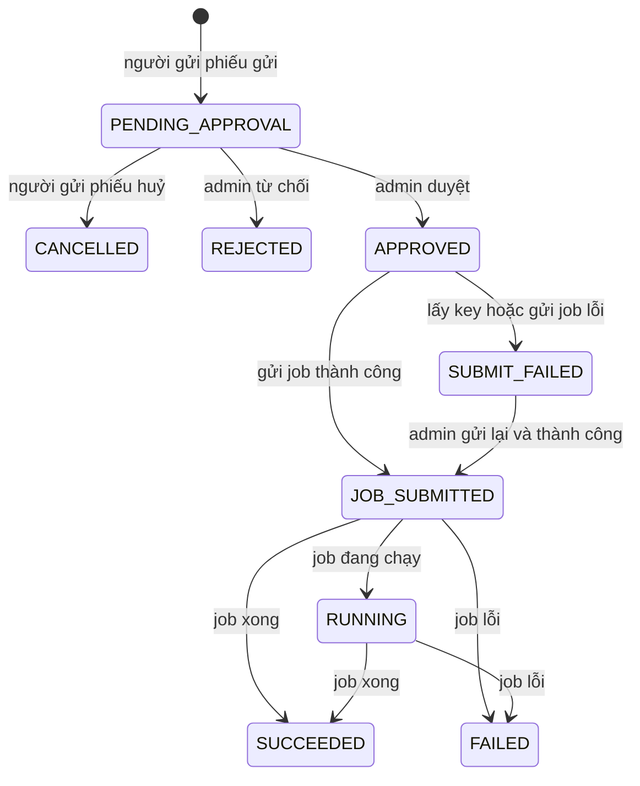

# Hợp đồng luồng khử định danh bảng (phiếu PYC)

**Dành cho:** team DAK, những người hiện thực luồng này trên DAK thật.
**Tài liệu này nói gì:** những hành vi bên ngoài nhìn thấy được mà DAK phải làm đúng. Không mô tả cách bên mock hiện thực bên trong.

> **Về chữ "PYC":** trong tài liệu này PYC là **phiếu yêu cầu khử định danh**. Trong [docs/key-access/](../key-access/) "PYC" còn là phiếu cấp quyền key theo bảng của DAK. Đó là hai loại phiếu khác nhau.

> **Cách đọc các đường dẫn `/mock-portal/...` và `/mock-admin/...`:** chúng chỉ là giao diện HTTP của **bản mock**, để chạy thử bằng `curl`. DAK thật làm bằng giao diện của mình,
> **miễn là giữ nguyên hành vi và các bước chuyển trạng thái**. Người dùng không gọi API: team được cấp tài khoản, đăng nhập portal và gửi file phiếu.

## Mục lục

| Mục | Nội dung |
| --- | --- |
| [0](#0-đọc-nhanh) | Đọc nhanh: luồng 6 bước, DAK cần làm gì |
| [1](#1-phiếu-và-trạng-thái) | Phiếu trông như thế nào, các trạng thái |
| [2](#2-nội-dung-file-phiếu) | Người gửi phiếu điền gì, quy tắc kiểm, mục `env` |
| [3](#3-giới-hạn-và-chống-trùng) | Giới hạn số phiếu, chống gửi trùng |
| [4](#4-việc-của-người-gửi-phiếu-portal) | Người gửi phiếu làm được gì |
| [5](#5-việc-của-admin) | Admin duyệt, từ chối, gửi lại |
| [6](#6-key-khử-định-danh-theo-bảng) | Lấy key của bảng và giao cho job |
| [7](#7-gửi-job-và-theo-dõi-job) | Gửi job cho Airflow, theo dõi trạng thái job |
| [8](#8-mã-lỗi) | Mã lỗi HTTP, lỗi trong file phiếu, lỗi `submitError` |
| [9](#9-audit-và-bảo-mật) | Ghi log kiểm toán, các điều bảo mật |
| [10](#10-ví-dụ-từ-đầu-đến-cuối) | Một phiếu đi từ gửi đến xong |
| [11](#11-cấu-hình-dak-cần-có) | Các giá trị cấu hình DAK cần có |
| [12](#12-chỉ-có-ở-bản-mock) | Phần chỉ có ở bản mock |

## 0. Đọc nhanh

**Luồng trong một câu:** người của một team gửi phiếu yêu cầu khử định danh một bảng, admin DAK duyệt, DAK tự lấy key của bảng rồi chạy job, job ghi ra một **bảng kết quả** đã khử định danh,
người gửi phiếu thấy kết quả ngay trên phiếu.

| Bước | Ai làm | Việc | Phiếu sang trạng thái |
| --- | --- | --- | --- |
| 1 | Người gửi phiếu | Gửi file phiếu: bảng nguồn, các cột cần khử định danh, DAG, mục đích, và (tuỳ chọn) env của job | `PENDING_APPROVAL` |
| 2 | Admin | Xem phiếu, **duyệt** hoặc **từ chối** (kèm lý do) | `APPROVED` hoặc `REJECTED` |
| 3 | DAK | Lấy key của bảng từ Vault, tạo một Secret riêng cho phiếu để chứa key | (vẫn `APPROVED`) |
| 4 | DAK | Gửi job cho Airflow (trigger một DAG) | `JOB_SUBMITTED`, hoặc `SUBMIT_FAILED` nếu bước 3 hoặc 4 lỗi |
| 5 | Airflow, Spark | Job chạy, ghi bảng kết quả | `RUNNING` rồi `SUCCEEDED` hoặc `FAILED` |
| 6 | DAK | Xoá Secret chứa key khi job kết thúc | (trạng thái cuối giữ nguyên) |

**DAK cần hiện thực 5 việc:**
1. Giao diện gửi phiếu cho team, kiểm phiếu đúng mục 2, giới hạn đúng mục 3.
2. Giao diện admin: duyệt, từ chối, gửi lại (mục 5).
3. Lấy key của bảng từ Vault và tạo Secret riêng cho từng phiếu (mục 6).
4. Gửi job cho Airflow và theo dõi trạng thái (mục 7).
5. Lưu phiếu, trả đúng mã lỗi, ghi log kiểm toán (mục 8, 9).

**Những điều đã chốt là KHÔNG làm:**
- Không sửa phiếu sau khi gửi. Muốn đổi thì huỷ rồi gửi phiếu mới.
- Chỉ khử định danh kiểu `HASH`. `ENCRYPT` và `MAPPING` bị từ chối.
- Không kiểm key của từng cột, không kiểm cột đã được mã hoá hay chưa. Job băm thẳng trên bảng như nó đang có.
- Không cho người gửi phiếu chọn tài nguyên chạy job (cores, memory, số executor).
- Admin không sửa env của phiếu, chỉ duyệt hoặc từ chối.
- Không giới hạn database của bảng kết quả (xem cảnh báo ở mục 2.3).

## 1. Phiếu và trạng thái

### 1.1 Một phiếu

Ví dụ một phiếu **đã chạy xong**:

```json
{
  "requestCode": "PYC-2026-000007",
  "state": "SUCCEEDED",
  "database": "demo_db",
  "table": "users_cdr_2",
  "columns": [{ "column": "name", "mode": "HASH" }],
  "dagId": "deid_pseudonymize_table",
  "purpose": "Share data with partner X for churn analysis",
  "env": {
    "ENABLE_HIVE_SUPPORT": "true",
    "OUTPUT_DB": "demo_db",
    "OUTPUT_FORMAT": "delta",
    "OUTPUT_MODE": "overwrite",
    "OUTPUT_TABLE": "users_cdr_2_pseudonymized"
  },
  "team": "teamtscauiy",
  "createdBy": "hungvt",
  "createdAt": "2026-10-23T08:05:00Z",
  "sourceFile": { "name": "valid-request.json", "sha256": "9f2c…" },
  "decidedAt": "2026-10-23T09:00:00Z",
  "decidedBy": "admin",
  "outputDatabase": "demo_db",
  "outputTable": "users_cdr_2_pseudonymized",
  "keyVersion": 3,
  "jobRef": { "kind": "AirflowDagRun", "name": "deid-2026-000007" },
  "jobState": "SUCCEEDED",
  "jobFinishedAt": "2026-10-23T09:12:40Z"
}
```

Các trường luôn có: `requestCode`, `state`, `database`, `table`, `columns`, `purpose`, `team`, `createdBy`, `createdAt`, `sourceFile`. Các trường còn lại **chỉ xuất hiện khi có ý nghĩa** (không bao giờ trả `null`):

| Trường | Có khi nào | Ý nghĩa |
| --- | --- | --- |
| `requestCode` | Luôn có | Mã phiếu `PYC-<năm>-<6 số>`, tăng dần |
| `team` | Luôn có | Team của người gửi. Phiếu **thuộc team**, không thuộc từng người. Người gửi không tự khai team |
| `createdBy` | Luôn có | Tên tài khoản đã đăng nhập |
| `dagId` | Khi DAK gửi job bằng Airflow | DAG do người gửi chọn |
| `env` | Khi người gửi nhập env, hoặc từ `APPROVED` trở đi | Trước khi duyệt: đúng những env người gửi nhập. Từ `APPROVED`: **env cuối cùng của job** (đã điền mặc định) |
| `sourceFile` | Luôn có | `name` chỉ để hiển thị (bỏ đường dẫn, ký tự điều khiển, tối đa 255 ký tự). `sha256` là băm của đúng các byte đã gửi. DAK nên giữ cả file gốc để đối chiếu |
| `decidedAt`, `decidedBy` | Từ `APPROVED`, hoặc `REJECTED` | Thời điểm và người duyệt hoặc từ chối |
| `reasonText` | `REJECTED` | Lý do admin ghi |
| `outputDatabase`, `outputTable` | Từ `APPROVED` | Bảng kết quả của job, lấy từ `OUTPUT_DB` và `OUTPUT_TABLE` cuối cùng trong `env`. **Chỉ để xem**, không phải ô nhập |
| `keyVersion` | Từ `JOB_SUBMITTED` | Version của key bảng trong Vault đã giao cho job. Không phải giá trị key |
| `jobRef` | Từ `JOB_SUBMITTED` | `kind` là `AirflowDagRun` (hoặc `SparkApplication`), `name` là tên dag run (hoặc tên SparkApplication) |
| `submitError` | `SUBMIT_FAILED` | Thông điệp lỗi cố định, xem mục 8.3. Không chứa token, secret hay key |
| `jobState`, `jobFinishedAt` | Khi đã hỏi trạng thái job | `jobState` là `RUNNING`, `SUCCEEDED`, `FAILED` hoặc `UNKNOWN`; `jobFinishedAt` chỉ có khi job đã kết thúc |

### 1.2 Các trạng thái



| Trạng thái | Nghĩa | Phiếu có thể sang |
| --- | --- | --- |
| `PENDING_APPROVAL` | Chờ admin | `CANCELLED`, `REJECTED`, `APPROVED` |
| `APPROVED` | Đã duyệt, DAK đang lấy key và gửi job. Đây là trạng thái ngắn, trong cùng một lần duyệt | `JOB_SUBMITTED`, `SUBMIT_FAILED` |
| `SUBMIT_FAILED` | Đã duyệt nhưng lấy key hoặc gửi job lỗi. Xem `submitError`. Admin sửa nguyên nhân rồi gửi lại | `JOB_SUBMITTED`, hoặc lại `SUBMIT_FAILED` |
| `JOB_SUBMITTED` | Đã gửi job, chưa thấy job chạy | `RUNNING`, `SUCCEEDED`, `FAILED` |
| `RUNNING` | Job đang chạy | `SUCCEEDED`, `FAILED` |
| `SUCCEEDED` | **Cuối.** Job xong, đối chiếu đạt | không |
| `FAILED` | **Cuối.** Job lỗi | không |
| `REJECTED` | **Cuối.** Admin từ chối | không |
| `CANCELLED` | **Cuối.** Người gửi phiếu huỷ | không |

Phiếu ở trạng thái cuối **không đổi nữa**. Muốn làm lại thì gửi phiếu mới.
Thao tác sai trạng thái (ví dụ huỷ một phiếu đã duyệt) bị từ chối bằng `409 invalid_state`, thông điệp nêu trạng thái hiện tại.

## 2. Nội dung file phiếu

Đây là các thông tin DAK cần thu thập từ người gửi phiếu, dù giao diện dùng form, Excel hay JSON. Bản mock nhận JSON:

```json
{
  "database": "demo_db",
  "table": "users_cdr_2",
  "columns": [{ "column": "name", "mode": "HASH" }],
  "dagId": "deid_pseudonymize_table",
  "env": {
    "OUTPUT_DB": "demo_db",
    "OUTPUT_TABLE": "users_cdr_2_pseudonymized",
    "OUTPUT_MODE": "overwrite"
  },
  "purpose": "Share data with partner X for churn analysis"
}
```

### 2.1 Các trường và quy tắc

| Trường | Bắt buộc | Quy tắc | Mã lỗi (`code`) |
| --- | --- | --- | --- |
| `database`, `table` | Có | `[A-Za-z0-9_]{1,128}`. Tự chuyển chữ thường | `invalid_table` |
| `columns` | Có | 1 đến 100 phần tử, mỗi phần tử là `{ "column": "...", "mode": "..." }`. Tên cột cùng quy tắc như trên, chuyển chữ thường, **cột trùng được gộp thành một** | `invalid_column` |
| `columns[].mode` | Không | `HASH`. Bỏ trống thì là `HASH`. `ENCRYPT` và `MAPPING` bị từ chối | `invalid_mode` |
| `dagId` | Có, khi DAK gửi job bằng Airflow | Người gửi chọn DAG trong **danh sách DAG được phép** do DAK cấu hình. Khớp `[A-Za-z0-9_][A-Za-z0-9_.-]{0,249}`. Khi DAK không dùng Airflow, trường này được khai nhưng bị bỏ qua | `invalid_dag` |
| `env` | Không | Env của job, xem mục 2.2 | `invalid_env` |
| `purpose` | Có | Mục đích sử dụng, 1 đến 500 ký tự sau khi bỏ khoảng trắng đầu cuối | `invalid_purpose` |
| (cả file) | | Tối đa **64 KB**, đúng định dạng JSON, **không có trường lạ** (trường lạ bị từ chối, không bỏ qua im lặng), không có khoá trùng | `invalid_file` |

`dagId` ngoài danh sách được phép bị từ chối bằng **cùng một thông điệp** (`dagId is not allowed`) dù DAG có tồn tại trên Airflow hay không. Làm vậy để người dùng không dò được tên DAG của hệ thống.
Giao diện nên cho người dùng chọn `dagId` từ danh sách được phép thay vì tự gõ (bản mock: `GET /mock-portal/deid-dags`).

### 2.2 Mục `env`: người gửi phiếu cấu hình job

`env` là một object `TÊN: "giá trị"`. Giá trị luôn là **chuỗi**. Người gửi phiếu **không bắt buộc** nhập gì; env nào không nhập thì DAK điền giá trị mặc định lúc duyệt.

> **Phụ thuộc vào job:** ba env `INPUT_FROM`, `INPUT_TO`, `INPUT_HOURS` (khoảng ngày và giờ) cần job `pseudonymize-table-app` hỗ trợ lọc theo cột `date` và `hour` **trên nguồn là bảng**.
> Phiên bản job hiện tại chỉ cho dùng chúng với nguồn là thư mục và báo lỗi cấu hình với nguồn là bảng; phần này đang được bổ sung vào job. Chỉ bật ba env này ở DAK khi job đã được cập nhật.

**Các env người gửi phiếu được nhập** (đây là danh sách mặc định, DAK có thể cấu hình thêm bớt, xem mục 11):

| Tên | Ý nghĩa | Giá trị hợp lệ | Nếu không nhập |
| --- | --- | --- | --- |
| `OUTPUT_DB` | Database chứa bảng kết quả | `[a-z0-9_]{1,128}` (chữ thường, số, gạch dưới) | Database của bảng nguồn, hoặc một database cố định do DAK cấu hình |
| `OUTPUT_TABLE` | Tên bảng kết quả | `[a-z0-9_]{1,128}` | DAK tự đặt lúc duyệt: `{bảng nguồn}_deid_{yyyyMMdd}_{số}`, ví dụ `users_cdr_2_deid_20261023_7` |
| `OUTPUT_MODE` | Cách ghi vào bảng kết quả | `overwrite`, `append` hoặc `overwrite-partitions` | `overwrite-partitions` nếu phiếu có `INPUT_FROM`, `INPUT_TO` hoặc `INPUT_HOURS`; ngược lại `overwrite` |
| `OUTPUT_FORMAT` | Định dạng bảng kết quả | `delta`, `hive` hoặc `iceberg` | `delta` |
| `ENABLE_HIVE_SUPPORT` | Bật hỗ trợ Hive | `true` hoặc `false` | `true` |
| `INPUT_FROM` | Ngày (giờ) bắt đầu cần khử định danh, **tính cả đầu** | `yyyyMMdd` hoặc `yyyyMMddHH` (ví dụ `20261012`, `2026101218`) | Không đặt: không giới hạn đầu |
| `INPUT_TO` | Ngày (giờ) kết thúc, **tính cả cuối** | như `INPUT_FROM` | Không đặt: không giới hạn cuối |
| `INPUT_HOURS` | Chỉ lấy các giờ này trong **mỗi ngày** của khoảng | `18` (một giờ) hoặc `6-18` (từ giờ 6 đến giờ 18), giờ từ 0 đến 23 | Không đặt: lấy mọi giờ |

**Khoảng ngày và giờ (`INPUT_FROM`, `INPUT_TO`, `INPUT_HOURS`).** Khử định danh thường chạy theo ngày hoặc theo giờ, nên người gửi phiếu có thể giới hạn dữ liệu cần xử lý. Job chỉ đọc các partition `(date, hour)` nằm trong khoảng.
**Bảng nguồn phải có hai cột partition `date` (chuỗi `yyyyMMdd`) và `hour` (chuỗi `HH`, ví dụ `05`).** Bảng thiếu hai cột này thì job lỗi. **Không đặt cả ba env thì job xử lý cả bảng**, như trước đây.

| Người gửi phiếu nhập | Dữ liệu được xử lý |
| --- | --- |
| `INPUT_FROM=20261012`, `INPUT_TO=20261012` | Cả ngày 12 |
| `INPUT_FROM=20261012`, `INPUT_TO=20261014` | Ba ngày 12, 13, 14 |
| `INPUT_FROM=2026101218`, `INPUT_TO=2026101218` | Đúng một giờ: 18h ngày 12 |
| `INPUT_FROM=2026101218`, `INPUT_TO=2026101306` | Liên tục từ 18h ngày 12 đến 06h ngày 13 |
| `INPUT_FROM=20261012`, `INPUT_TO=20261014`, `INPUT_HOURS=6-8` | Giờ 06 đến 08 của **mỗi** ngày 12, 13, 14 |
| Chỉ `INPUT_HOURS=0-0` | Giờ 00 của **mọi** ngày trong bảng |

Khi có khoảng ngày hoặc giờ, bảng kết quả được **partition theo `(date, hour)`**, và cách ghi mặc định là `overwrite-partitions`: chạy lại cùng khoảng chỉ thay đúng các partition đó, không xoá ngày và giờ khác, không nhân đôi dữ liệu.
Nếu bảng kết quả đã tồn tại với kiểu partition khác thì job lỗi; khi đó đổi `OUTPUT_TABLE` hoặc xoá bảng cũ.

Trong tên mặc định của `OUTPUT_TABLE`: `yyyyMMdd` là ngày duyệt theo giờ UTC, `số` là phần số cuối của mã phiếu bỏ số 0 đứng đầu (`PYC-2026-000007` cho `7`).

**Quy tắc kiểm `env`:**
- `env` phải là một object, tối đa **10 mục**.
- Mỗi giá trị là chuỗi, tối đa **256 ký tự**, không có ký tự xuống dòng hay ký tự điều khiển, và khớp đúng quy tắc của tên đó. **Giá trị phải đúng ngay từ đầu**: ví dụ `OUTPUT_DB` viết hoa bị từ chối, DAK không tự sửa thành chữ thường.
- Tên **không có trong danh sách** bị từ chối bằng cùng một thông điệp: `env name is not allowed`. Không liệt kê danh sách được phép trong thông điệp lỗi.
- **Quy tắc riêng của khoảng ngày và giờ** (kiểm ngay lúc gửi phiếu, lỗi nằm ở `env.<TÊN>`): `INPUT_FROM` và `INPUT_TO` phải là ngày có thật và giờ từ 00 đến 23; thiếu giờ thì `INPUT_FROM` hiểu là giờ 00 và `INPUT_TO` hiểu là giờ 23;
  khi có cả hai thì `INPUT_FROM` không được lớn hơn `INPUT_TO`. `INPUT_HOURS` có hai số thì số đầu không được lớn hơn số sau.
- **`OUTPUT_MODE=overwrite-partitions` chỉ hợp lệ khi phiếu có ít nhất một trong `INPUT_FROM`, `INPUT_TO`, `INPUT_HOURS`**, vì chế độ này cần biết partition nào để thay. Vi phạm thì lỗi ở `env.OUTPUT_MODE`.
- **Bảng kết quả không được trùng bảng nguồn.** Cặp (`OUTPUT_DB`, `OUTPUT_TABLE`) không được bằng cặp (`database`, `table`) của phiếu. Nếu không nhập `OUTPUT_DB` thì dùng database mặc định (xem bảng trên) để so. Lý do: job ghi vào bảng kết quả, ghi nhầm vào bảng nguồn sẽ làm hỏng dữ liệu gốc. Lỗi nằm ở `env.OUTPUT_TABLE`.
- Lỗi `env` nằm trong `problems[]` (mục 2.4) với `field` là `env.<TÊN>`, hoặc `env` nếu sai ở mức cả object. Thông điệp lỗi **không lặp lại** giá trị người dùng đã nhập.

**Các env KHÔNG BAO GIỜ được cho người gửi phiếu nhập.** Đây là các env quyết định job xử lý bảng nào và lấy key ở đâu. Nếu người gửi sửa được, họ có thể làm job làm việc khác với những gì admin đã duyệt:

| Env | Vì sao không cho nhập |
| --- | --- |
| `DB_NAME`, `TABLE_NAME`, `PSEUDO_COLUMNS` | Chính là bảng và cột trên phiếu mà admin đã duyệt. DAK lấy từ phiếu |
| `PSEUDO_MODE`, `VERIFY` | Cách khử định danh (chỉ `HASH`) và bước đối chiếu sau khi ghi. Cố định |
| `WAREHOUSE_PATH` | Nơi lưu bảng của môi trường. Cố định |
| `INPUT_*` (trừ `INPUT_FROM`, `INPUT_TO`, `INPUT_HOURS`), `MAPPING_TABLE_PATH` | Cho job đọc file hoặc thư mục bất kỳ trên HDFS (`INPUT_PATH`, `INPUT_FORMAT`...) |
| `CRYPTO_*`, `VAULT_*`, `DAK_*` | Quyết định job lấy key từ đâu |
| `JAVA_*`, `LD_*`, `SPARK_*`, `HADOOP_*`, `KRB5*` | Cấu hình bên trong container, nơi có keytab |
| Tên có chứa `SECRET`, `TOKEN`, `PASSWORD`, `PASSWD`, `KEY` | Tránh để bí mật nằm trong phiếu, trong `conf` của Airflow và trong log |

Ký hiệu `*` nghĩa là "bắt đầu bằng" (`INPUT_*` gồm `INPUT_PATH`, `INPUT_FORMAT`, `INPUT_SCHEMA`...; **ba ngoại lệ được phép** là `INPUT_FROM`, `INPUT_TO`, `INPUT_HOURS`). "Tên có chứa" nghĩa là chứa chuỗi đó ở bất kỳ vị trí nào (`MY_API_TOKEN` bị cấm).
**DAK phải từ chối khởi động** nếu cấu hình danh sách env được phép chứa một env thuộc nhóm này.

### 2.3 Ba rủi ro của bảng kết quả và cách ghi

Vì người gửi phiếu được chọn bảng kết quả và không giới hạn database, admin **phải đọc `OUTPUT_DB`, `OUTPUT_TABLE`, `OUTPUT_MODE` và khoảng ngày giờ trên phiếu trước khi duyệt**:

1. **Ghi đè bảng của người khác.** Nếu `OUTPUT_TABLE` là tên một bảng đã có cùng `OUTPUT_MODE=overwrite`, job thay toàn bộ nội dung bảng đó. Với `overwrite-partitions`, các partition `(date, hour)` trùng của bảng đó bị thay. DAK không biết bảng đã tồn tại hay chưa vì không hỏi Hive metastore.
2. **`append` có thể ghi trùng.** Nếu job lỗi giữa chừng rồi được chạy lại, phần đã ghi lần trước vẫn còn và bị ghi thêm một lần nữa. Với `overwrite` và `overwrite-partitions`, chạy lại bao nhiêu lần cũng ra cùng kết quả.
3. **`overwrite` kèm khoảng ngày giờ xoá dữ liệu ngoài khoảng.** `overwrite` thay **cả bảng kết quả** bằng dữ liệu của lần chạy này, nên các ngày và giờ khác đang có trong bảng kết quả bị mất. Khi cần xử lý theo ngày hoặc giờ hãy dùng `overwrite-partitions` (mặc định khi có khoảng).

### 2.4 Cách báo lỗi file phiếu

Kiểm file **gom mọi lỗi một lượt**, để người dùng thấy hết lỗi và sửa file một lần. Có lỗi nào thì **không tạo phiếu**. Lỗi trả theo dạng:

```json
{
  "error": "invalid_file",
  "message": "The uploaded request has 3 problems",
  "problems": [
    { "field": "columns[1].column", "code": "invalid_column", "message": "column name must match [A-Za-z0-9_]{1,128}" },
    { "field": "dagId", "code": "invalid_dag", "message": "dagId is not allowed" },
    { "field": "env.OUTPUT_MODE", "code": "invalid_env", "message": "value must match overwrite|append|overwrite-partitions" }
  ],
  "requestId": "6b1f…"
}
```

Khi cả file hỏng (quá 64 KB, không phải JSON, không phải object, khoá trùng) thì `problems` rỗng và `message` nói rõ lý do.

## 3. Giới hạn và chống trùng

- Mỗi team có tối đa **20 phiếu chưa ở trạng thái cuối**. Vượt thì từ chối gửi phiếu: `429 too_many_active_requests`.
- Không cho hai phiếu **đang xử lý** (chưa ở trạng thái cuối) của cùng một team trùng cả `database`, `table` và **tập cột**: từ chối bằng `409 duplicate_request`, thông điệp nêu mã phiếu cũ (`An active request for the same table and columns already exists: PYC-2026-000003`).
  Nhờ vậy bấm gửi hai lần hoặc tải lại trang không tạo hai phiếu.
- **Chống trùng không tính `env`.** Hai phiếu cùng bảng nguồn, cùng cột nhưng khác `env` vẫn bị coi là trùng. Một team muốn gửi phiếu thứ hai cho cùng bảng và cột phải đợi phiếu đầu kết thúc.

## 4. Việc của người gửi phiếu (portal)

Mọi thao tác yêu cầu đăng nhập. Người gửi phiếu **chỉ thấy và thao tác trên phiếu của team mình**. Phiếu của team khác và phiếu không tồn tại cho **cùng một kết quả** "không tìm thấy" (`404 not_found`), để không lộ phiếu có tồn tại.

| Thao tác | Việc | Trạng thái | Đường dẫn trong mock |
| --- | --- | --- | --- |
| Gửi phiếu | Kiểm file (mục 2), kiểm giới hạn (mục 3), hợp lệ thì tạo phiếu | → `PENDING_APPROVAL` | `POST /mock-portal/deid-requests` (multipart, trường `file`), trả `201` kèm phiếu |
| Huỷ phiếu | Huỷ phiếu đang chờ duyệt | `PENDING_APPROVAL` → `CANCELLED` | `POST /mock-portal/deid-requests/{code}/cancel`, trả `200` kèm phiếu |
| Xem một phiếu | Nếu job đang chạy, DAK làm mới trạng thái job trước khi hiển thị (mục 7.5) | không đổi | `GET /mock-portal/deid-requests/{code}` |
| Danh sách phiếu của team | Mới nhất trước, lọc theo trạng thái, phân trang | không đổi | `GET /mock-portal/deid-requests?state=&limit=&cursor=` |
| Xem DAG được phép | Danh sách DAG để người dùng chọn khi điền phiếu | không đổi | `GET /mock-portal/deid-dags`, trả `{ "dagIds": [ … ] }` |
| Xem env được nhập | Danh sách env, quy tắc và giá trị mặc định để giao diện dựng form | không đổi | `GET /mock-portal/deid-job-env` |

**Chi tiết cần giống nhau:**
- **Huỷ lặp lại** trên phiếu đã `CANCELLED` **không phải lỗi**: trả lại phiếu, không ghi audit thêm. Huỷ phiếu ở trạng thái khác `PENDING_APPROVAL` thì `409 invalid_state`.
- **Không có thao tác sửa phiếu.**
- **Danh sách phiếu:** trả `{ "requests": [ … ], "nextCursor": "PYC-2026-000007" }`, mới nhất trước.
  `limit` từ 1 đến 100 (mặc định 20). `state` là một trong các trạng thái ở mục 1.2, không phân biệt hoa thường.
  `nextCursor` là mã phiếu cuối của trang và **chỉ có khi còn phiếu phía sau**; truyền lại làm `cursor` để lấy trang kế (vẫn dùng được khi phiếu đó không còn khớp bộ lọc `state`).
  `limit` sai, `state` lạ, `cursor` lạ hoặc của team khác đều trả `400 invalid_request`.
- **Danh sách env được nhập** trả `{ "maxEntries": 10, "env": [ { "name", "pattern", "defaultValue" } ] }`. `defaultValue` vắng với `OUTPUT_DB` và `OUTPUT_TABLE`, vì DAK tính lúc duyệt.
- **Mã phiếu sai định dạng** (không phải `PYC-<năm>-<6 số>`) trả `404 not_found`, giống phiếu không tồn tại.
- Phiếu của team mình khi `PENDING_APPROVAL` chỉ có `env` người gửi đã nhập; phiếu đã duyệt có đủ env cuối cùng (mục 1.1).

## 5. Việc của admin

Admin thấy phiếu của **mọi team**, đủ nội dung gồm `dagId`, `purpose`, `env`.

| Thao tác | Việc | Trạng thái | Đường dẫn trong mock |
| --- | --- | --- | --- |
| Danh sách phiếu | Phiếu mọi team, lọc theo `state` (thường là `PENDING_APPROVAL`), phân trang như mục 4 | không đổi | `GET /mock-admin/deid-requests?state=PENDING_APPROVAL` |
| Xem một phiếu | Như người gửi phiếu nhưng không giới hạn theo team | không đổi | `GET /mock-admin/deid-requests/{code}` |
| **Duyệt** | Điền env mặc định, lấy key, giao key, gửi job (mục 5.1) | `PENDING_APPROVAL` → `APPROVED` → `JOB_SUBMITTED` hoặc `SUBMIT_FAILED` | `POST /mock-admin/deid-requests/{code}/approve` (không body) |
| **Từ chối** | `reasonText` bắt buộc, 1 đến 500 ký tự sau khi bỏ khoảng trắng | `PENDING_APPROVAL` → `REJECTED` | `POST /mock-admin/deid-requests/{code}/reject` với `{ "reasonText": "..." }` |
| **Gửi lại** | Làm lại bước lấy key và gửi job sau khi đã sửa nguyên nhân | `SUBMIT_FAILED` → `JOB_SUBMITTED` (hoặc lại `SUBMIT_FAILED`) | `POST /mock-admin/deid-requests/{code}/retry-submit` |

**Admin chỉ duyệt hoặc từ chối.** Không nhập tên bảng kết quả, không sửa `env`, không có body khi duyệt.

### 5.1 Khi admin duyệt, DAK làm gì (theo đúng thứ tự)

1. **Chốt env cuối cùng:** điền giá trị mặc định cho env người gửi không nhập (mục 2.2), kiểm lại "bảng kết quả không được trùng bảng nguồn", rồi lưu env cuối cùng vào phiếu. Phiếu sang `APPROVED`.
   Nếu bảng kết quả trùng bảng nguồn (chỉ xảy ra khi cấu hình DAK đổi từ lúc gửi phiếu) thì `approve` trả `400 invalid_request` và phiếu **vẫn `PENDING_APPROVAL`**; admin từ chối, người dùng gửi lại.
2. **Lấy key và giao key** cho job (mục 6).
3. **Gửi job** (mục 7).
4. Trả phiếu **sau khi đã thử xong cả ba bước**: `JOB_SUBMITTED` nếu được, `SUBMIT_FAILED` kèm `submitError` nếu không.

**Điều cần đúng:**
- `approve` trả **`200` cả khi `SUBMIT_FAILED`**, vì việc duyệt đã thành công; lỗi nằm ở trạng thái của phiếu.
- **Chỉ một lần duyệt có tác dụng.** Hai admin duyệt cùng lúc: một người thắng, người kia nhận lại phiếu hiện tại. `approve` lặp lại trên phiếu đã duyệt (bất kỳ trạng thái sau đó) trả `200` cùng phiếu, **không giao key và không gửi job lần hai**.
- `approve` phiếu đã `CANCELLED` hoặc `REJECTED`: `409 invalid_state`. Người gửi phiếu huỷ trước thì admin không duyệt được.
- Giao key lỗi hoặc gửi job lỗi: phiếu vào `SUBMIT_FAILED`, Secret key vừa tạo bị xoá (mục 6).
- `retry-submit` giữ nguyên env đã chốt, chạy lại bước 2 và 3.
- **Trước khi duyệt, admin nên đọc** `OUTPUT_DB`, `OUTPUT_TABLE`, `OUTPUT_MODE` trên phiếu (mục 2.3).

## 6. Key khử định danh theo bảng

Job khử định danh dùng một key **theo bảng** (không phải key của từng cột). Key do **DAK backend** đọc từ **Vault của DAK** lúc duyệt, cùng nguồn với key bảng của luồng `GET /api/v1/keys/{database}/{table}`.

1. **Đọc key:** lấy `keyPrefix` và version của bảng (`database`, `table`) ở Vault. Bảng chưa có key thì phiếu vào `SUBMIT_FAILED` với `submitError = "table key not found"`. Người vận hành tạo key rồi bấm gửi lại. Phiếu **không** bị từ chối.
2. **Kiểm định dạng:** `keyPrefix` phải là **base64 chuẩn của đúng 32 byte** (44 ký tự, kết thúc bằng `=`). Khác thì `SUBMIT_FAILED` với `submitError = "table key has unsupported format"`. Thông báo **không bao giờ** chứa key.
3. **Giao key cho job bằng tên Secret, không bằng giá trị.** DAK tạo một **Secret riêng cho từng phiếu** trong namespace chạy job:
   - Tên Secret: `deid-key-<năm>-<6 số>` (lấy từ mã phiếu, chữ thường), ví dụ `deid-key-2026-000007`.
   - Nội dung: một file tên `pseudonym.hmac_v1`, giá trị là `base64:<keyPrefix>`.
   - Nhãn: `dak.vai/request-code=<mã phiếu>` và `dak.vai/kind=deid-key`.
   - Nếu Secret cùng tên còn sót từ lần trước: xoá rồi tạo lại, đúng một lần.
   - Job (DAG) chỉ nhận **tên** Secret và mount nó vào thư mục `/etc/pseudonym-keys`.
   - Key **không bao giờ** xuất hiện trong phiếu, `conf` của Airflow, biến môi trường của job, log, audit hay phản hồi nào. (Airflow lưu `conf` trong cơ sở dữ liệu và hiện trên giao diện, nên không dùng `conf` để chuyển key.)
4. **Dọn dẹp:** DAK xoá Secret khi job kết thúc (`SUCCEEDED`, `FAILED`, hoặc `jobState = UNKNOWN`), và khi lấy key hoặc gửi job lỗi giữa chừng. Xoá Secret chỉ được áp dụng cho tên đúng dạng `deid-key-<năm>-<6 số>`. Nếu xoá lỗi thì ghi cảnh báo và để lại; Secret có nhãn ở trên để quét dọn thủ công.
5. **Chỉ `HASH`.** `ENCRYPT` cần khoá 64 byte và `MAPPING` cần bảng ánh xạ; một key bảng 32 byte không đủ cho chúng, nên các mode này bị từ chối ở mục 2.

**Lưu ý cho bên dùng dữ liệu kết quả:** nếu cột nguồn đã được mã hoá không tất định, `HASH` trên ciphertext không còn nối được các bản ghi của cùng một chủ thể.

## 7. Gửi job và theo dõi job

Hiện tại DAK gửi job bằng cách **trigger một DAG của Airflow 2.x** (REST `/api/v1`). Điều bắt buộc về hành vi:

**7.1 Gọi lại không tạo job thứ hai.** Mã dag run (`dag_run_id`) suy ra từ mã phiếu: `deid-<năm>-<6 số>`, ví dụ `deid-2026-000007` (chữ thường, hợp DNS-1123; cũng là tên SparkApplication). Airflow trả `409` vì đã có dag run này thì coi như **đã gửi**, dùng lại tham chiếu.
**7.2 Người dùng chỉ chọn được** `database`, `table`, cột, `mode` (đã kiểm), `dagId` (trong danh sách được phép) và các env trong danh sách được phép. Image, key, đường dẫn và mọi env ngoài danh sách đều do DAK và DAG quyết định. `purpose` và `sourceFile` **không bao giờ** đi vào job.
**7.3 Gọi Airflow:** `POST {airflow}/api/v1/dags/{dagId}/dagRuns`, với `dagId` **lấy từ phiếu** và **kiểm lại với danh sách DAG được phép ngay trước khi gọi** (danh sách có thể đã đổi từ lúc gửi phiếu; không còn trong danh sách thì `submitError = "airflow dag not allowed"`, không gọi mạng):

```json
{
  "dag_run_id": "deid-2026-000007",
  "conf": {
    "requestCode": "PYC-2026-000007",
    "database": "demo_db",
    "table": "users_cdr_2",
    "pseudoColumns": "name:HASH",
    "keySecretName": "deid-key-2026-000007",
    "env": {
      "ENABLE_HIVE_SUPPORT": "true",
      "OUTPUT_DB": "demo_db",
      "OUTPUT_FORMAT": "delta",
      "OUTPUT_MODE": "overwrite",
      "OUTPUT_TABLE": "users_cdr_2_pseudonymized"
    }
  }
}
```

| Khoá trong `conf` | Giá trị | Ghi chú |
| --- | --- | --- |
| `requestCode` | Mã phiếu | Dùng để từ job tìm lại phiếu (nhãn truy vết) |
| `database`, `table` | Bảng nguồn của phiếu | |
| `pseudoColumns` | Các cột dạng `tên:MODE` nối bằng dấu phẩy, ví dụ `msisdn:HASH,imei:HASH` | |
| `keySecretName` | **Tên** Secret chứa key (mục 6) | **Không phải key.** `conf` không bao giờ chứa key |
| `env` | **Env cuối cùng của job**, gồm cả `OUTPUT_DB`, `OUTPUT_TABLE` | Người gửi nhập cộng giá trị mặc định (mục 2.2). Luôn là object, không bao giờ thiếu `OUTPUT_DB` và `OUTPUT_TABLE` |

DAK **kiểm lại `env`** với danh sách env được phép hiện hành và quy tắc "bảng kết quả khác bảng nguồn" ngay trước khi gọi Airflow. Sai thì phiếu vào `SUBMIT_FAILED` với `submitError = "invalid job parameters"`, không gọi mạng.

**Xác thực với Airflow:** do DAK và bên vận hành thống nhất. Airflow 2.8 hiện chỉ bật hai cách đăng nhập cho REST API là `basic_auth` và `session` nên không nhận Bearer token Keycloak.
Cách đang dùng: một **user Airflow riêng cho DAK**, quyền tối thiểu (đọc DAG, tạo dag run), gọi bằng HTTP Basic. Dùng Bearer token Keycloak chỉ được khi Airflow bật thêm một backend nhận loại token đó.

**7.4 DAG phải làm đúng những điều sau** (mẫu đầy đủ: `dak-mock/k8s/airflow/dags/sample_dag_deid_pseudonymize_table.py`):
   - Đặt tên SparkApplication bằng `dag_run_id`, tạo nó ở **cùng namespace với Secret key**.
   - Mount Secret có tên `conf.keySecretName` vào `/etc/pseudonym-keys`, đặt nguồn key `file`.
   - Các env `INPUT_FROM`, `INPUT_TO`, `INPUT_HOURS` chỉ có trong `conf.env` khi người gửi phiếu nhập; không có thì job không được đặt chúng và xử lý cả bảng.
   - Đưa `conf.env` vào env của **driver** (executor không nhận env nào do người gửi nhập); env còn thiếu thì dùng giá trị mặc định ghi sẵn trong DAG.
   - **Không tin `conf`:** DAG kiểm lại mọi giá trị và dừng trước khi tạo job nếu sai, vì DAG có thể bị người khác chạy tay. Env ngoài danh sách của DAG bị từ chối.
   - `render_template_as_native_obj` phải là `False`, nếu không "2" bị đổi thành số `2` và Kubernetes từ chối SparkApplication (`422`).
   - `timeToLiveSeconds` của SparkApplication ≥ 604800 (7 ngày), để còn xem lại trạng thái và log.
   - Danh sách env trong DAG (`JOB_ENV`) và danh sách env được phép của DAK **phải khớp nhau**; DAG và DAK nên cập nhật cùng lúc khi đổi danh sách.
**7.5 Theo dõi trạng thái job:**

| Nguồn | Cách hỏi | Ánh xạ sang `jobState` và `state` |
| --- | --- | --- |
| Airflow | `GET {airflow}/api/v1/dags/{dagId}/dagRuns/{dag_run_id}`, đọc `state` | `queued`, `running` → `RUNNING`; `success` → `SUCCEEDED`; `failed` → `FAILED`; trạng thái khác → coi là `RUNNING`; `404` → `UNKNOWN` |
| SparkApplication (nếu DAK dùng cách này) | `status.applicationState.state` | `SUBMITTED`, `PENDING_RERUN`, `RUNNING` → `RUNNING`; `COMPLETED` → `SUCCEEDED`; `FAILED`, `SUBMISSION_FAILED`, `FAILING` → `FAILED`; chưa có `status` → `RUNNING`; đã bị xoá → `UNKNOWN` |

**Cách làm mới trạng thái:**
- Khi người gửi phiếu hoặc admin **xem phiếu** đang `JOB_SUBMITTED` hoặc `RUNNING`, DAK hỏi trạng thái job rồi cập nhật phiếu. Trạng thái cuối của job được ghi vào phiếu **một lần**; các lần xem sau không hỏi lại.
- **Lỗi khi hỏi** (mạng, Airflow lỗi): giữ nguyên trạng thái cũ, ghi cảnh báo, vẫn trả phiếu bình thường. Xem phiếu không được hỏng vì Airflow chập chờn.
- `jobState = UNKNOWN` (không còn thấy job): `state` của phiếu **giữ nguyên**, Secret key vẫn được xoá.
- Khuyến nghị: DAK thật nên có tiến trình nền cập nhật định kỳ để xoá Secret key sớm; bản mock chỉ cập nhật khi có người xem phiếu, nên Secret có thể tồn tại lâu hơn.

**Mã thoát của driver `pseudonymize-table-app`:** `0` xong và đối chiếu đạt; `1` lỗi khi chạy; `2` sai cấu hình; `3` đã ghi nhưng đối chiếu **không** đạt. Ở mức phiếu, mọi mã khác `0` đều là `FAILED`; muốn biết lý do cần đọc log driver.

## 8. Mã lỗi

### 8.1 Mã lỗi HTTP

Áp dụng cho cả đường dẫn mock; DAK thật hiển thị tương đương trên giao diện. Thân lỗi luôn là `{ "error": "<mã>", "message": "<nội dung>", "requestId": "<mã>" }`, và mọi phản hồi có header `X-Request-Id` cùng giá trị.

| HTTP | `error` | Khi nào |
| --- | --- | --- |
| 400 | `invalid_file` | File sai định dạng, quá 64 KB, có trường lạ, hoặc có lỗi trong `problems` (mục 2.4) |
| 400 | `invalid_request` | Tham số sai: `limit` ngoài 1 đến 100 hoặc không phải số, `state` lạ, `cursor` lạ hoặc của team khác, `reasonText` thiếu hoặc quá dài, bảng kết quả trùng bảng nguồn lúc duyệt |
| 401 | `invalid_credentials` | Chưa đăng nhập (DAK thật: phiên hết hạn). Bản mock: token portal sai hoặc thiếu |
| 404 | `not_found` | Phiếu không tồn tại **hoặc** thuộc team khác (cùng một kết quả); mã phiếu sai định dạng |
| 409 | `invalid_state` | Thao tác không hợp lệ ở trạng thái hiện tại; thông điệp nêu trạng thái |
| 409 | `duplicate_request` | Đã có phiếu đang xử lý trùng bảng và tập cột; thông điệp nêu mã phiếu cũ |
| 429 | `too_many_active_requests` | Team đã có đủ 20 phiếu chưa kết thúc |

**Lỗi lấy key và gửi job KHÔNG là lỗi HTTP.** Chúng đưa phiếu vào `SUBMIT_FAILED` và `approve` vẫn trả `200` (mục 5.1, 8.3).

### 8.2 Mã lỗi trong `problems[]` của file phiếu

| `code` | Trường | Nghĩa |
| --- | --- | --- |
| `invalid_table` | `database`, `table` | Thiếu hoặc sai quy tắc tên |
| `invalid_column` | `columns`, `columns[i].column` | Thiếu, rỗng, quá 100 phần tử, tên cột sai |
| `invalid_mode` | `columns[i].mode` | Không phải `HASH` |
| `invalid_dag` | `dagId` | Thiếu, hoặc không nằm trong danh sách được phép |
| `invalid_purpose` | `purpose` | Thiếu, rỗng, hoặc quá 500 ký tự |
| `invalid_env` | `env`, `env.<TÊN>` | `env` không phải object, quá 10 mục, tên không được phép, giá trị sai quy tắc hoặc không phải chuỗi, khoảng ngày giờ sai (`INPUT_FROM` lớn hơn `INPUT_TO`...), `overwrite-partitions` khi không có khoảng, bảng kết quả trùng bảng nguồn |
| `invalid_file` | tên trường lạ | Trường không có trong mục 2.1 |

### 8.3 `submitError` của phiếu `SUBMIT_FAILED`

`submitError` luôn là **một trong các thông điệp cố định** dưới đây. Không bao giờ chứa token, secret, key hay nội dung phản hồi của Vault, Kubernetes, Airflow. Sửa nguyên nhân rồi `retry-submit`, không cần gửi phiếu mới.

| `submitError` | Nghĩa | Cách xử lý |
| --- | --- | --- |
| `table key not found` | Bảng chưa có key ở Vault | Tạo key cho bảng (mục 6) |
| `table key has unsupported format` | Key không phải base64 chuẩn của đúng 32 byte | Ghi lại key đúng định dạng. **Không ghi đè** key đã dùng để mã hoá dữ liệu thật |
| `vault unavailable` | Không đọc được Vault (mạng, token hết hạn, thiếu quyền) | Kiểm kết nối và quyền của DAK tới Vault |
| `kubernetes denied the request` | DAK không có quyền tạo hoặc xoá Secret ở namespace chạy job | Cấp quyền `create` và `delete` trên `secrets` ở namespace đó |
| `kubernetes unavailable` | DAK không gọi được Kubernetes, hoặc xoá Secret cũ lỗi | Kiểm kết nối, token ServiceAccount |
| `airflow dag not allowed` | `dagId` của phiếu không còn trong danh sách DAG được phép | Thêm DAG vào danh sách |
| `airflow dag not found` | Airflow không có DAG đó | Kiểm DAG đã triển khai, không bị lỗi parse hoặc tắt |
| `airflow denied the request` | Airflow trả `401` hoặc `403` | Kiểm user và mật khẩu hoặc token của DAK, quyền của user |
| `airflow unavailable` | Không gọi được Airflow, hoặc Airflow trả lỗi `5xx` | Kiểm địa chỉ Airflow và mạng |
| `invalid job parameters` | Tham số job hoặc `env` không qua kiểm tra lại trước khi gọi Airflow | Kiểm danh sách env được phép; nếu đã đổi sau lúc gửi phiếu thì từ chối phiếu và để người dùng gửi lại |
| `internal error while delivering the key` | Lỗi không lường trước ở bước giao key | Xem log của DAK (chỉ ghi loại lỗi, không ghi nội dung) |
| `internal error while submitting the job` | Lỗi không lường trước ở bước gửi job | Như trên |

## 9. Audit và bảo mật

**Audit:** ghi **một dòng cho mỗi lần chuyển trạng thái**, và không bao giờ ghi token, key hay secret:

```text
DEID_TRANSITION requestCode=PYC-2026-000007 from=PENDING_APPROVAL to=APPROVED actor=admin team=teamtscauiy database=demo_db table=users_cdr_2 columns=name dagId=deid_pseudonymize_table envNames=ENABLE_HIVE_SUPPORT,OUTPUT_DB,OUTPUT_FORMAT,OUTPUT_MODE,OUTPUT_TABLE envCount=5 result=OK
```

- Gửi phiếu ghi `from=- to=PENDING_APPROVAL actor=<tên tài khoản> fileSha256=<băm>`, kèm `envNames` và `envCount` nếu phiếu có `env`.
- Thao tác bị từ chối ghi `result=ERROR error=<mã>`.
- Giao key ghi `KEY_DELIVERY requestCode=… keyVersion=<n> result=OK|ERROR`, không có giá trị key.
- `envNames` chỉ có **tên** env, **không ghi giá trị**. `purpose` không vào audit vì là văn bản tự do của người dùng.
- `actor` của admin là tài khoản admin thật (bản mock ghi `admin`).

**Các điều bảo mật cần giữ:**
- Key chỉ tồn tại ở **Vault**, trong **bộ nhớ** của DAK lúc giao, và trong **Secret riêng của phiếu** cho đến khi job kết thúc. Không ở bất kỳ chỗ nào khác (mục 6).
- Phiếu của team này không bao giờ lộ cho team khác, kể cả qua thông điệp lỗi (mục 4).
- Mọi thông điệp lỗi và `submitError` là chuỗi cố định, không lặp lại dữ liệu người dùng nhập và không chứa nội dung phản hồi của hệ thống khác.
- Danh sách DAG được phép là **điều kiện bảo mật**: mọi DAG trong danh sách đều nhận tên Secret chứa key. Chỉ đưa vào đó các DAG khử định danh.
- File phiếu **không được ghi xuống đĩa**; DAK chỉ lưu nội dung đã đọc và băm SHA-256.

## 10. Ví dụ từ đầu đến cuối

Cả ví dụ dùng bản mock; DAK thật làm tương đương trên giao diện. `$P` là địa chỉ của mock.

**Bước 1. Người gửi phiếu gửi file** (trả `201`, phiếu `PENDING_APPROVAL`, chỉ có env người gửi đã nhập):

```bash
curl -s -H "X-Mock-Portal-Token: $TOKEN" -F file=@valid-request-with-env.json $P/mock-portal/deid-requests
```

```json
{ "requestCode": "PYC-2026-000007", "state": "PENDING_APPROVAL", "database": "demo_db", "table": "users_cdr_2",
  "columns": [{ "column": "name", "mode": "HASH" }], "dagId": "deid_pseudonymize_table", "purpose": "…",
  "env": { "OUTPUT_DB": "demo_db", "OUTPUT_FORMAT": "delta", "OUTPUT_MODE": "overwrite", "OUTPUT_TABLE": "users_cdr_2_pseudonymized" },
  "team": "teamtscauiy", "createdBy": "hungvt", "createdAt": "2026-10-23T08:05:00Z", "sourceFile": { "name": "valid-request-with-env.json", "sha256": "9f2c…" } }
```

**Bước 2. Admin duyệt** (trả `200`; phiếu đã có đủ env cuối cùng, tên bảng kết quả và tham chiếu job):

```bash
curl -s -X POST -H "X-Mock-Admin-Token: $ADMIN" $P/mock-admin/deid-requests/PYC-2026-000007/approve
```

Phiếu trả về có `"state": "JOB_SUBMITTED"`, `env` đủ 5 mục, `"outputDatabase": "demo_db"`, `"outputTable": "users_cdr_2_pseudonymized"`, `"keyVersion": 3`, `"jobRef": { "kind": "AirflowDagRun", "name": "deid-2026-000007" }`.
Cùng lúc DAK đã tạo Secret `deid-key-2026-000007` và gửi `POST …/dags/deid_pseudonymize_table/dagRuns` với `conf` như ở mục 7.

**Bước 3. Người gửi phiếu xem lại** (trả `200`; DAK hỏi Airflow rồi cập nhật phiếu):

```bash
curl -s -H "X-Mock-Portal-Token: $TOKEN" $P/mock-portal/deid-requests/PYC-2026-000007
```

Lần xem này phiếu có `"state": "RUNNING"`, `"jobState": "RUNNING"`. Một lần xem sau khi job xong có `"state": "SUCCEEDED"`, `"jobState": "SUCCEEDED"`, `"jobFinishedAt": "…"`, và Secret `deid-key-2026-000007` đã bị xoá.
Bảng kết quả `demo_db.users_cdr_2_pseudonymized` đã có dữ liệu.

**Trường hợp lỗi thường gặp: bảng chưa có key.** Bước 2 trả `200` nhưng phiếu có `"state": "SUBMIT_FAILED"`, `"submitError": "table key not found"`. Tạo key cho bảng ở Vault rồi:

```bash
curl -s -X POST -H "X-Mock-Admin-Token: $ADMIN" $P/mock-admin/deid-requests/PYC-2026-000007/retry-submit
```

## 11. Cấu hình DAK cần có

Các giá trị sau do DAK cấu hình, không do người dùng nhập. Cột "Tên trong mock" để đối chiếu với bản mock.

| Cấu hình | Ý nghĩa | Mặc định | Tên trong mock |
| --- | --- | --- | --- |
| Số phiếu chưa kết thúc tối đa mỗi team | Mục 3 | 20 | `dak.deid.max-active-per-team` |
| Kích thước file phiếu tối đa | Mục 2.1 | 64 KB | `dak.deid.max-upload-bytes` |
| Chế độ khử định danh được phép | Chỉ `HASH` | `HASH` | `dak.deid.allowed-modes` |
| Danh sách DAG được phép | Người gửi chọn `dagId` trong danh sách này; là điều kiện bảo mật | không có | `dak.deid.airflow.allowed-dag-ids` |
| Database kết quả mặc định | Dùng khi người gửi không nhập `OUTPUT_DB`; để trống thì là database nguồn | trống | `dak.deid.output-database` |
| Mẫu tên bảng kết quả mặc định | Dùng khi không nhập `OUTPUT_TABLE`. Phải chứa `{table}` và `{seq}`, ngoài ra chỉ `[a-z0-9_]` và `{yyyyMMdd}` | `{table}_deid_{yyyyMMdd}_{seq}` | `dak.deid.output-table-template` |
| Danh sách env được phép | Tên, quy tắc giá trị, giá trị mặc định (mục 2.2). Không được chứa env thuộc nhóm bị cấm | 8 env ở mục 2.2 | `dak.deid.job-env` |
| Số env tối đa một phiếu | Mục 2.2 | 10 | `dak.deid.job-env.max-entries` |
| Namespace tạo Secret key | **Phải trùng namespace nơi DAG tạo SparkApplication**, vì Pod chỉ mount được Secret cùng namespace | không có | `dak.deid.kubernetes.namespace` |
| Địa chỉ và cách xác thực Airflow | Mục 7 | không có | `dak.deid.airflow.*` |
| Vị trí key bảng ở Vault | Mỗi bảng một secret, field `keyPrefix` | `kv/hla-datalake/datalake/spark-application/{database}.{table}` | `dak.vault.path-template` |

## 12. Chỉ có ở bản mock

Để chạy thử luồng bằng `curl` mà không cần giao diện, bản mock có thêm những thứ DAK thật **không cần làm theo**:

- **Đăng nhập giả bằng token.** Người gửi phiếu gửi header `X-Mock-Portal-Token` (mỗi tài khoản giả có một token). Admin gửi header `X-Mock-Admin-Token` (một token chung); sai hoặc thiếu thì trả `404`.
  DAK thật dùng phiên đăng nhập và phân quyền của giao diện.
- **Phiếu lưu trong bộ nhớ.** Khởi động lại mock thì mất phiếu. DAK thật cần lưu bền, và bộ đếm mã phiếu không được quay về 1.
- **Cập nhật trạng thái job chỉ khi có người xem phiếu.** DAK thật nên có tiến trình nền (mục 7).
- **Cách gửi job `noop`:** không gọi Airflow, chỉ ghi log và coi job đã xong. Dùng để chạy thử luồng phiếu mà không cần Airflow, Vault hay Kubernetes.
- Hướng dẫn chạy mock, triển khai và các bước kiểm: [dak-mock/README.md](../../dak-mock/README.md) mục 11. Thiết kế chi tiết của mục `env`: [JOB_ENV_PLAN.md](./JOB_ENV_PLAN.md).
