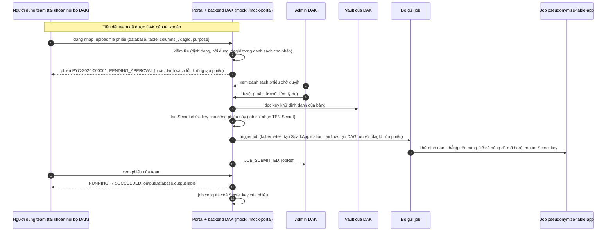
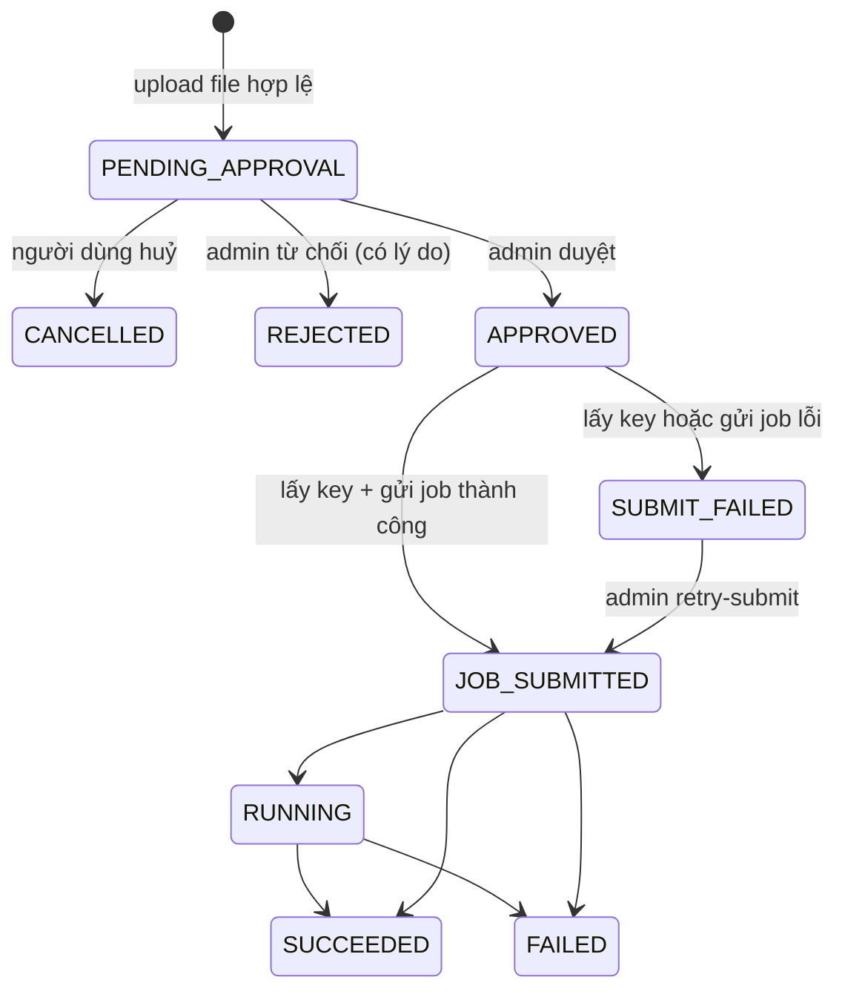

# Flow phiếu khử định danh (PYC) trên DAK (làm trên `dak-mock` trước)

Ngày: 2026-10-23 (sửa lần 6: chốt O1). Trạng thái: **plan đã duyệt, chưa code.** Chỉ còn phải điền giá trị cấu hình Airflow (`token-url`, `client_id`, scope, `base-url`) trước khi chạy thật bước D8.

Mục tiêu: team có nhu cầu được DAK cấp **tài khoản nội bộ**, đăng nhập portal DAK và **upload phiếu yêu cầu khử định danh (PYC)**; admin DAK duyệt;
DAK backend lấy key khử định danh **theo bảng** từ Vault của DAK rồi trigger job khử định danh ([`pseudonymize-table-app`](../../pseudonymize-table-app/README.md)).
Bảng có thể đã được mã hoá theo cột (luồng nội bộ `GET /api/v1/keys/by-column?tag=internal`); job **chạy thẳng trên bảng như nó đang có**, không giải mã.
Làm trên `dak-mock` trước để kiểm chứng luồng, sau đó dùng tài liệu này hướng dẫn team DAK làm bản thật.

> **Về tên "PYC":** trong [docs/key-access/](../key-access/) "PYC" gắn với phiếu cấp quyền key theo bảng của DAK. Ở thư mục này **PYC = phiếu yêu cầu khử định danh**
> (theo bạn thống nhất). Khi đọc chéo hai thư mục, nhớ đây là hai loại phiếu khác nhau dù cùng tên gọi.

| Tài liệu                                                       | Dành cho ai / khi nào đọc                                                                                         |
| -------------------------------------------------------------- | ----------------------------------------------------------------------------------------------------------------- |
| README này                                                     | **Đọc đầu tiên.** Luồng, phạm vi, các quyết định đã chốt và việc còn mở                                           |
| [`API_CONTRACT.md`](./API_CONTRACT.md)                         | Hợp đồng nghiệp vụ: nội dung phiếu, quy tắc kiểm file upload, duyệt, giao key, gửi job. **Đây là phần đưa team DAK** |
| [`MOCK_IMPLEMENTATION_PLAN.md`](./MOCK_IMPLEMENTATION_PLAN.md) | Thiết kế trong `dak-mock`: portal giả, tài khoản giả, lớp mới, RBAC k8s, các bước TDD, kịch bản chạy thử          |

## 1. Luồng

Không có bước "tạo nháp" và "submit" riêng: **upload một file hợp lệ là gửi phiếu**. Muốn sửa nội dung thì huỷ phiếu đang chờ duyệt rồi upload file mới.
Phiếu thuộc **team**, không thuộc từng người: mọi người trong team thấy và huỷ được phiếu của team mình.

## 2. Máy trạng thái của phiếu

Trạng thái cuối: `REJECTED`, `CANCELLED`, `SUCCEEDED`, `FAILED`. Phiếu ở trạng thái cuối **không đổi nữa**; muốn làm lại thì upload phiếu mới.
Khác với `YC` `REJECTED` của `by-column` (dính theo cột), phiếu bị từ chối **không** chặn phiếu mới, vì lý do từ chối có thể nằm ở cột, mode
hay mục đích của riêng phiếu đó.

`SUBMIT_FAILED` tách riêng khỏi `FAILED` vì hai lỗi khác nhau: **việc duyệt đã xong nhưng job chưa chạy** (admin retry được) và job chạy rồi mà lỗi
(cần xem log job, upload phiếu mới). Các nguyên nhân `SUBMIT_FAILED`: bảng **chưa có key** trong Vault (tạo key rồi `retry-submit`), key sai định dạng, Vault/Kubernetes/Airflow không phản hồi,
`dagId` không tồn tại trên Airflow.

## 3. Phạm vi

| Có (trong mock)                                                                                       | Không (để team DAK thật làm)                                                      |
| ----------------------------------------------------------------------------------------------------- | --------------------------------------------------------------------------------- |
| **Portal giả** `/mock-portal/**`: upload file phiếu, xem phiếu của team mình, huỷ phiếu chờ duyệt      | Giao diện portal thật, đăng nhập/đăng xuất, cấp và quản lý tài khoản              |
| **Tài khoản giả**: danh sách `username → team` + token cấu hình trong Secret                           | Quy trình cấp tài khoản, đổi/khoá mật khẩu, SSO                                   |
| API admin (dưới `/mock-admin/**`, token riêng): liệt kê, duyệt, từ chối, gửi lại job                   | Giao diện duyệt phiếu, phân quyền admin theo vai trò, lưu vết người duyệt thật     |
| Kiểm file upload (định dạng, nội dung, `dagId` trong danh sách cho phép, giới hạn, trùng)              | Cơ sở dữ liệu và kho lưu **file gốc đã upload**: mock chỉ giữ nội dung đã parse + SHA-256 của file |
| Lúc duyệt: đọc key bảng từ Vault, tạo Secret key cho phiếu, xoá Secret khi job xong                    | Xoay key, lưu vết dùng key, HSM/KMS                                               |
| Gửi job bằng 3 cách chọn qua cấu hình: `noop` (chỉ log manifest), `kubernetes`, `airflow`              | Tự thử lại job lỗi, hàng đợi, giới hạn đồng thời job                              |
| Theo dõi trạng thái job khi có người xem phiếu (không có tiến trình nền)                              | Thông báo (mail/chat) cho admin và team, hết hạn phiếu tự động                    |
| Audit từng bước chuyển trạng thái                                                                      | Phiếu cho nguồn là file/thư mục (`INPUT_PATH`); mock chỉ làm nguồn là bảng        |

Vì người dùng thật dùng giao diện, **mock không có Keycloak cho luồng phiếu**: portal giả chỉ cần tài khoản giả để biết phiếu thuộc team nào.
Keycloak trong mock vẫn phục vụ `by-column` như cũ và lấy token gọi Airflow (khi `submitter=airflow`).
Luồng phiếu **không đụng tới key cột**; nó chỉ đọc **key theo bảng** ở bước duyệt.

## 4. Quyết định đã chốt

| #   | Câu hỏi                                         | Quyết định                                                                                                                                                                                                                                                                  |
| --- | ----------------------------------------------- | --------------------------------------------------------------------------------------------------------------------------------------------------------------------------------------------------------------------------------------------------------------------------- |
| Q1  | Job đọc bảng đã mã hoá thì giải mã thế nào?     | **Không giải mã.** Job áp dụng thẳng khử định danh trên bảng như hiện có, không cần biết cột đã mã hoá hay chưa                                                                                                                                                              |
| Q2  | Định dạng file phiếu                            | **JSON** (giả định; người dùng thật điền trên giao diện DAK). Hợp đồng chỉ ràng buộc các trường logic                                                                                                                                                                         |
| Q3  | Tài khoản ↔ team                                | Mỗi tài khoản thuộc đúng một team; **phiếu thuộc team, không theo user**. Mock giữ `username` chỉ để ghi audit                                                                                                                                                                |
| Q4  | Có cần grant của team trên cột không?           | **Không**. Kiểm soát bằng bước admin duyệt                                                                                                                                                                                                                                    |
| Q5  | Mode giả danh                                   | Mặc định **chỉ `HASH`**. `ENCRYPT`/`MAPPING` **chưa hỗ trợ** ở bản đầu (xem O2)                                                                                                                                                                                                |
| Q6  | Tên bảng đích                                   | **DAK quyết**, truyền vào job như một **tham số khi trigger** (`conf` của DAG run, hoặc env của SparkApplication). Người dùng không đặt                                                                                                                                       |
| Q7  | Phiếu có buộc cột đã có key không?              | **Không.** Khử định danh dùng key **theo bảng**, không theo cột. Phiếu **không kiểm key cột**; bỏ cờ `require-column-key` và lỗi `column_not_encrypted`                                                                                                                       |
| Q8  | Gửi job: kubectl hay API?                       | **Gọi Kubernetes API** từ trong pod (POST tạo `SparkApplication` bằng ServiceAccount riêng), không dùng `kubectl`                                                                                                                                                             |
| Q9  | Airflow xác thực thế nào?                       | Webserver Airflow tích hợp Keycloak. **Dùng `client_id`/`client_secret` (client_credentials)** vì đây là luồng tự động; không dùng tài khoản người                                                                                                                              |
| Q10 | Phiếu mất khi mock restart                      | **Chấp nhận** cho mock. Truy ngược bằng nhãn `dak.vai/request-code`                                                                                                                                                                                                           |
| Q11 | Airflow REST API có chấp nhận token Keycloak?   | **Có** (đã xác nhận): gọi với `Authorization: Bearer <access token Keycloak>`                                                                                                                                                                                                 |
| Q12 | `dag_id` ai chọn?                               | **Người dùng chọn** `dagId` trong phiếu. Để người dùng không chạy được DAG tuỳ ý (DAG nhận Secret chứa key), **`dagId` phải nằm trong danh sách cho phép** `allowed-dag-ids` do DAK cấu hình; admin cũng thấy `dagId` khi duyệt. Xem O3                                          |
| Q13 | Key khử định danh lấy thế nào?                  | **DAK backend đọc key theo bảng từ Vault của DAK rồi trigger job.** Key không nằm trong phiếu, không nằm trong `conf`/env/log: backend tạo **Secret riêng cho phiếu** và chỉ truyền **tên Secret** cho job. Xem O2                                                              |
| Q14 | Tên phiếu                                       | **PYC** (mã `PYC-<năm>-<6 số>`)                                                                                                                                                                                                                                               |
| Q15 | Cách giao key cho job (O2)                      | **Đã duyệt:** Secret riêng cho phiếu `deid-key-<mã>`, file `pseudonym.hmac_v1`, job chỉ nhận **tên Secret**; key bảng trong Vault phải là 32 byte base64; chỉ `HASH`. Key sai định dạng hoặc thiếu thì phiếu `SUBMIT_FAILED`, không bị từ chối |
| Q16 | Danh sách `dagId` cho phép (O3)                 | **Đã duyệt:** `allowed-dag-ids` là điều kiện bắt buộc khi dùng Airflow; kiểm lúc upload và kiểm lại lúc trigger                                                                                                                              |
| Q17 | Namespace của job và Secret key (O4)            | **Giữ namespace hiện tại** `vlp-tenantw1xjixm-wsw7vtwvi-teamtscauiy` (không tách namespace riêng). Mock cần `secrets` `create`+`delete`; **chấp nhận rủi ro** xoá nhầm Secret khác nếu pod bị chiếm, giảm bằng cách code chỉ xoá `deid-key-…` và NetworkPolicy |
| Q18 | Phiên bản Airflow và REST API (O1)            | **Airflow 2.8, REST `/api/v1`** (`POST /api/v1/dags/{dagId}/dagRuns`, `GET /api/v1/dags/{dagId}/dagRuns/{dag_run_id}`). Không cần hỗ trợ `/api/v2`. `token-url`, `client_id`, scope do vận hành truyền vào cấu hình sau |

**Hệ quả của Q1, ghi nhận để team DAK biết (không chặn mock):** nếu cột đã mã hoá theo cách **không tất định** (vd key sinh theo từng dòng), thì `HASH` trên ciphertext
cho các định danh giả **khác nhau** với cùng một giá trị gốc, nên không còn liên kết được bản ghi của cùng một chủ thể. Bên dùng dữ liệu đầu ra nên biết trước điều này.

## 5. Việc còn mở

| #  | Việc                                                                                                                                                                                                              | Ảnh hưởng          |
| -- | ----------------------------------------------------------------------------------------------------------------------------------------------------------------------------------------------------------------- | ------------------ |
| O1 | **Giá trị cấu hình Airflow cần điền** (không phải quyết định thiết kế): `token-url` của realm, `client_id`, scope (người vận hành sẽ truyền sau) và `base-url` của webserver (chưa có giá trị; mặc định trong plan chỉ là giả định) | Chỉ khi chạy thật D8/D11 |

Đã đóng: **O1 phần thiết kế** (Airflow **2.8**, dùng REST **`/api/v1`**, Q18), **O2** (cách giao key, Q15), **O3** (allowlist `dagId`, Q16), **O4** (namespace hiện tại, Q17). Chi tiết và rủi ro còn lại của chúng nằm ở
[plan mock](./MOCK_IMPLEMENTATION_PLAN.md) mục 4.6b, 4.7, 4.8 và 8.

Hai việc **cần kiểm trước khi chạy thật** (không chặn mock): (a) key bảng hiện có trong Vault có đúng **32 byte base64** không (nếu không, phiếu `SUBMIT_FAILED`); (b) pod `dak-mock` bị chiếm sẽ xoá được Secret bất kỳ trong namespace job (Q17).

## 6. Thứ tự làm

1. Bắt đầu D1 ngay (không còn quyết định nào chặn D1–D7, D9, D10); giá trị Airflow (O1) chỉ cần khi chạy thật D8.
2. Làm theo [`MOCK_IMPLEMENTATION_PLAN.md`](./MOCK_IMPLEMENTATION_PLAN.md) mục 5 (TDD, `noop` trước rồi mới tới `kubernetes`/`airflow`).
3. Chạy thử đầu-cuối trên cluster (mục 7 của plan mock).
4. Đưa [`API_CONTRACT.md`](./API_CONTRACT.md) cho team DAK, kèm kết quả thử của mock và các việc còn mở ở mục 5.
