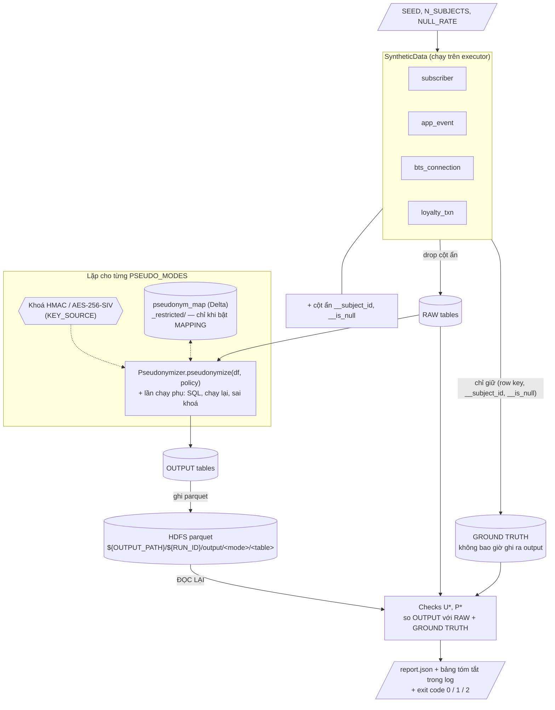
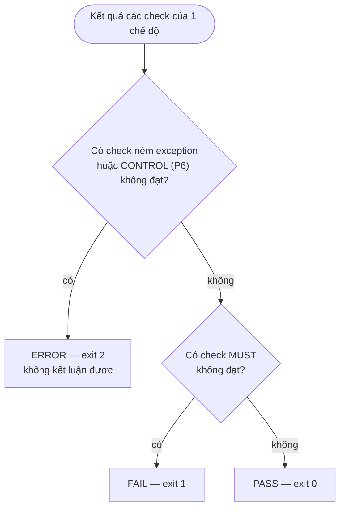

# Plan: Spark app sinh dữ liệu + kiểm chứng giả danh hoá — `pseudonym-verify-app`

App Spark tự sinh dữ liệu viễn thông tổng hợp (có "đáp án" — biết chính xác dòng nào thuộc chủ thể
nào), áp thư viện [`pseudonym-udf`](../PSEUDONYMIZATION_UDF_PLAN.md) lên dữ liệu đó theo các chế
độ của tài liệu nguồn — băm có salt `HASH`, mã hoá `ENCRYPT` (mặc định), bảng ánh xạ `MAPPING`
(**mặc định tắt**, bật qua `PSEUDO_MODES`) — rồi chạy một
bộ kiểm tra đo được để trả lời **có/không**: _đã khử định danh thành công chưa_. Kết quả là verdict
(`PASS`/`FAIL`/`ERROR`) cho từng chế độ, 1 file `report.json` và exit code, nên dùng được làm cổng
chặn trong CI/Airflow.

Cùng phong cách với `hdfs-load-stress-test`: sinh dữ liệu ngay trên executor từ `spark.range`, tất
định theo `SEED`, cấu hình qua biến môi trường của driver.

---

## 1. "Khử định danh thành công" nghĩa là gì

Bám theo mục 2.3 của tài liệu nguồn, giả danh hoá **thành công** khi **đồng thời** thoả 3 điều kiện.
Mỗi điều kiện được đo bằng các check ở mục 5, có ngưỡng cố định, không dựa vào cảm nhận:

| #   | Điều kiện                                                                       | Căn cứ trong tài liệu                                                    | Diễn giải đo lường                                                                                                                         | Nhóm check |
| --- | ------------------------------------------------------------------------------- | ------------------------------------------------------------------------ | ------------------------------------------------------------------------------------------------------------------------------------------ | ---------- |
| C1  | **Trường định danh đã được thay** bằng định danh giả                            | a) "Thay thế các trường định danh … bằng một giá trị định danh giả"      | Không còn số thuê bao, IMEI, mã KH gốc ở bất kỳ cột nào của output, dạng nguyên vẹn hay lẫn trong text.                                     | P1–P3      |
| C2  | **Không suy ngược được nếu không có salt / khoá / bảng ánh xạ**                 | chú thích ¹ "tránh việc dữ liệu bị suy ngược"; c) an toàn phụ thuộc vào bảo vệ salt/khoá/bảng ánh xạ | Băm lại toàn bộ không gian định danh bằng mọi cách không cần khoá → khớp 0. Có khoá/bảng ánh xạ → khớp 100% (đối chứng). Khoá không lọt ra ngoài. | P4–P7      |
| C3  | **Liên kết được các bản ghi của cùng một chủ thể** — phân tích dọc vẫn đúng     | b) "Cho phép liên kết các bản ghi của cùng một chủ thể …"; d) 3 ví dụ Viettel | 1 chủ thể ↔ đúng 1 định danh giả; join, hành trình MyViettel, mẫu di chuyển BTS, lịch sử điểm Viettel++ cho kết quả **bằng hệt** dữ liệu gốc; luồng ưu đãi Viettel++ tìm đúng khách hàng. | U1–U12     |

Và: **bộ kiểm tra phải tự chứng minh nó bắt được lỗi** (mục 6 — mutation self-test). Một bộ check
luôn báo xanh thì vô nghĩa.

## 2. Luồng xử lý



Check chạy trên dữ liệu **đọc lại từ HDFS**, không phải DataFrame trong bộ nhớ — kiểm đúng cái thực
sự nằm trên Data Lake.

## 3. Sinh dữ liệu — `SyntheticData`

### 3.1. Định danh gốc của chủ thể `s ∈ [0, N_SUBJECTS)`

Mọi định danh sinh từ `s` bằng **hoán vị song ánh** (affine mod 10ᵏ với hệ số nguyên tố cùng nhau
với 10) → mỗi chủ thể có định danh **duy nhất**, không cần shuffle/distinct, và ground truth là chính `s`.
Mỗi loại định danh có **1 định dạng duy nhất** (lib xử lý giá trị nguyên trạng).

| Trường             | Công thức (minh hoạ)                                            | Ví dụ             |
| ------------------ | --------------------------------------------------------------- | ----------------- |
| `isdn`             | `"849" + lpad((48271·s + 12345) mod 10⁸, 8)`                     | `84903217465`     |
| `imei`             | `"35" + lpad((a·s + b) mod 10¹³, 13)` (15 số)                    | `352099001761481` |
| `customer_id`      | `"KH" + lpad(s, 10)`                                            | `KH0000123456`    |
| `province`, `plan` | phân phối theo `hash(s, seed)`                                  |                   |

### 3.2. Các bảng — theo 3 ví dụ trong tài liệu nguồn

| Bảng             | Số dòng                       | Cột                                                                              | Ví dụ trong tài liệu                     |
| ---------------- | ----------------------------- | -------------------------------------------------------------------------------- | ---------------------------------------- |
| `subscriber`     | `N`                           | `record_id, customer_id, isdn, imei, province, plan`                             | (bảng nối 3 loại định danh)              |
| `app_event`      | `N × APP_EVENTS_PER_SUBJECT`  | `event_id, isdn, event_type (login/check_balance/buy_data/…), event_ts`          | Phân tích hành trình khách hàng MyViettel |
| `bts_connection` | `N × BTS_CONN_PER_SUBJECT`    | `conn_id, imei, cell_id, connect_ts, duration_s`                                 | Nghiên cứu hiệu quả trạm BTS              |
| `loyalty_txn`    | `N × LOYALTY_TXN_PER_SUBJECT` | `txn_id, customer_id, txn_type (earn/redeem), points, txn_ts`                    | Chương trình Viettel++                   |

- Dòng sự kiện thuộc chủ thể `s = pmod(xxhash64(id, SEED), N)` → có người nhiều sự kiện, có người ít.
- `record_id`/`event_id`/`conn_id`/`txn_id`: khoá dòng tổng hợp, **không** gắn với người — dùng để
  ghép output với ground truth.
- `bts_connection`: mỗi thiết bị đi qua một tập cell theo thời gian (sinh theo `hash(imei, ngày)`) để
  có "mẫu di chuyển" thật sự mà U7 đo lại được.
- Bẫy duy nhất cài vào dữ liệu thô: thay `NULL_RATE` giá trị định danh bằng `null` (kiểm U2).

### 3.3. Ground truth

Bộ sinh trả về DataFrame có thêm `__subject_id` và `__is_null` cho mỗi cột định danh. App tách thành:

- `raw = df.drop("__subject_id", "__is_null_*")` — thứ đưa vào lib (lib **không thấy** đáp án).
- `truth = df.select(rowKey, "__subject_id", "__is_null_*")` — chỉ dùng trong check, persist trong bộ
  nhớ, không ghi ra output.

## 4. Policy, chế độ và khoá cho lần chạy

`src/main/resources/demo-policy.yaml` — đúng policy mẫu ở mục 4.2 plan lib:

| Bảng.cột                                            | Xử lý                                        |
| --------------------------------------------------- | -------------------------------------------- |
| `subscriber.isdn`, `app_event.isdn`                 | giả danh, giữ tên cột                        |
| `subscriber.imei`, `bts_connection.imei`            | giả danh, giữ tên cột                        |
| `subscriber.customer_id`, `loyalty_txn.customer_id` | giả danh, **đổi tên thành `pseudonym_id`**   |
| các cột còn lại                                     | giữ nguyên                                   |

App chạy policy này **1 lần cho mỗi chế độ** trong `PSEUDO_MODES` (mặc định `HASH,ENCRYPT`),
thay `mode` của mọi cột; mỗi chế độ có output và verdict riêng.

`MAPPING` **mặc định tắt** vì là chế độ tốn nhất (MERGE Delta + join bảng ánh xạ) và cần
`delta-spark`. Bật bằng `PSEUDO_MODES=HASH,ENCRYPT,MAPPING`. Khi tắt: không tạo bảng ánh xạ, các
check/mutation dành riêng cho `MAPPING` không chạy, report không có mục `MAPPING`.

**Khoá** — `KEY_SOURCE`:

- `ephemeral` (mặc định): sinh bằng `SecureRandom` (32 byte HMAC, 64 byte AES-256-SIV) ngay trong
  driver, bọc vào `PrefixSource` trong bộ nhớ, **không ghi đi đâu**. Chạy được ở local, không cần Vault.
- `vault` / `file`: đi đúng đường production (`key-prefix-lib`) — kiểm cả phần đấu nối khoá trên
  cluster. P6 (đối chứng) khi đó cần đọc khoá → chỉ chạy được nếu SA có quyền đọc khoá.

**Bảng ánh xạ** (chỉ khi bật `MAPPING`): `${OUTPUT_PATH}/${RUN_ID}/_restricted/pseudonym_map` — **ngoài** thư mục
`output/`, đúng yêu cầu "lưu trữ riêng biệt" của mục c.

## 5. Bộ check — định nghĩa đo lường

Ký hiệu: với mỗi cột giả danh `c` của bảng `T`, `J = OUT(T) ⋈ TRUTH(T)` theo khoá dòng →
`(pseudo, subject_id, is_null)`. Gộp `J` của mọi cột **cùng loại định danh** (vd `isdn` của
`subscriber` và `app_event`) thành `J_id`.

Mức độ: **MUST** (vi phạm → `FAIL`), **CONTROL** (đối chứng, vi phạm → `ERROR`), **INFO** (chỉ báo cáo).

### 5.1. Nhóm U — liên kết được, phân tích dọc vẫn đúng (C3)

| ID  | Kiểm tra                                    | Cách tính                                                                                                                                                                         | Ngưỡng PASS    | Mức  |
| --- | ------------------------------------------- | --------------------------------------------------------------------------------------------------------------------------------------------------------------------------------- | -------------- | ---- |
| U1  | Không mất/thừa dòng                         | `count(OUT(T)) == count(RAW(T))` cho mọi bảng                                                                                                                                     | chênh = 0      | MUST |
| U2  | `null` vào → `null` ra                      | số dòng mà `is_null XOR (pseudo IS NULL)`                                                                                                                                         | = 0            | MUST |
| U3  | Đúng định dạng theo chế độ                  | số giá trị non-null không khớp: `HASH` `^k\d+_[0-9a-f]{32}$`, `ENCRYPT` `^e\d+_[A-Za-z0-9_-]+$`, `MAPPING` `^t_[0-9a-f]{32}$`                                                     | = 0            | MUST |
| U4  | **1 chủ thể → 1 định danh giả**             | trên `J_id` (bỏ dòng null): số `subject_id` có `countDistinct(pseudo) > 1` — **xuyên bảng**                                                                                       | = 0            | MUST |
| U5  | **1 định danh giả → 1 chủ thể**             | trên `J_id`: số `pseudo` có `countDistinct(subject_id) > 1`                                                                                                                       | = 0            | MUST |
| U6  | Join giữa các bảng giữ nguyên               | `count(app_event ⋈ subscriber ON isdn)`, `count(bts_connection ⋈ subscriber ON imei)`, `count(loyalty_txn ⋈ subscriber ON pseudonym_id)` trên OUT == trên TRUTH (`ON subject_id`) | chênh = 0      | MUST |
| U7  | **Chỉ số của 3 ví dụ trong tài liệu** giữ nguyên | Tính trên OUT (theo định danh giả) và trên TRUTH (theo subject), so dạng multiset — xem bảng dưới                                                                           | bằng tuyệt đối | MUST |
| U8  | Ổn định giữa các lần chạy                   | Chạy lại lib trên RAW với **số partition khác** + UDF instance mới (`MAPPING`: dùng lại bảng ánh xạ đã có) → `OUT₁ EXCEPT OUT₂` và ngược lại                                        | = ∅            | MUST |
| U9  | DataFrame API ≡ SQL                         | `HASH`: `pseudo_hash`; `ENCRYPT`: `pseudo_encrypt`; `MAPPING`: `JOIN pseudonym_map` — cùng RAW, 2 đường → symmetric difference                                                    | = ∅            | MUST |
| U10 | Không trộn thế hệ khoá                      | `HASH`/`ENCRYPT`: số tiền tố `k<N>_`/`e<N>_` khác nhau trong 1 cột                                                                                                                | = 1            | MUST |
| U11 | Hiệu năng                                   | rows/s của bước giả danh từng chế độ, so với baseline `sha2` built-in trên cùng dữ liệu                                                                                           | —              | INFO |
| U12 | **Luồng ưu đãi Viettel++**                  | Lấy ngẫu nhiên `OFFER_SAMPLE` `pseudonym_id` từ `loyalty_txn` OUT → `Reidentifier` (mục 6 plan lib) → so `customer_id` trả về với TRUTH                                            | đúng 100%      | MUST |

Chỉ số của U7, mỗi ví dụ trong mục d tài liệu nguồn 1 nhóm:

| Ví dụ trong tài liệu                       | Chỉ số so sánh                                                                                                                                  |
| ------------------------------------------ | ----------------------------------------------------------------------------------------------------------------------------------------------- |
| Hành trình khách hàng MyViettel            | Chuỗi `event_type` theo `event_ts` của từng người; số event/người; số người đi hết phễu `login → check_balance → buy_data` theo đúng thứ tự thời gian |
| Hiệu quả trạm BTS (mẫu di chuyển, thời gian kết nối) | Chuỗi `cell_id` theo `connect_ts` của từng thiết bị; số cell khác nhau/thiết bị; tổng `duration_s`/thiết bị; số thiết bị khác nhau/cell |
| Viettel++ (lịch sử tích điểm và đổi quà)   | Tổng điểm `earn`/`redeem` theo người; chuỗi giao dịch theo `txn_ts` của từng người                                                               |

> U4 + U5 cùng PASS ⇔ ánh xạ chủ thể ↔ định danh giả là **song ánh** — đây là định nghĩa chính xác
> của "liên kết các bản ghi của cùng một chủ thể mà không cần biết danh tính thật" (mục b). U6/U7/U12
> là hệ quả kiểm ở mức nghiệp vụ, bám đúng 3 ví dụ trong tài liệu.

### 5.2. Nhóm P — đã thay định danh, không suy ngược được (C1, C2)

| ID  | Kiểm tra                                  | Cách tính                                                                                                                                                                                                                                                                                               | Ngưỡng PASS       | Mức     |
| --- | ----------------------------------------- | ------------------------------------------------------------------------------------------------------------------------------------------------------------------------------------------------------------------------------------------------------------------------------------------------------- | ----------------- | ------- |
| P1  | Schema đầu ra đúng policy                 | Cột giả danh có mặt với đúng tên `output` (vd `pseudonym_id`), kiểu `string`; cột gốc bị đổi tên (`customer_id`) **không còn**; các cột khác giữ nguyên                                                                                                                                                 | khớp tuyệt đối    | MUST    |
| P2  | Không sót giá trị định danh nguyên vẹn    | Từ điển `D` = mọi `isdn`, `imei`, `customer_id` của mọi chủ thể. `O` = mọi giá trị của **mọi cột** OUT (cast string, `stack` thành 1 cột). Đếm `O ⋉ D`                                                                                                                                                 | = 0               | MUST    |
| P3  | Không sót định danh lẫn trong text        | Regex **tìm chuỗi con** trên mọi cột `string` **không phải cột giả danh**: SĐT VN `(?<![0-9A-Za-z])(?:\+?84\|0)[35789]\d{8}(?![0-9A-Za-z])`, IMEI `\d{15}`, mã KH `KH\d{10}` (cùng ràng biên không phải chữ/số)                                                                                       | = 0 lần khớp      | MUST    |
| P4  | **Suy ngược không cần khoá**              | Giả lập kẻ tấn công **liệt kê toàn bộ không gian định danh** (ở đây: mọi giá trị trong `D`). Với mỗi `v` tính: `md5`, `sha1`, `sha256`, `sha512` (hex đầy đủ và cắt 32 ký tự, base64), HMAC-SHA256 với khoá đoán (`""`, `"secret"`, `"salt"`, `"changeit"`), `sha256("salt"‖v)`. Bỏ tiền tố của OUT rồi đếm giao | = 0               | MUST    |
| P5  | Sai khoá / bảng ánh xạ khác → không khớp  | `HASH`: chạy lại với khoá ngẫu nhiên mới → giao với OUT = ∅. `ENCRYPT`: giải mã OUT bằng khoá sai → 100% lỗi xác thực. `MAPPING`: dựng bảng ánh xạ mới độc lập trên cùng RAW → giao token = ∅                                                                                                         | như mô tả         | MUST    |
| P6  | **Đối chứng**: có khoá / bảng ánh xạ → suy ngược được hết | `HASH`: tính lại HMAC trên `D` bằng khoá thật → tỉ lệ định danh giả trong OUT được khớp. `ENCRYPT`: giải mã OUT → so với RAW. `MAPPING`: tra bảng ánh xạ → so với RAW                                                                                                         | = 100%            | CONTROL |
| P7  | Khoá / bảng ánh xạ được giữ riêng         | `HASH`/`ENCRYPT`: khoá (base64 và hex) **không xuất hiện** trong dữ liệu OUT, `queryExecution.toString` + `EXPLAIN EXTENDED/FORMATTED` của mọi DataFrame/SQL đã chạy, `DESCRIBE FUNCTION EXTENDED`, `spark.conf.getAll`, message của exception cố ý kích hoạt (khoá hỏng), file log của app. `MAPPING`: đường dẫn bảng ánh xạ **không nằm dưới** thư mục `output/` | = 0 lần xuất hiện | MUST    |

Lý do của từng thiết kế:

- **P3 chỉ quét cột không phải cột giả danh.** Định danh giả hex 32 ký tự ngẫu nhiên có thể tình cờ
  chứa ≥ 15 chữ số liền nhau → quét regex trên cột giả danh sẽ báo nhầm. Cột giả danh đã được U3 (khớp
  định dạng **toàn bộ**) và P2 (khớp chính xác) bao phủ.
- **P4 là phép thử "salt/khoá có thật sự bí mật không"** (mục c). Nếu ai đó đổi lib sang `sha2(isdn)`
  (đúng gợi ý SQL ở mục d), mọi check U vẫn xanh (sha2 cũng tất định, cũng song ánh) — **chỉ P4 bắt
  được**. Không gian SĐT nhỏ nên giả lập "liệt kê toàn bộ" là sát thực tế.
- **P6 không phải là lỗi bảo mật mà là đối chứng.** Nếu P6 < 100% thì hoặc lib không tất định, hoặc
  bộ check P4/P5 đang so sai (vd quên bỏ tiền tố) — khi đó P4 = 0 không còn ý nghĩa. P6 fail →
  verdict `ERROR` (không phải `FAIL`): _không kết luận được_. P6 đồng thời minh hoạ đúng mục c: an
  toàn phụ thuộc **hoàn toàn** vào khoá/bảng ánh xạ.
- Event log của Spark (nếu bật `spark.eventLog.enabled`) nằm ngoài tầm của app lúc đang chạy — quét
  khoá trong event log là 1 bước của script CI sau khi job kết thúc.

### 5.3. Quy tắc ra verdict

Áp cho từng chế độ; verdict chung của lần chạy = verdict xấu nhất (`ERROR` > `FAIL` > `PASS`).



## 6. Kiểm chứng chính bộ check — mutation self-test (`RUN_MODE=selftest`)

Chạy pipeline với các bản giả danh **cố ý sai** (thay hàm giả danh qua 1 tham số strategy của
`Pipeline`). Bộ check chỉ được tin dùng khi **mọi** mutation bị bắt (verdict ≠ `PASS` và các check
kỳ vọng nằm trong danh sách fail):

| Mutation | Chế độ    | Cài sai                                                                    | Phải bị bắt bởi    |
| -------- | --------- | -------------------------------------------------------------------------- | ------------------ |
| M1       | `HASH`    | Không làm gì (trả nguyên giá trị)                                           | U3, P2             |
| M2       | `HASH`    | `sha2(value, 256)` không khoá, giữ đúng định dạng `k1_` + 32 hex             | **P4** (U luôn xanh) |
| M3       | `HASH`    | Định danh giả ngẫu nhiên (UUID) mỗi dòng                                    | U4, U6, U8         |
| M4       | `HASH`    | Chỉ dùng 2 byte HMAC (lặp lại cho đủ 32 hex — đúng định dạng)               | U5                 |
| M5       | `HASH`    | Đưa khoá vào Spark conf / log 1 dòng chứa khoá                              | P7                 |
| M6       | `HASH`    | Khoá sinh lại mỗi lần chạy                                                  | U8                 |
| M7       | `HASH`    | Thêm `pseudonym_id` nhưng **quên xoá** cột `customer_id` gốc                | P1, P2             |
| M8       | `ENCRYPT` | AES-GCM với IV ngẫu nhiên (như `aes_encrypt` mặc định của Spark)            | U4, U6             |
| M9       | `MAPPING` | Không ghi bảng ánh xạ — token sinh lại mỗi lần chạy                         | U8                 |
| M10      | `MAPPING` | Token = `sha256(raw_value)` thay vì ngẫu nhiên                              | P4                 |

Chỉ chạy mutation của các chế độ có trong `PSEUDO_MODES`: mặc định M1–M8 (8 mutation); bật
`MAPPING` thì thêm M9–M10 (10 mutation).

Output: bảng `mutation → verdict → các check fail → caught?`. Self-test PASS ⇔ mọi mutation đã chạy
đều bị bắt.

## 7. Chế độ chạy

| `RUN_MODE` | Dữ liệu       | Dùng khi                                                                                                            |
| ---------- | ------------- | ------------------------------------------------------------------------------------------------------------------- |
| `full`     | tổng hợp      | Nghiệm thu lib, CI mỗi lần đổi lib: chạy toàn bộ U/P cho mọi chế độ trong `PSEUDO_MODES`.                           |
| `selftest` | tổng hợp, nhỏ | CI mỗi lần đổi **bộ check**: chạy các mutation (mục 6).                                                              |
| `guard`    | **thật**      | Nhúng vào job giả danh production làm cổng chặn **trước khi ghi**. Không có ground truth nên chạy tập con dưới đây. |

Check ở `guard` (không cần đáp án):

| Check                       | Cách làm trên dữ liệu thật                                                                                                                                                                                                       |
| --------------------------- | -------------------------------------------------------------------------------------------------------------------------------------------------------------------------------------------------------------------------------- |
| U1, U2, U3, U10, P1, P3, P7 | Như trên — không cần ground truth.                                                                                                                                                                                               |
| U4+U5 (thay thế)            | Giả danh lại tập giá trị gốc khác nhau của cột thành cặp `(raw, pseudo)`: `a` = số giá trị gốc, `b` = số định danh giả, `c` = số cặp, `d` = số định danh giả khác nhau trong output thật. **`a == b == c == d` ⇔ song ánh và nhất quán với output** (bắt được va chạm và không tất định). |
| P2                          | `D` = giá trị định danh lấy từ chính cột gốc (sample theo `IDENTIFIER_SAMPLE_FRACTION`) — job đã có quyền đọc dữ liệu gốc.                                                                                                       |

Không chạy ở `guard`: P4–P6, U12 (cần khoá trong tay check, và cần đáp án) — đã được nghiệm thu ở `full`.

## 8. Báo cáo

`${OUTPUT_PATH}/${RUN_ID}/report.json`:

```json
{
  "runId": "pv-20261013-01",
  "runMode": "full",
  "verdict": "PASS",
  "config": { "seed": "s1", "nSubjects": 1000000, "nullRate": 0.01, "keySource": "ephemeral" },
  "rows": { "subscriber": 1000000, "app_event": 20000000, "bts_connection": 10000000, "loyalty_txn": 3000000 },
  "modes": {
    "HASH": {
      "verdict": "PASS",
      "checks": [
        { "id": "U4", "level": "MUST", "status": "PASS",
          "metric": "subjects_with_multiple_pseudonyms", "observed": 0, "threshold": "== 0", "samples": [] },
        { "id": "P4", "level": "MUST", "status": "PASS",
          "metric": "unkeyed_dictionary_matches", "observed": 0, "threshold": "== 0",
          "detail": { "dictionarySize": 3000000, "candidateHashes": 60000000 } },
        { "id": "P6", "level": "CONTROL", "status": "PASS",
          "metric": "keyed_match_rate", "observed": 1.0, "threshold": "== 1.0" }
      ],
      "timings": { "pseudonymizeSec": 58, "checksSec": 190, "pseudonymizeRowsPerSec": 586000 }
    },
    "ENCRYPT": { "verdict": "PASS", "checks": [] }
  }
}
```

(Số liệu trong ví dụ là minh hoạ định dạng, không phải kết quả đo.)

- `samples` chỉ chứa **khoá dòng / subject_id** (tối đa 5), **không bao giờ** chứa giá trị định danh
  gốc hay khoá — report không được trở thành nơi rò rỉ.
- Log driver in bảng tóm tắt 1 dòng/check/chế độ (`MODE | ID | status | observed | threshold`).

## 9. Cấu hình (biến môi trường của driver)

| Biến                                                                          | Mặc định                     | Ý nghĩa                                                |
| ----------------------------------------------------------------------------- | ---------------------------- | ------------------------------------------------------ |
| `RUN_MODE`                                                                    | `full`                       | `full` / `selftest` / `guard`                          |
| `PSEUDO_MODES`                                                                | `HASH,ENCRYPT`               | các chế độ giả danh cần kiểm; thêm `MAPPING` để bật    |
| `RUN_ID`                                                                      | (bắt buộc)                   | `^[A-Za-z0-9_-]{1,64}$` — cùng quy tắc với stress test |
| `OUTPUT_PATH`                                                                 | (bắt buộc)                   | thư mục gốc HDFS                                       |
| `SEED`                                                                        | `s1`                         | dữ liệu tất định theo seed                             |
| `N_SUBJECTS`                                                                  | `1000000`                    | số chủ thể (≤ 10⁸ — giới hạn của hoán vị `isdn`)       |
| `APP_EVENTS_PER_SUBJECT` / `BTS_CONN_PER_SUBJECT` / `LOYALTY_TXN_PER_SUBJECT` | `20` / `10` / `3`            |                                                        |
| `PARTITIONS`                                                                  | `200`                        |                                                        |
| `NULL_RATE`                                                                   | `0.01`                       |                                                        |
| `OFFER_SAMPLE`                                                                | `10000`                      | số `pseudonym_id` dùng cho U12                         |
| `KEY_SOURCE`                                                                  | `ephemeral`                  | `ephemeral` / `file` / `vault` / `dak`                 |
| `MAPPING_TABLE_PATH`                                                          | `${OUTPUT_PATH}/${RUN_ID}/_restricted/pseudonym_map` | chỉ dùng khi bật `MAPPING`; phải nằm ngoài `output/` |
| `POLICY_PATH`                                                                 | `demo-policy.yaml`           | đọc từ đĩa, không có thì từ classpath (jar)            |
| `WRITE_OUTPUT`                                                                | `true`                       | `false` = chỉ kiểm trong bộ nhớ (bỏ qua bước đọc lại)  |
| `INPUT_TABLE` / `GUARD_TABLE` / `IDENTIFIER_SAMPLE_FRACTION`                  | — / — / `0.01`               | chỉ cho `guard` (parquet đầu vào, tên bảng trong policy) |

Validate toàn bộ lúc khởi động (fail-fast, message rõ), giống `StressConfig`.

## 10. Cấu trúc module

```
pseudonym-verify-app/
├── pom.xml                          # pseudonym-udf + key-prefix-lib "provided" (nạp qua spark.jars); shade Delta + patch block token
├── Dockerfile                       # build context = gốc repo; COPY fat jar + 2 jar lib
├── k8s/pseudonym-verify-full.yaml   # SparkApplication, RUN_MODE=full
├── k8s/pseudonym-verify-selftest.yaml
├── k8s/pseudonym-keys-secret.yaml   # mẫu Secret khoá cho KEY_SOURCE=file (chỉ chỗ trống)
└── src/
    ├── main/resources/{demo-policy.yaml, log4j2.properties}
    ├── main/scala/vai/lakehouse/pseudonymverify/
    │   ├── app/      PseudoVerifyApp (main mỏng: execute -> exit code), SparkSessions (Delta + patch + PseudonymExtension)
    │   ├── config/   VerifyConfig, RunMode
    │   ├── data/     SyntheticData (4 bảng + ground truth, mục 3), IdentityFormats (hoán vị isdn/imei/customer_id)
    │   ├── check/    Check (Check/CheckResult/VerifyContext), CheckSupport, LinkabilityChecks U1–U12,
    │   │             UseCaseMetrics (U7), PrivacyChecks P1–P7, AttackDictionary (P4)
    │   ├── job/      VerifyJob (trait) + FullJob / SelftestJob / GuardJob, VerifySession (dữ liệu dùng chung),
    │   │             Pipeline (Strategy: lib thật hoặc mutation), Mutations M1–M10
    │   ├── report/   Verdict, ReportWriter, Preview
    │   ├── key/      KeyMaterial (khoá ephemeral hoặc qua key-prefix-lib + dạng chuỗi cho P7)
    │   └── logging/  Log
    └── test/scala/vai/lakehouse/pseudonymverify/
        ├── config/VerifyConfigSpec, data/SyntheticDataSpec, report/VerdictSpec
        ├── app/PseudoVerifyAppSpec     # execute: cấu hình sai -> 2; full nhỏ -> 0
        └── job/EndToEndSpec            # full (3 chế độ) PASS, selftest 10/10, guard PASS
```

Đường FAIL của từng check không có spec riêng: nó được kiểm bằng chính mutation self-test. Mỗi mutation phải làm đúng
các check kỳ vọng FAIL (mục 6), và `EndToEndSpec` chạy cả 10 mutation.

## 11. Tài nguyên

| Quy mô            | `N_SUBJECTS` | Tổng dòng / chế độ | Gợi ý                                  |
| ----------------- | ------------ | ------------------ | -------------------------------------- |
| Local / smoke     | 10 000       | ~340 k             | `local[*]`, vài phút cho 2 chế độ mặc định|
| Selftest (CI)     | 50 000       | ~1.7 M             | 10 lần pipeline; driver 2g, 2 executor |
| Full (nghiệm thu) | 1 000 000    | ~34 M              | driver 4g, 4 executor × 4 core × 8g    |

P4 là bước nặng nhất (từ điển ~3 M giá trị × ~20 cách băm ≈ 60 M hash) — vẫn nhỏ với Spark; giao với
OUT bằng join theo cột hash.

## 12. Các bước triển khai

1. `IdentityFormats` + spec (song ánh) — TDD.
2. `SyntheticData` + ground truth + spec tất định.
3. `KeyMaterial`, `Pipeline` (gọi `Pseudonymizer.pseudonymize` của lib, lặp theo chế độ).
4. Khung `Check`/`CheckResult`/`Verdict`/`ReportWriter`.
5. Check U1–U12 + `UseCaseMetrics`, mỗi check kèm spec PASS/FAIL.
6. Check P1–P7 + `AttackDictionary`, kèm spec.
7. `Mutations` + `RUN_MODE=selftest` → mặc định phải đạt 8/8; với `MAPPING` bật phải đạt 10/10.
8. `RUN_MODE=full` local (N = 10k), chế độ mặc định → `PASS`; chạy thêm 1 lần có `MAPPING`.
9. Dockerfile + manifest; chạy `full` trên cluster với `KEY_SOURCE=ephemeral`, rồi `KEY_SOURCE=vault`.
10. `RUN_MODE=guard`: tách các check dùng được thành API gọi được từ job production.

## 13. Tiêu chí nghiệm thu toàn bộ

Lib `pseudonym-udf` được coi là **khử định danh thành công** và được phép dùng trên dữ liệu thật khi:

1. `RUN_MODE=selftest`: **mọi mutation đã chạy đều bị bắt** — 8/8 với mặc định (bộ check đáng tin).
2. `RUN_MODE=full`, `N_SUBJECTS=1 000 000`, `KEY_SOURCE=ephemeral`: với **mỗi** chế độ trong
   `PSEUDO_MODES` (mặc định `HASH`, `ENCRYPT`), mọi check **MUST = PASS** và P6 = 100% → verdict `PASS`.
3. Như (2) với `KEY_SOURCE=vault` trên cluster: cùng kết quả (đấu nối khoá production đúng).
4. 2 lần chạy `full` cùng `SEED` cho `report.json` giống nhau (trừ `timings`).
5. Job production bật `guard` và chặn ghi khi verdict `FAIL`/`ERROR`.
6. Chỉ khi định dùng `MAPPING` trên dữ liệu thật: lặp lại (1)–(3) với
   `PSEUDO_MODES=HASH,ENCRYPT,MAPPING` (selftest phải đạt 10/10). Token `MAPPING` khác nhau giữa 2 lần
   chạy độc lập là bình thường, mọi check vẫn phải `PASS`.
