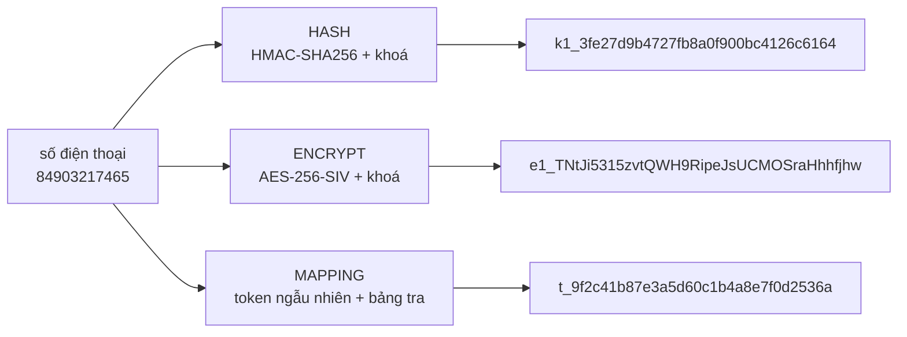
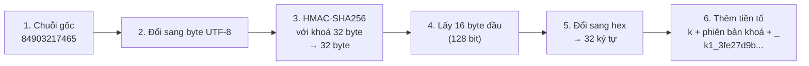
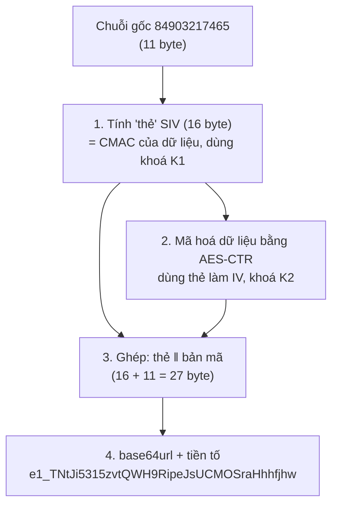
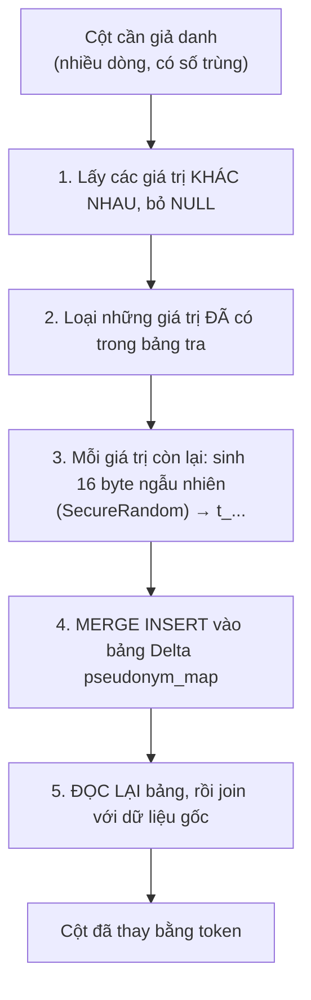
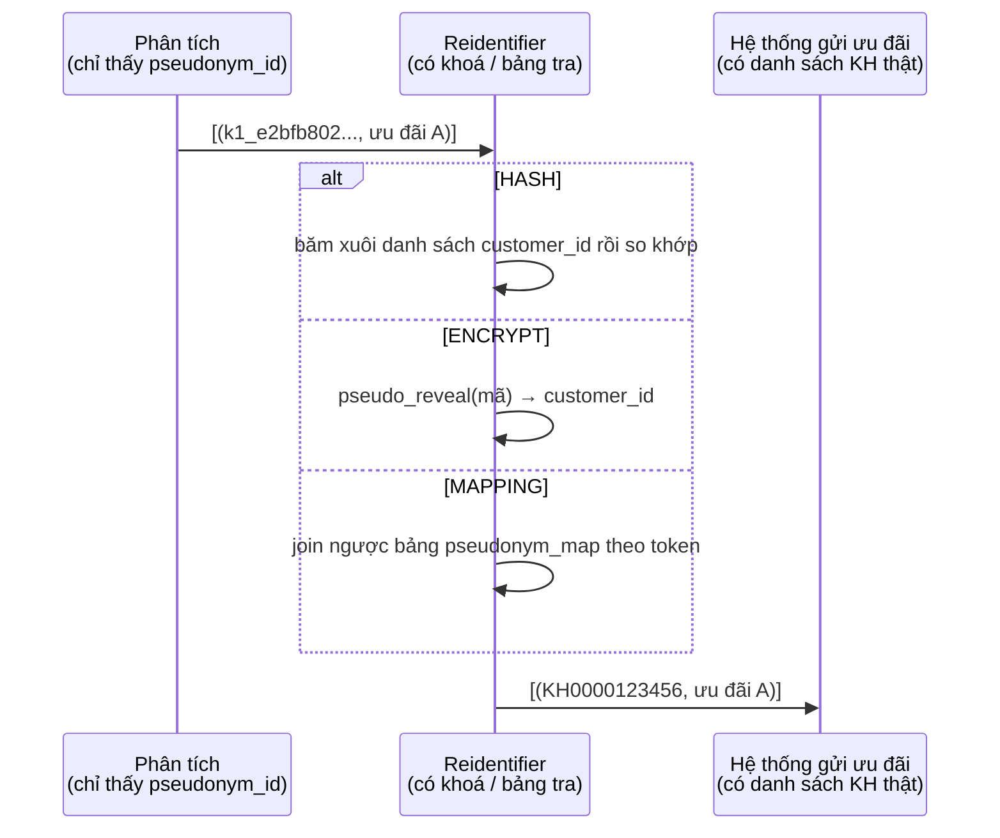
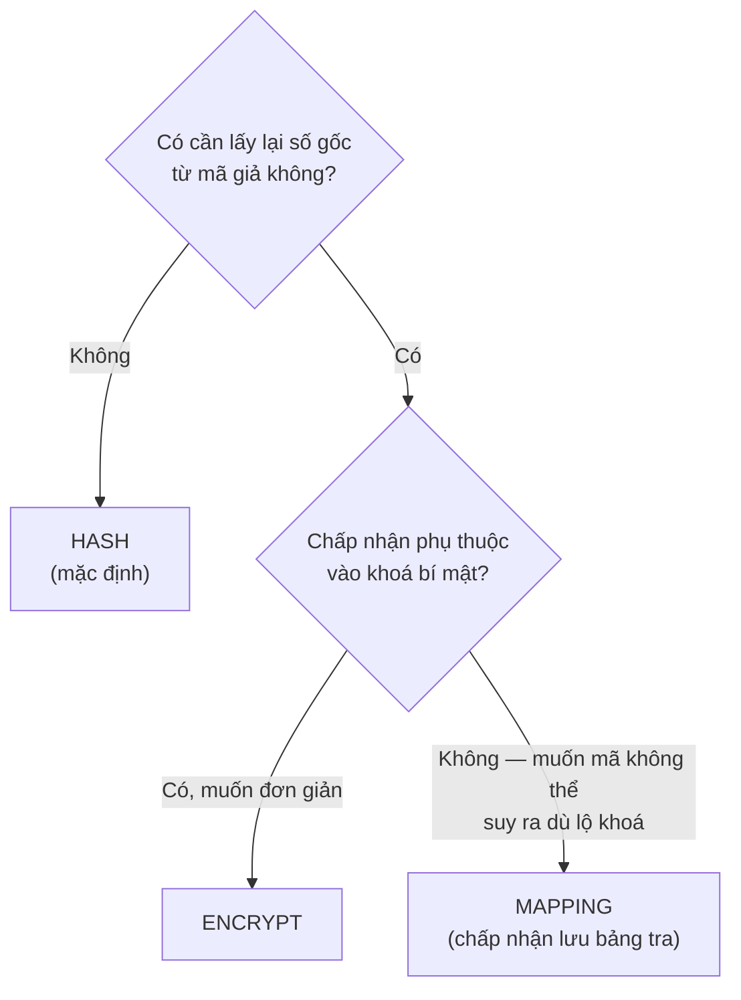

# Cơ chế các thuật toán giả danh hoá — giải thích bằng ví dụ

Tài liệu này giải thích **từng thuật toán hoạt động ra sao** bằng lời thường và ví dụ cụ thể. Không cần biết mật mã học.
Muốn biết thiết kế/quyết định kỹ thuật chi tiết: [`LIB_PLAN.md`](./LIB_PLAN.md). Muốn biết cách đo "khử định danh
thành công chưa": [`pseudonym-verify-utils/README.md`](../../pseudonym-verify-utils/README.md).

> **Về các giá trị trong tài liệu.** Mọi chuỗi `k1_...` và `e1_...` bên dưới là **kết quả thật** tính bằng đúng code của
> lib, với khoá **chỉ để minh hoạ** (HMAC: các byte `00 01 02 ... 1f`; AES-SIV: các byte `00 01 ... 3f`). Khoá thật sinh
> ngẫu nhiên, nên kết quả thật của bạn sẽ khác. Riêng token `t_...` của chế độ MAPPING là ngẫu nhiên nên chỉ là minh hoạ.

## 1. Bài toán trong 1 phút

Bảng dữ liệu có số điện thoại `84903217465`. Bạn muốn **phân tích hành vi của người này theo thời gian** (anh ta đăng nhập,
kiểm tra cước, mua data...), nhưng **người phân tích không được biết đó là số nào**.

Giải pháp: thay số điện thoại bằng một **mã giả** (pseudonym). Hai yêu cầu cùng lúc:

| Yêu cầu           | Nghĩa là                                                         | Hệ quả cho thuật toán                                     |
| ----------------- | ---------------------------------------------------------------- | --------------------------------------------------------- |
| **Che được**      | Nhìn mã giả không đoán ra số thật                                | Mã giả không được suy ngược nếu không có "bí mật"         |
| **Liên kết được** | Cùng số điện thoại luôn ra **cùng** mã giả, ở mọi bảng, mọi ngày | Thuật toán phải **tất định** (cùng đầu vào → cùng đầu ra) |

Hai yêu cầu này kéo ngược nhau, nên không thể dùng mã hoá thông thường (mỗi lần mã hoá ra một kết quả khác nhau — mất
tính liên kết) và cũng không thể dùng hàm băm trần (ai cũng tính lại được — mất tính che).

## 2. Vì sao không băm trần `sha256(số điện thoại)`?

Hàm băm `sha256` một chiều và tất định, trông có vẻ đủ. Nhưng **không gian số điện thoại rất nhỏ**: khoảng một tỉ số.
Kẻ tấn công không cần "đảo ngược" gì cả — chỉ cần **thử hết**:

```
for số in 84900000000 .. 84999999999:        # ~10^9 số, vài giờ trên một máy
    bảng_tra[ sha256(số) ] = số
```

Sau đó mỗi giá trị băm trong dữ liệu được tra ra số thật ngay lập tức. Ví dụ thật:

| Số gốc        | `sha256` (32 ký tự hex đầu)        |
| ------------- | ---------------------------------- |
| `84903217465` | `9dc68b26dba943eedf6f167b680c7f99` |
| `84903217466` | `b7b6013caae2e07f696b5e6f8ab330c4` |

Giá trị này **ai cũng tính được** — không có bí mật nào. Vì vậy lib dùng thuật toán **có khoá bí mật**: kẻ tấn công không
có khoá thì không thể tính trước bảng tra. Đây là điểm khác biệt cốt lõi giữa "băm trần" và các chế độ của lib.

## 3. Ba chế độ trong một cái nhìn



|                            | HASH                     | ENCRYPT                             | MAPPING                       |
| -------------------------- | ------------------------ | ----------------------------------- | ----------------------------- |
| Dùng gì để che             | khoá bí mật              | khoá bí mật                         | **bảng tra** (không có khoá)  |
| Lấy lại số gốc được không? | **Không** (chỉ tra xuôi) | **Có**, bằng khoá                   | **Có**, bằng bảng tra         |
| Mã giả trông ra sao        | `k1_` + 32 hex           | `e1_` + base64url (dài theo số gốc) | `t_` + 32 hex                 |
| Cùng số → cùng mã          | ✔                        | ✔                                   | ✔ (nhờ bảng tra)              |
| Chi phí                    | rẻ nhất                  | rẻ                                  | đắt nhất (ghi/đọc bảng Delta) |

Ba chế độ này tương ứng đúng ba cách tài liệu gốc nêu: "băm có salt", "mã hoá", và "bảng ánh xạ".

---

## 4. HASH — băm có khoá (HMAC-SHA256)

### 4.1. Ý tưởng

**HMAC** là cách chuẩn để "băm kèm một bí mật": kết quả phụ thuộc vào **cả dữ liệu lẫn khoá**. Hình dung nó như một chiếc
máy xay có khoá riêng: cùng một số điện thoại đưa vào máy của bạn luôn ra cùng một "bột", nhưng người khác không có đúng
chiếc máy (khoá) thì không tính lại được.

> "Salt bí mật" trong tài liệu gốc chính là khoá này. Lib dùng HMAC thay vì tự ghép `sha256(salt + số)` vì HMAC là cấu
> trúc đã được chứng minh an toàn; cách ghép tay dễ dính lỗi (ví dụ tấn công length-extension).

### 4.2. Từng bước



Bước 4 cắt còn 128 bit để mã gọn hơn. Xác suất 2 số khác nhau ra cùng mã (va chạm) với 1 tỉ chủ thể vào khoảng
`1.5 × 10⁻²¹` — coi như không bao giờ.

Bước 6: `k` = HASH, `1` = **phiên bản khoá**. Khi xoay khoá, mã mới là `k2_...` nên phát hiện được dữ liệu trộn 2 thế hệ.

### 4.3. Ví dụ thật

| Giá trị gốc                    | Mã giả (HASH)                         | Nhận xét                                                                                 |
| ------------------------------ | ------------------------------------- | ---------------------------------------------------------------------------------------- |
| `84903217465`                  | `k1_3fe27d9b4727fb8a0f900bc4126c6164` |                                                                                          |
| `84903217466`                  | `k1_dcb1405a0d66a2ca0f276d24a13747f9` | Chỉ khác **1 chữ số cuối** nhưng mã khác hoàn toàn — không thể đoán số "gần" từ mã "gần" |
| `KH0000123456` (mã khách hàng) | `k1_e2bfb802ec75bb5483681ef08b15f1d6` | Cùng thuật toán cho mọi loại định danh                                                   |
| `352099001761481` (IMEI)       | `k1_e922fc3540183d991b8032fb13750ad6` |                                                                                          |
| `NULL`                         | `NULL`                                | Không có giá trị → không sinh mã (không biến "rỗng" thành một "người" giả)               |
| `""` (chuỗi rỗng, khác NULL)   | `k1_d38b42096d80f45f826b44a9d5607de7` | Chuỗi rỗng vẫn được băm như giá trị thường                                               |

**Gọi 1000 lần với `84903217465` vẫn ra đúng `k1_3fe27d9b...`** — đó là tính tất định, nền tảng của việc liên kết bản ghi.

Tự thử bằng đúng code của lib:

```scala
import vai.lakehouse.pseudonym.core.{HmacPseudonymizer, PseudonymKey}

val hex = (0 until 32).map(i => f"$i%02x").mkString                   // khoá minh hoạ 00 01 ... 1f
val key = PseudonymKey.parse("pseudonym.hmac_v1", 1, s"hex:$hex", 32)
new HmacPseudonymizer(key).pseudonymize("84903217465")                // "k1_3fe27d9b4727fb8a0f900bc4126c6164"
```

### 4.4. Đảo ngược thế nào? — Không đảo được, chỉ "tra xuôi"

HASH là **một chiều**. Muốn biết `k1_3fe27d9b...` là ai, bên có thẩm quyền (có khoá) lấy **danh sách số điện thoại họ đã
biết**, băm xuôi từng số, rồi so:

```
danh sách khách hàng: 84903217465, 84903217466, ...
  băm xuôi → k1_3fe27d9b..., k1_dcb1405a..., ...
mã cần tra: k1_3fe27d9b...  →  khớp dòng 1  →  84903217465
```

Mã không nằm trong danh sách thì **không tra ra** (kết quả `NULL`).

### 4.5. Khi nào dùng

Mặc định cho phân tích: không cần lấy lại số gốc, rẻ nhất, không cần lưu bảng tra. Điểm yếu duy nhất: **lộ khoá = lộ
toàn bộ** (kẻ tấn công băm lại được cả không gian số điện thoại).

---

## 5. ENCRYPT — mã hoá tất định (AES-256-SIV)

### 5.1. Ý tưởng

Mã hoá thông thường (kể cả AES-GCM mà Spark dùng mặc định) trộn thêm một số ngẫu nhiên (IV) mỗi lần, nên **cùng một số
điện thoại mã hoá hai lần ra hai kết quả khác nhau** — rất an toàn nhưng **không join được**. Cần một chế độ mã hoá **tất
định**. **AES-SIV** (RFC 5297) làm đúng việc này: thay vì IV ngẫu nhiên, nó **tính IV từ chính dữ liệu**.

### 5.2. Từng bước



Vì thẻ SIV được tính từ dữ liệu nên **cùng đầu vào → cùng thẻ → cùng bản mã** (tất định). Khoá 64 byte = 2 khoá AES-256 (K1
cho bước 1, K2 cho bước 2).

### 5.3. Ví dụ thật

| Giá trị gốc       | Độ dài | Mã giả (ENCRYPT)                                | Độ dài bản mã |
| ----------------- | ------ | ----------------------------------------------- | ------------- |
| `84903217465`     | 11     | `e1_TNtJi5315zvtQWH9RipeJsUCMOSraHhhfjhw`       | 27 byte       |
| `84903217466`     | 11     | `e1_rZoK1tVsT3FxNVl5tgU0NnbhiqCrKORt373T`       | 27 byte       |
| `KH0000123456`    | 12     | `e1_GEecPKUNVWlcIDKOfaJzZhZjpTgYmlp6YkBgXQ`     | 28 byte       |
| `352099001761481` | 15     | `e1_mbiLuWcu7-c0pXTtlWzh1NMPummii-ue-igUekHBvw` | 31 byte       |

Quan sát:

- Hai số khác nhau 1 chữ số → hai mã **hoàn toàn khác nhau** (như HASH).
- Bản mã luôn **dài hơn bản gốc đúng 16 byte** (phần thẻ SIV). Nghĩa là **độ dài số gốc bị lộ** — chấp nhận được với số
  điện thoại/IMEI có độ dài cố định, cần lưu ý với dữ liệu độ dài thay đổi (như tên).

### 5.4. Giải mã và phát hiện giả mạo

```
giải mã e1_TNtJi53...  với khoá đúng      →  84903217465
giải mã e1_TNtJi53...  với khoá sai       →  LỖI "wrong key or tampered value"
giải mã e1_TNtJi5X...  (sửa 1 ký tự)      →  LỖI (thẻ không khớp — không bao giờ trả "rác")
```

Sau khi giải mã, thuật toán tính lại thẻ và so với thẻ nhận được; lệch là báo lỗi. Đây là tính **toàn vẹn** đi kèm.

### 5.5. Khi nào dùng

Khi **cần lấy lại số gốc** (vd luồng gửi ưu đãi) mà không muốn duy trì một bảng tra khổng lồ. Hàm giải mã
`pseudo_reveal` nằm ở extension **riêng** để không nạp nhầm lên engine của analyst.

---

## 6. MAPPING — bảng ánh xạ (token ngẫu nhiên)

### 6.1. Ý tưởng

Hai chế độ trên đều dựa vào **khoá**. MAPPING bỏ hẳn khoá: mỗi số điện thoại được phát một **mã ngẫu nhiên** (như phát số
thứ tự ở quầy), và ghi cặp `(số gốc, mã)` vào một **bảng tra** cất riêng. Mã hoàn toàn ngẫu nhiên nên **không có phép
tính nào** để từ mã suy ra số — kể cả khi biết thuật toán. An toàn dồn hết vào việc **bảo vệ bảng tra**.

### 6.2. Từng bước



### 6.3. Ví dụ

Bảng tra `pseudonym_map` sau lần chạy đầu (token minh hoạ):

| raw_value     | token                                |
| ------------- | ------------------------------------ |
| `84903217465` | `t_9f2c41b87e3a5d60c1b4a8e7f0d2536a` |
| `84903217466` | `t_01b7e5c9a4d8f3620ae1b97c35d40f88` |

Dữ liệu `app_event` trước/sau:

| event_id | isdn (gốc)    | →   | isdn (MAPPING)               |
| -------- | ------------- | --- | ---------------------------- |
| 1        | `84903217465` |     | `t_9f2c41b8...`              |
| 2        | `84903217465` |     | `t_9f2c41b8...` (cùng token) |
| 3        | `84903217466` |     | `t_01b7e5c9...`              |
| 4        | `NULL`        |     | `NULL`                       |

**Chạy lại lần sau** với dữ liệu mới có thêm số `84903217467`: hai số cũ **giữ nguyên token**, chỉ số mới được cấp token mới
— đó là lý do bảng tra phải được lưu bền (Delta) thay vì tính lại.

### 6.4. Hai chi tiết quan trọng

**(a) Vì sao phải ghi bảng rồi mới đọc lại để join (bước 5)?** Sinh token là hành vi _không tất định_ (mỗi lần gọi ra giá
trị khác). Nếu join thẳng với kết quả vừa sinh, Spark có thể **tính lại** khi một tác vụ bị chạy lại, và một số điện thoại
sẽ nhận 2 token khác nhau. Lấy bảng đã ghi làm "nguồn sự thật duy nhất" tránh được điều này.

**(b) Hai job chạy song song cùng gặp một số mới?** Delta chỉ cho một job `MERGE` thành công; job còn lại gặp xung đột,
**tự chạy lại**, lúc này thấy token đã có và dùng lại. Kết quả: mỗi số đúng 1 token (đã có test với 4 job song song).

### 6.5. Khi nào dùng

Khi muốn mã giả **không thể suy ra từ giá trị gốc dù lộ mọi khoá** (không có khoá nào để lộ). Đổi lại: phải lưu và bảo
vệ bảng tra (nó chứa **số gốc** — nhạy cảm ngang dữ liệu gốc), join tốn kém hơn, và bảng lớn dần.

---

## 7. Liên kết bản ghi giữa các bảng — ví dụ trọn vẹn (HASH)

Cùng một khách hàng xuất hiện ở hai bảng. Dữ liệu gốc:

**`subscriber`**

| customer_id    | isdn          | province |
| -------------- | ------------- | -------- |
| `KH0000123456` | `84903217465` | Ha Noi   |

**`app_event`**

| event_id | isdn          | event_type    | event_ts         |
| -------- | ------------- | ------------- | ---------------- |
| 1        | `84903217465` | login         | 2026-10-07 09:00 |
| 2        | `84903217465` | check_balance | 2026-10-07 09:02 |
| 3        | `84903217465` | buy_data      | 2026-10-07 09:05 |

Sau khi giả danh (policy: `isdn` giữ tên, `customer_id` đổi thành `pseudonym_id`):

**`subscriber`**

| pseudonym_id                          | isdn                                  | province |
| ------------------------------------- | ------------------------------------- | -------- |
| `k1_e2bfb802ec75bb5483681ef08b15f1d6` | `k1_3fe27d9b4727fb8a0f900bc4126c6164` | Ha Noi   |

**`app_event`**

| event_id | isdn                                  | event_type    | event_ts         |
| -------- | ------------------------------------- | ------------- | ---------------- |
| 1        | `k1_3fe27d9b4727fb8a0f900bc4126c6164` | login         | 2026-10-07 09:00 |
| 2        | `k1_3fe27d9b4727fb8a0f900bc4126c6164` | check_balance | 2026-10-07 09:02 |
| 3        | `k1_3fe27d9b4727fb8a0f900bc4126c6164` | buy_data      | 2026-10-07 09:05 |

Người phân tích **vẫn làm được**:

```sql
SELECT s.province, collect_list(e.event_type)     -- hành trình: login → check_balance → buy_data
FROM app_event e JOIN subscriber s ON e.isdn = s.isdn
GROUP BY s.province, e.isdn;
```

…nhưng **không biết** số điện thoại là gì. Đây chính là điều tài liệu gốc yêu cầu: _"liên kết các bản ghi của cùng một chủ
thể mà không cần biết danh tính thật"_. App kiểm chứng đo điều này bằng check U4/U5/U6/U7.

---

## 8. Kẻ tấn công thử gì, và lib chống ra sao

| Tấn công                      | Cách làm                                                         | Kết quả                   | Chặn bởi                                       | Check              |
| ----------------------------- | ---------------------------------------------------------------- | ------------------------- | ---------------------------------------------- | ------------------ |
| **Từ điển không khoá**        | Băm thử mọi số bằng md5/sha1/sha256/sha512... rồi so với dữ liệu | 0 khớp                    | Có khoá bí mật                                 | **P4**             |
| **Đoán khoá**                 | Thử khoá `""`, `"secret"`, `"salt"`...                           | 0 khớp                    | Khoá ngẫu nhiên 256 bit                        | **P4**             |
| **Dùng sai khoá**             | Giải mã/tính lại bằng khoá khác                                  | Không khớp / lỗi xác thực | Khoá riêng                                     | **P5**             |
| **Đọc khoá từ log/plan/conf** | Tìm khoá trong `EXPLAIN`, log, Spark conf, thông báo lỗi         | Không thấy                | Khoá nằm trong closure UDF, không phải literal | **P7**             |
| **Gọi hàm tuỳ ý (oracle)**    | Analyst gọi `pseudo_hash` lên mọi số rồi so                      | Lộ toàn bộ                | **Không nạp** extension lên engine của analyst | quy ước triển khai |
| **Đối chứng**                 | _Có_ khoá thật thì phải suy ngược được 100%                      | = 100%                    | (để chứng minh các check ở trên không "mù")    | **P6**             |

Điểm đáng nhớ: P6 là "điều ngược lại" — nếu có khoá mà vẫn **không** tra được thì bộ kiểm tra đang hỏng, nên kết quả
`ERROR` (không kết luận) chứ không phải `PASS`.

---

## 9. Luồng tái định danh (ưu đãi Viettel++)

Hệ thống phân tích chỉ ra "gửi ưu đãi cho `pseudonym_id` này". Hệ thống gửi ưu đãi (có thẩm quyền) đổi lại thành khách
hàng thật:



Hệ thống phân tích **không bao giờ** thấy `customer_id`; hệ thống gửi ưu đãi không cần thấy hành vi.

---

## 10. Chọn chế độ nào?



Mặc định `HASH`. Cùng một cột định danh ở nhiều bảng **phải cùng chế độ**, nếu không các mã sẽ không khớp nhau (lib kiểm
tra điều này khi nạp policy).

## 11. Những điều dễ hiểu nhầm

| Hiểu nhầm                                                     | Thực tế                                                                                                                                                                                |
| ------------------------------------------------------------- | -------------------------------------------------------------------------------------------------------------------------------------------------------------------------------------- |
| "Đã giả danh thì không còn là dữ liệu cá nhân"                | **Vẫn là dữ liệu cá nhân**: ai giữ khoá/bảng tra thì tái định danh được; ngày sinh + tỉnh + giới tính vẫn có thể chỉ mặt một người. Giả danh hoá _giảm rủi ro_, không phải ẩn danh hoá |
| "`0903217465` và `84903217465` là cùng một số nên ra cùng mã" | **Không**: lib băm _nguyên trạng_ chuỗi đầu vào, hai chuỗi này ra hai mã khác nhau và đứt liên kết. Dữ liệu phải được **đồng nhất định dạng** trước khi giả danh                       |
| "Mã dài/khó đoán nên an toàn"                                 | An toàn đến từ **khoá bí mật** (hoặc bảng tra), không từ độ dài mã. Băm trần `sha256` cũng dài mà không an toàn (mục 2)                                                                |
| "Đổi khoá cho an toàn hơn"                                    | Đổi khoá = **toàn bộ mã đổi** → đứt phân tích dọc. Chỉ xoay khi nghi lộ khoá, và phải giả danh lại toàn bộ lịch sử                                                                     |
| "ENCRYPT giống `aes_encrypt` của Spark"                       | Khác: `aes_encrypt` dùng IV ngẫu nhiên (không tất định, không join được). ENCRYPT dùng SIV nên tất định                                                                                |

## 12. Tự quan sát trên máy bạn

Tạo bảng mẫu bằng SQL ở [`pseudonymize-table-app/README.md`](../../pseudonymize-table-app/README.md), chạy app khử định danh, rồi
kiểm bằng [`pseudonym-verify-utils`](../../pseudonym-verify-utils/README.md):

```bash
spark-submit --class vai.lakehouse.pseudonymverify.app.PseudonymValidateApp \
  --jars pseudonym-udf.jar,key-prefix-lib.jar pseudonym-verify-utils.jar crm.subscriber crm.subscriber_pseudonymized isdn,imei HASH
```

Bạn sẽ thấy đúng các hiện tượng ở tài liệu này: `isdn`/`imei` thành `k1_...` (HASH), `e1_...` (ENCRYPT), `t_...` (MAPPING); `NULL` vẫn `NULL`;
các cột không định danh giữ nguyên; không còn giá trị gốc nào trong bảng đích.
