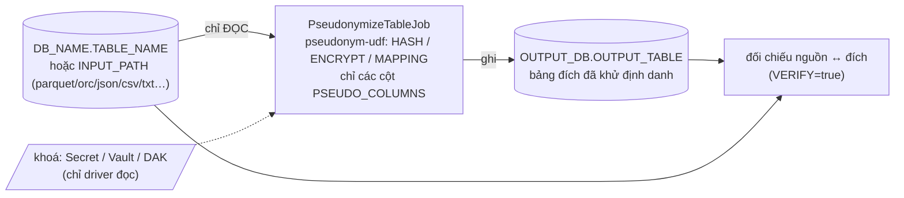

# pseudonymize-table-app

Spark job **khử định danh (giả danh hoá) một bảng hoặc một thư mục file**: nhận nguồn (tên DB + tên bảng, hoặc đường dẫn
file/thư mục + định dạng) và danh sách cột cần khử định danh — mỗi cột có thể dùng chế độ riêng; thay các cột đó bằng
định danh giả bằng lib [`pseudonym-udf`](../pseudonym-udf), ghi ra bảng đích.

- Giải thích cơ chế từng thuật toán kèm ví dụ: [docs/pseudonymization/ALGORITHMS.md](../docs/pseudonymization/ALGORITHMS.md)
- Thiết kế lib: [docs/pseudonymization/LIB_PLAN.md](../docs/pseudonymization/LIB_PLAN.md)
- Muốn **kiểm tra bảng đích** sau khi chạy (so với bảng nguồn): [`pseudonym-verify-utils`](../pseudonym-verify-utils/README.md)



## 1. Cấu trúc thư mục

```
pseudonymize-table-app/
├── README.md
├── Dockerfile                          # build context = GỐC REPO (cần jar của pseudonym-udf + key-prefix-lib)
├── pom.xml                             # lib = provided (nạp qua spark.jars); shade Delta + patch block token
├── k8s/
│   ├── pseudonymize-table.yaml         # SparkApplication, nguồn là bảng
│   ├── pseudonymize-file.yaml          # SparkApplication, nguồn là file/thư mục (INPUT_PATH)
│   └── pseudonym-keys-secret.yaml      # mẫu Secret khoá (CRYPTO_PREFIX_SOURCE=file) — chỉ có chỗ trống
└── src/
    ├── main/resources/log4j2.properties
    ├── main/scala/vai/lakehouse/pseudonymizetable/
    │   ├── app/      PseudonymizeTableApp (main mỏng: execute -> exit code), SparkSessions
    │   ├── config/   JobConfig (đọc + validate env, gom mọi lỗi 1 lượt), OutputFormat
    │   ├── job/      PseudonymizeTableJob (đọc -> giả danh -> ghi -> đối chiếu)
    │   └── logging/  Log (logger "VLP")
    └── test/scala/...   13 test: cấu hình, và chạy app thật (HASH/ENCRYPT/MAPPING, append, DB đích khác, các mã lỗi)
```

Cùng khuôn với `spark-app`: `main` mỏng, cấu hình chỉ qua biến môi trường, patch block token Isilon, `Log` "VLP".

## 2. Build

Yêu cầu: JDK 11+ (đã kiểm chứng trên JDK 21), Maven 3.8+. Chạy ở **gốc repo**.

```bash
mvn -B -pl pseudonymize-table-app -am clean package                 # build + test (kèm key-prefix-lib, pseudonym-udf, spark-app)
mvn -B -pl pseudonymize-table-app -am clean package -DskipTests     # chỉ cần jar
# -> pseudonymize-table-app/target/pseudonymize-table-app.jar        (fat jar: app + Delta + patch; KHÔNG chứa lib giả danh)
# -> pseudonym-udf/target/pseudonym-udf-1.0-SNAPSHOT.jar
# -> key-prefix-lib/target/key-prefix-lib-1.0-SNAPSHOT.jar

IMAGE=hub.vtcc.vn:8989/hungvt0110/pseudonymize-table-app:v0.1
docker build -f pseudonymize-table-app/Dockerfile -t "$IMAGE" .      # context = gốc repo
docker push "$IMAGE"
```

Test (không cần cluster/Vault/HDFS): `mvn -B -pl pseudonymize-table-app -am test -DwildcardSuites=vai.lakehouse.pseudonymizetable`.
`PseudonymizeTableAppSpec` tạo bảng thật trong catalog của 1 SparkSession local, nạp khoá qua `spark.pseudonym.*` (nguồn
`file`) rồi chạy `execute` — đúng đường cấu hình của production.

## 3. Đầu vào / đầu ra

### 3.1. Biến môi trường của job (chỉ driver đọc)

| Biến                                | Mặc định                                                               | Ý nghĩa                                                                                                                                                                                                                                                                 |
| ----------------------------------- | ---------------------------------------------------------------------- | ----------------------------------------------------------------------------------------------------------------------------------------------------------------------------------------------------------------------------------------------------------------------- |
| `DB_NAME` + `TABLE_NAME`            | —                                                                      | **Nguồn là bảng** trong catalog. Chỉ `[A-Za-z0-9_]`. Bắt buộc nếu không dùng `INPUT_PATH`                                                                                                                                                                               |
| `INPUT_PATH`                        | —                                                                      | **Nguồn là file/thư mục**, vd `/landing/vtt/lakehouse/vtt-core/f016-mpre-tot-charge-m/date=20261012/hour=18/` (đường dẫn tuyệt đối hoặc URI `hdfs://…`; glob được). Loại trừ với `DB_NAME`/`TABLE_NAME` (xem 3.5)                                                       |
| `INPUT_FROM` / `INPUT_TO`           | —                                                                      | Khoảng thời gian **liên tục**, bao gồm hai đầu, `yyyyMMdd` hoặc `yyyyMMddHH` (FROM mặc định giờ 00, TO mặc định 23). Với `INPUT_PATH` là **gốc** của cây `date=…/hour=…/`; với `DB_NAME`/`TABLE_NAME` là lọc trên hai cột partition `date`, `hour` (xem 3.8)                                                                              |
| `INPUT_HOURS`                       | —                                                                      | Lọc thêm giờ trong ngày cho mọi ngày của khoảng: `6-18` hoặc `18`                                                                                                                                                                                                       |
| `INPUT_DATE_KEY` / `INPUT_HOUR_KEY` | `date` / `hour` | Tên khoá thư mục tầng ngày / tầng giờ-batch nếu khác mặc định, vd `dt` / `batch`; cũng là tên cột partition |
| `INPUT_FORMAT`                      | (bắt buộc khi có `INPUT_PATH`)                                         | `parquet` / `orc` / `avro` / `json` / `delta` / `csv` / `tsv` / `txt` (= `csv`, text phân tách ký tự) / `text` (mỗi dòng 1 cột `value`)                                                                                                                                 |
| `INPUT_SCHEMA`                      | —                                                                      | Schema DDL cho file không có schema sẵn, vd `isdn STRING, imei STRING, amount DOUBLE`. Không có thì csv/tsv/txt đặt tên cột `_c0, _c1, …`                                                                                                                               |
| `INPUT_OPTION_<tên>`                | —                                                                      | Option của Spark reader, vd `INPUT_OPTION_delimiter=\|`, `INPUT_OPTION_header=true`, `INPUT_OPTION_encoding=UTF-8`                                                                                                                                                      |
| `INPUT_BAD_FILES`                   | `fail`                                                                 | Chỉ với `INPUT_PATH`. File không đọc được: `fail` dừng job rồi **liệt kê file lỗi**; `skip` bỏ file lỗi, xử lý phần còn lại, log danh sách file đã bỏ qua và job vẫn **thành công (exit 0)**; `report` chỉ quét và liệt kê, không ghi gì, exit `4` nếu có lỗi (xem 3.7) |
| `INPUT_CHECK_FULL`                  | `false`                                                                | Chỉ với `INPUT_PATH`. `false`: quét nhanh csv/tsv/txt (đếm ký tự phân tách, chỉ bắt dòng quá `maxColumns`); `true`: đọc và parse đầy đủ từng file (bắt mọi lỗi đọc, tốn thêm một lượt đọc)                                                                              |
| `INPUT_CHECK_PARALLELISM`           | `4`                                                                    | Số file quét song song khi tìm file lỗi (1..64)                                                                                                                                                                                                                         |
| `PSEUDO_COLUMNS`                    | (bắt buộc)                                                             | Cột cần khử định danh, phân cách bằng dấu phẩy, vd `isdn,imei`. Mỗi cột có thể kèm chế độ riêng: `isdn:HASH,imei:ENCRYPT` (xem 3.6). Không lặp, phải có trong nguồn                                                                                                     |
| `PSEUDO_MODE`                       | `HASH`                                                                 | `HASH` (một chiều) / `ENCRYPT` (giải mã lại được) / `MAPPING` (bảng ánh xạ). Chế độ **mặc định** cho cột trong `PSEUDO_COLUMNS` không ghi `:MODE`                                                                                                                       |
| `OUTPUT_DB`                         | `DB_NAME` (nguồn bảng); **bắt buộc** với nguồn file                    | Database bảng đích (tự `CREATE DATABASE IF NOT EXISTS`)                                                                                                                                                                                                                 |
| `OUTPUT_TABLE`                      | `<TABLE_NAME>_pseudonymized` (nguồn bảng); **bắt buộc** với nguồn file | Tên bảng đích. **Không được trùng bảng nguồn** (xem 3.3)                                                                                                                                                                                                                |
| `OUTPUT_FORMAT`                     | `delta`                                                                | `delta` / `hive` (ghi Parquet) / `iceberg` (cần catalog Iceberg đã cấu hình)                                                                                                                                                                                            |
| `OUTPUT_MODE`                       | `overwrite`; **`overwrite-partitions`** khi có partition đầu ra        | `overwrite` (thay **cả** bảng đích) / `append` (ghi nối) / `overwrite-partitions` (chỉ thay các partition có trong dữ liệu lần này, xem 3.8)                                                                                                                            |
| `OUTPUT_PARTITION_BY`               | `date,hour` khi đọc theo khoảng; không partition nếu không             | Cột partition của bảng đích, phân cách bằng dấu phẩy; `none` để tắt. Phải có trong dữ liệu, không nằm trong `PSEUDO_COLUMNS`                                                                                                                                            |
| `OUTPUT_SKIP_EXISTING` | `false` | Chỉ khi ghi từng partition (`overwrite-partitions`, hoặc `append` + partition). `true`: partition đã có trong bảng đích thì **bỏ qua**, là cách "chạy tiếp" sau khi lỗi giữa chừng (xem 3.9) |
| `OUTPUT_WRITE_RETRIES` | `2` với `overwrite-partitions`, `0` với chế độ khác | Số lần thử lại thêm cho **từng partition** khi gặp lỗi tạm, 0..5. Chỉ cho phép với `overwrite-partitions` (thử lại `append` có thể nhân đôi dữ liệu) |
| `OUTPUT_RETRY_WAIT_SECONDS` | `30` | Giây chờ giữa các lần thử lại, 0..600 |
| `VERIFY`                            | `true`                                                                 | Đọc lại bảng đích và đối chiếu với nguồn (mục 5)                                                                                                                                                                                                                        |
| `MAPPING_TABLE_PATH`                | —                                                                      | Chỉ `PSEUDO_MODE=MAPPING`: đường dẫn bảng ánh xạ Delta (hoặc dùng `spark.pseudonym.mapping.path`)                                                                                                                                                                       |
| `WAREHOUSE_PATH`                    | —                                                                      | URI đầy đủ của warehouse, vd `hdfs://vailakehouse.datalakehla.viettel.com.vn:8020/prod8/warehouse`; đặt `spark.sql.warehouse.dir` (không phụ thuộc `fs.defaultFS`) — cùng quy ước với `crawler-streaming-app`                                                           |
| `ENABLE_HIVE_SUPPORT`               | `true`                                                                 | `true` để đọc bảng qua Hive metastore (như `spark-app`)                                                                                                                                                                                                                 |
| `APP_NAME`                          | `PseudonymizeTable`                                                    | Tên trên Spark UI                                                                                                                                                                                                                                                       |

Sai cấu hình → job **không dựng Spark**, in mọi lỗi một lượt và thoát với exit code `2`.

### 3.2. Đầu ra

- Bảng `OUTPUT_DB.OUTPUT_TABLE` có **cùng cột, cùng thứ tự** với bảng nguồn; các cột trong `PSEUDO_COLUMNS` đã được thay
  bằng định danh giả, các cột còn lại **giữ nguyên**.
- Định danh giả luôn là `STRING`: cột số (vd `BIGINT`) trong `PSEUDO_COLUMNS` sẽ thành `STRING` ở bảng đích.
- `NULL` vẫn là `NULL`. Cùng một giá trị gốc luôn ra cùng một định danh giả (nên vẫn join/đếm/gom nhóm được).

| Chế độ    | Giá trị trong bảng đích                                                      |
| --------- | ---------------------------------------------------------------------------- |
| `HASH`    | `k1_` + 32 ký tự hex                                                         |
| `ENCRYPT` | `e1_` + base64url (dài hơn bản gốc 16 byte)                                  |
| `MAPPING` | `t_` + 32 ký tự hex ngẫu nhiên; cặp `(giá trị gốc, token)` nằm ở bảng ánh xạ |

### 3.3. Vì sao không ghi đè bảng gốc

Giả danh hoá `HASH` là **một chiều**: ghi đè bảng gốc là mất dữ liệu vĩnh viễn nếu có sai sót (nhầm cột, nhầm khoá).
Job chỉ **đọc** bảng nguồn và từ chối cấu hình `OUTPUT_DB.OUTPUT_TABLE == DB_NAME.TABLE_NAME`. Muốn thay thế bảng gốc,
làm bước riêng có kiểm soát sau khi đã kiểm tra bảng đích (đổi tên bảng / trỏ lại view).

### 3.4. Ví dụ

```text
DB_NAME=crm  TABLE_NAME=subscriber  PSEUDO_COLUMNS=isdn,imei  PSEUDO_MODE=HASH

crm.subscriber                                      crm.subscriber_pseudonymized
id | isdn        | imei            | province       id | isdn                                  | imei             | province
1  | 84903217465 | 352099001761481 | Ha Noi         1  | k1_3fe27d9b4727fb8a0f900bc4126c6164   | k1_e922fc35...   | Ha Noi
3  | 84903217465 | NULL            | Ha Noi         3  | k1_3fe27d9b4727fb8a0f900bc4126c6164   | NULL             | Ha Noi
```

(Giá trị `k1_...` minh hoạ với khoá thử nghiệm; khoá thật cho kết quả khác. Xem [ALGORITHMS.md](../docs/pseudonymization/ALGORITHMS.md).)

### 3.5. Nguồn là file / thư mục

Đặt `INPUT_PATH` + `INPUT_FORMAT` (thay cho `DB_NAME`/`TABLE_NAME`). Job chỉ **đọc**, kết quả vẫn ghi ra **bảng đích**
`OUTPUT_DB.OUTPUT_TABLE` (hai biến này bắt buộc vì không có tên bảng nguồn để suy ra mặc định).

```yaml
# Thư mục HDFS đang chứa file txt phân tách bằng '|', không header
- name: INPUT_PATH
  value: /landing/vtt/lakehouse/vtt-core/f016-mpre-tot-charge-m/date=20261012/hour=18/
- name: INPUT_FORMAT
  value: txt # csv/txt đều là text phân tách; text = nguyên dòng
- name: INPUT_OPTION_delimiter
  value: "|"
- name: INPUT_SCHEMA # có schema thì dùng tên cột thật trong PSEUDO_COLUMNS
  value: "isdn STRING, imei STRING, amount DOUBLE"
- name: PSEUDO_COLUMNS
  value: isdn:HASH,imei:ENCRYPT
- name: OUTPUT_DB
  value: landing
- name: OUTPUT_TABLE
  value: f016_mpre_tot_charge_m_pseudonymized
```

Lưu ý:

- Trỏ thẳng vào thư mục `date=…/hour=…/` thì **không** có cột partition `date`/`hour` trong dữ liệu (Spark chỉ suy ra
  partition từ phần path _dưới_ thư mục gốc đã cho). Cần cột đó thì trỏ vào thư mục cha hoặc dùng glob, vd
  `INPUT_PATH=/landing/.../f016-mpre-tot-charge-m/` kèm `INPUT_OPTION_basePath=/landing/.../f016-mpre-tot-charge-m`.
- Không có `INPUT_SCHEMA` và không `INPUT_OPTION_header=true` thì cột tên `_c0, _c1, …` và đều là `STRING`; có header thì
  dùng `INPUT_OPTION_header=true` (tên cột lấy từ dòng đầu). `PSEUDO_COLUMNS` dùng đúng tên cột đó.
- Chuỗi rỗng trong csv/txt được đọc là `NULL` (mặc định Spark) và vẫn `NULL` ở bảng đích.
- `avro` cần module spark-avro (image `apache/spark` có sẵn); các định dạng khác là built-in.
- Nguồn file không đổi được giữa hai lần đọc (job đọc lại nguồn để đối chiếu ở mục 5): đừng ghi thêm file vào thư mục
  trong lúc job chạy.

### 3.6. Mỗi cột một chế độ

`PSEUDO_COLUMNS` nhận `cột[:MODE]`, ví dụ `isdn:HASH,imei:ENCRYPT,customer_id`. Cột không ghi `:MODE` dùng `PSEUDO_MODE`
(mặc định `HASH`). Chỉ khoá của các chế độ **thực sự dùng** mới bị đọc: cả `HASH` và `ENCRYPT` thì cần cả
`pseudonym.hmac_v<N>` và `pseudonym.aes_siv_v<N>` (mục 4.2); có cột `MAPPING` thì cần `MAPPING_TABLE_PATH`.

Chọn chế độ theo nhu cầu từng cột: cột chỉ để nối/đếm (`isdn`) → `HASH`; cột cần khôi phục sau này theo quy trình được duyệt
(`imei`) → `ENCRYPT`. Xem [ALGORITHMS.md](../docs/pseudonymization/ALGORITHMS.md).

### 3.7. File lỗi trong thư mục

Một file hỏng (CSV dính dòng, parquet cụt, lỗi HDFS...) làm cả job fail mà log không nói là file nào. Với `INPUT_PATH`:

| `INPUT_BAD_FILES` | Hành vi | Exit |
| --- | --- | --- |
| `fail` (mặc định) | Chạy bình thường; **nếu job lỗi** thì quét đầy đủ từng file bằng đúng cấu hình reader, log `BAD FILE <path> — <cause>` | 1 |
| `report` | Chỉ quét, liệt kê file lỗi, **không ghi** bảng đích. Dùng để kiểm tra một thư mục trước khi chạy thật | 0 sạch / 4 có lỗi |
| `skip` | **Không quét trước**: đọc thẳng với `spark.sql.files.ignoreCorruptFiles=true` nên Spark bỏ file lỗi; ghi xong, job log `SKIPPED <path> — <cause>` cho từng file bị bỏ | 0 (thành công) |

**Cách `skip` biết file nào bị bỏ.** Spark bỏ file lỗi trong im lặng (chỉ WARN ở log executor), nên job bọc một cột đầu ra
bằng biểu thức ghi lại tên file đã cho ra dòng (accumulator). Sau khi ghi, các file trong thư mục mà không cho ra dòng nào
là file bị bỏ; lý do thật của từng file được xác định bằng cách đọc lại **chỉ file đó**. Đối chiếu (`VERIFY`) chỉ so với các
file đã đọc được. Không tốn thêm lượt đọc nào cho việc quét.

Giới hạn cần biết:
- File hỏng **giữa chừng**: các dòng trước chỗ hỏng đã được ghi, phần sau bị bỏ; file này **không** nằm trong danh sách
  `SKIPPED` (chỉ có WARN `Skipped the rest of the content in the corrupted file` ở log executor).
- File rỗng cũng được liệt kê (lý do "không có dòng dữ liệu nào").
- `skip` **mất dữ liệu của file lỗi**; job vẫn kết thúc thành công nên nếu cần báo động hãy theo dõi dòng `SKIPPED`.
- `INPUT_CHECK_FULL`/`INPUT_CHECK_PARALLELISM` chỉ còn ảnh hưởng `report` và bước chẩn đoán khi job lỗi.

**Schema csv/txt.** Không khai `INPUT_SCHEMA` và không có header: app tự dựng schema `_c0.._cN` (STRING) từ dòng đầu của
file tốt đầu tiên, thay vì để Spark suy schema bằng dòng đầu của file đầu tiên (một file hỏng đứng đầu sẽ làm fail cả
job trước khi `ignoreCorruptFiles` có tác dụng).

### 3.8. Chạy theo khoảng ngày/giờ và ghi partition

`INPUT_PATH` là **gốc** của cây thư mục `date=<yyyyMMdd>/hour=<HH>/`; khoảng cần xử lý chọn bằng `INPUT_FROM`/`INPUT_TO`
(liên tục, gồm hai đầu) và tuỳ chọn `INPUT_HOURS` (lọc giờ trong ngày). Job **liệt kê thư mục thật** nên `hour=5` lẫn
`hour=05` đều đúng, ngày/giờ không tồn tại được bỏ qua; không có thư mục nào trong khoảng thì job dừng (exit 1).

| Cấu hình                              | Xử lý                                   |
| ------------------------------------- | --------------------------------------- |
| `FROM=20261012 TO=20261012`           | Cả ngày 12 (24 giờ nếu có)              |
| `FROM=20261012 TO=20261014`           | Ba ngày 12, 13, 14                      |
| `FROM=2026101218 TO=2026101218`       | Đúng một giờ                            |
| `FROM=2026101218 TO=2026101306`       | Liên tục từ 18h ngày 12 đến 06h ngày 13 |
| `FROM=20261012 TO=20261014 HOURS=6-8` | Giờ 06–08 của mỗi ngày 12, 13, 14       |

**Nguồn là bảng (`DB_NAME` + `TABLE_NAME`).** `INPUT_FROM`/`INPUT_TO`/`INPUT_HOURS` cũng dùng được, với cùng ý nghĩa ở bảng trên.
Bảng nguồn phải có hai cột chuỗi `date` (`yyyyMMdd`) và `hour` (`HH`), tên cố định (không có `INPUT_DATE_KEY`/`INPUT_HOUR_KEY`);
thiếu một trong hai cột thì job dừng trước khi ghi. Job lọc ngay trên nguồn bằng so sánh thẳng trên hai cột partition nên Spark
chỉ đọc partition trong khoảng. Dạng phút `yyyyMMddHHmm` bị từ chối (bảng chỉ có giờ). Có khoảng thì bảng đích mặc định
partition theo `(date, hour)` và `OUTPUT_MODE` mặc định `overwrite-partitions` như nguồn file; hai cột `date`, `hour` không được
nằm trong `PSEUDO_COLUMNS`. Khác nguồn file: ghi **một lượt** (không có thử lại/bỏ qua theo từng partition vì không liệt kê
thư mục trước).

**Thư mục theo batch (vd 20 phút).** Tầng thứ hai nhận giá trị `HH` (`hour=05`) hoặc `HHMM` 3–4 chữ số (`batch=0020`,
`batch=1740`); giá trị sai (giờ > 23, phút > 59) bị bỏ qua. Ví dụ nguồn `/landing/ebs_3g_4g/dt=20261014/batch=0020/`:
`INPUT_DATE_KEY=dt`, `INPUT_HOUR_KEY=batch`.

| Cấu hình | Batch được xử lý (trong ngày 14) |
| --- | --- |
| `FROM=20261014 TO=20261014` | Cả 72 batch `0000…2340` |
| `FROM=202610140020 TO=202610140100` | `0020, 0040, 0100` |
| `FROM=2026101401 TO=2026101401` | Cả giờ 01: `0100, 0120, 0140` |
| `FROM=20261014 TO=20261015 HOURS=0-0` | Giờ 00 của mỗi ngày: `0000, 0020, 0040` |

**Đầu ra.** Dữ liệu có thêm hai cột `date`, `hour` (kiểu chuỗi, giữ `05`) ở cuối và bảng đích được partition theo
`(date, hour)`: thư mục bảng có `date=20261012/hour=05/…`. Muốn partition khác: `OUTPUT_PARTITION_BY`.

| `OUTPUT_MODE`                                          | Hành vi với bảng đích đã có                                                                                                                                                               |
| ------------------------------------------------------ | ----------------------------------------------------------------------------------------------------------------------------------------------------------------------------------------- |
| `overwrite-partitions` (**mặc định khi có partition**) | Chỉ thay các partition `(date, hour)` có trong lần chạy này; partition khác giữ nguyên; chạy lại cùng khoảng **không** nhân đôi. Dùng Delta `INSERT OVERWRITE` ở chế độ dynamic partition |
| `append`                                               | Ghi nối; chạy lại sẽ nhân đôi dữ liệu                                                                                                                                                     |
| `overwrite`                                            | Thay **toàn bộ** bảng bằng dữ liệu lần này (xoá các ngày/giờ khác)                                                                                                                        |

Đối chiếu (`VERIFY`) ở `overwrite-partitions` chỉ so với các partition vừa ghi và vẫn kiểm chính xác (số dòng, null,
distinct, không sót giá trị gốc). Lưu ý: bảng đã tồn tại với partition khác cấu hình sẽ bị từ chối (exit 1) — đổi
`OUTPUT_TABLE` hoặc xoá bảng cũ; `OUTPUT_PARTITION_BY` chưa hỗ trợ `OUTPUT_FORMAT=iceberg`.

**Ghi theo từng partition.** Với `overwrite-partitions`/`append` có partition `(date, hour)`, job:
1. đăng ký bảng (rỗng, đúng schema + partition) trong metastore **trước** khi ghi, thử lại 3 lần nếu metastore chập chờn;
2. ghi và commit **từng partition một**, mỗi partition một dòng log (thời gian luôn tính bằng **giây**):
   ```
   [3/72] WRITE START dt=20261013/batch=0040
   [ OK ] [3/72] WRITE DONE dt=20261013/batch=0040 in 142.3 s | tasks=96 | rows read=5,061,240 (12,410.5 MB) | rows written=5,061,240 (11,020.3 MB) | executor run=2,140.2 s | cpu=1,830.7 s | gc=41.0 s
   [FAIL] [3/72] WRITE FAILED dt=… after 61.0 s: <root cause>
   ```
   Tên partition cũng hiện ở mô tả job trong Spark UI (`write dt=…/batch=… (3/72)`). Log4j2 bật thêm
   `Committed delta #N to …/_delta_log` của Delta cho mỗi commit.

Lợi ích: lỗi chỉ rõ partition nào; mỗi commit nhỏ; partition đã ghi xong không bị mất khi một partition sau lỗi (chạy lại
chỉ thay lại từng partition, không nhân đôi). Chế độ `overwrite` (thay cả bảng) vẫn ghi một lượt.

**Chẩn đoán khi job lỗi.** Quét đầy đủ từng file chỉ chạy khi lỗi liên quan tới ĐỌC file (parse CSV, Parquet hỏng, mất
file). Lỗi metastore/HDFS khi ghi, khoá, cấu hình... không quét (trước đây quét lại cả thư mục, có thể tốn hàng giờ).

**Log thời gian từng bước (giây).** Mỗi bước in `<bước> [duration] : x.x s` và cuối job có bảng tổng kết:
```
STEP TIMINGS (seconds)
  spark session startup                          : 19.0 s  (6%)
  read: resolve source (list dirs, schema)       :  3.2 s  (1%)
  pseudonymize: build plan                       :  0.4 s  (0%)
  write: read + pseudonymize + write (fused)     : 270.5 s (88%)
  detect skipped files                           :  2.1 s  (1%)
  verify                                         : …
  total                                          : 307.8 s
```
Spark chạy đọc + khử + ghi trong **cùng các task** nên không tách được thành ba mốc thời gian riêng; để biết nút thắt, mỗi
partition (và cả bước ghi) in thêm số liệu task: số dòng/MB đọc và ghi, `executor run`, `cpu`, `gc` (giây).

### 3.9. Phục hồi khi lỗi giữa chừng

Job ghi nhiều partition (ví dụ 72 batch/ngày, có thể hàng giờ). Mỗi partition được ghi và commit **nguyên tử** và có thể
ghi đè lại mà không nhân đôi dữ liệu, nên có ba lớp phục hồi:

| Lớp | Làm gì | Cấu hình |
| --- | --- | --- |
| 1. Task | Spark tự thử lại task lỗi | `spark.task.maxFailures` (mặc định 4) |
| 2. Partition | App thử lại **từng partition** khi lỗi tạm: timeout, `IOException`, `MetaException`/`HiveException`, mất executor. Lỗi cố định (cấu hình, khoá, schema, file nguồn hỏng) **không** thử lại | `OUTPUT_WRITE_RETRIES`, `OUTPUT_RETRY_WAIT_SECONDS` |
| 3. Ứng dụng | Operator chạy lại **cả app** khi driver chết/pod bị đuổi; app mới **bỏ qua partition đã ghi** nên chỉ làm phần còn thiếu | `restartPolicy: OnFailure` + `OUTPUT_SKIP_EXISTING=true` |

Log khi thử lại và khi chạy tiếp:
```
[WARN ] [37/72] WRITE ATTEMPT 1/3 FAILED dt=20261014/batch=1240: Read timed out; retrying in 30 s
[37/72] WRITE START dt=20261014/batch=1240 (attempt 2/3)
[ OK ] [37/72] WRITE DONE dt=20261014/batch=1240 (attempt 2/3) in 151.2 s | …
[1/72] SKIP dt=20261014/batch=0000 (already in target, OUTPUT_SKIP_EXISTING=true)
partitions written / skipped : 36 / 36
```

Lưu ý quan trọng:
- **Batch đến muộn:** `OUTPUT_SKIP_EXISTING=true` giữ nguyên partition đã có, nên dữ liệu đến sau khi partition được ghi **không** được làm mới. Muốn làm mới, chạy riêng khoảng đó với `OUTPUT_SKIP_EXISTING=false`.
- **`VERIFY`** tự bị bỏ qua khi có partition bị bỏ qua (bảng đích còn dữ liệu của lần chạy trước).
- **Không dùng `restartPolicy: OnFailure` với `OUTPUT_MODE=append` khi chưa bật `OUTPUT_SKIP_EXISTING`**: các partition đã ghi sẽ bị ghi thêm lần nữa.
- Operator chạy lại cả khi app thoát với exit `2` (sai cấu hình) cho đến hết `onFailureRetries`; hãy kiểm tra cấu hình trước khi apply.
- **Chạy tay lại phần còn thiếu** (không cần cờ nào): đặt `INPUT_FROM` bằng batch bị lỗi đầu tiên; `overwrite-partitions` an toàn kể cả khi khoảng chồng lấn.
- Thử lại chỉ áp dụng khi biết trước danh sách partition (đọc theo `INPUT_FROM`/`INPUT_TO`); ghi một lượt (`overwrite` cả bảng) không có thử lại hay bỏ qua.

## 4. Env của `pseudonym-udf` cần truyền vào

Lib đọc cấu hình ở **driver** (khoá được đọc 1 lần rồi nằm trong closure của UDF gửi xuống executor), nên các biến dưới
đây chỉ cần khai ở `spec.driver.env`. Executor **không** cần khoá — chỉ cần 2 jar lib (`spark.jars`).

### 4.1. Cách lib tìm cấu hình

Mỗi tham số logic được tìm theo thứ tự, lấy giá trị đầu tiên có mặt:

1. **Spark conf** `spark.pseudonym.<tham số>` (khai trong `spec.sparkConf`).
2. **Biến môi trường** của driver (bảng 4.3).
3. Mặc định của lib.

Hai cách tương đương; dùng biến môi trường nếu muốn đồng nhất với `spark-app`/`cdr-crypto` (đã dùng `CRYPTO_*`,
`VAULT_*`, `DAK_*`), dùng Spark conf nếu cấu hình qua `sparkConf` thuận tiện hơn.

### 4.2. Tối thiểu cần gì theo từng chế độ

| `PSEUDO_MODE`              | Phải có                                                                                           | Không cần              |
| -------------------------- | ------------------------------------------------------------------------------------------------- | ---------------------- |
| `HASH`                     | nguồn khoá + khoá **`pseudonym.hmac_v<N>`** (32 byte)                                             | khoá AES, bảng ánh xạ  |
| `ENCRYPT`                  | nguồn khoá + khoá **`pseudonym.aes_siv_v<N>`** (64 byte)                                          | khoá HMAC, bảng ánh xạ |
| `MAPPING` (bất kỳ cột nào) | **`MAPPING_TABLE_PATH`** (hoặc `spark.pseudonym.mapping.path`) + session có Delta (app đã tự bật) | nguồn khoá, khoá       |

Chỉ khoá của chế độ đang dùng mới bị đọc: chạy `HASH` mà thiếu khoá AES vẫn thành công.

### 4.3. Bảng env / conf

| Tham số                 | Biến môi trường (driver)         | Spark conf                              | Mặc định                                              | Ý nghĩa                                                                                                   |
| ----------------------- | -------------------------------- | --------------------------------------- | ----------------------------------------------------- | --------------------------------------------------------------------------------------------------------- |
| nguồn khoá              | `CRYPTO_PREFIX_SOURCE`           | `spark.pseudonym.source`                | `file`                                                | `file` / `vault` / `dak`. Ghép `file,vault` được (thử lần lượt); **`dak` không được ghép** với nguồn khác |
| **File** — thư mục khoá | `CRYPTO_KEY_PREFIX_DIR`          | `spark.pseudonym.file.dir`              | `conf/key-prefix`                                     | Thư mục mount Secret; mỗi khoá 1 file đúng tên khoá                                                       |
| **Vault** — địa chỉ     | `VAULT_ADDR`                     | `spark.pseudonym.vault.addr`            | — (bắt buộc khi dùng vault)                           | URL Vault                                                                                                 |
| Vault — kiểu xác thực   | `VAULT_AUTH_METHOD`              | `spark.pseudonym.vault.authMethod`      | `kubernetes`                                          | `kubernetes` / `token`                                                                                    |
| Vault — token tĩnh      | `VAULT_TOKEN`                    | `spark.pseudonym.vault.token`           | —                                                     | Bắt buộc khi `authMethod=token` (nên lấy từ `secretKeyRef`)                                               |
| Vault — role            | `VAULT_ROLE`                     | `spark.pseudonym.vault.role`            | —                                                     | Bắt buộc khi `authMethod=kubernetes`                                                                      |
| Vault — mount xác thực  | `VAULT_AUTH_MOUNT`               | `spark.pseudonym.vault.authMount`       | `kubernetes`                                          |                                                                                                           |
| Vault — mount KV        | `VAULT_KV_MOUNT`                 | `spark.pseudonym.vault.kvMount`         | `kv`                                                  | KV v2                                                                                                     |
| Vault — đường dẫn gốc   | `VAULT_KV_PATH`                  | `spark.pseudonym.vault.kvBasePath`      | — (bắt buộc)                                          | Khoá ở `<kvMount>/data/<kvBasePath>/<tên khoá>`                                                           |
| Vault — tên field       | `VAULT_KEY_FIELD`                | `spark.pseudonym.vault.keyField`        | `keyPrefix`                                           | Field trong secret chứa giá trị khoá                                                                      |
| Vault — JWT SA          | `VAULT_JWT_PATH`                 | `spark.pseudonym.vault.jwtPath`         | `/var/run/secrets/kubernetes.io/serviceaccount/token` |                                                                                                           |
| **DAK** — địa chỉ       | `DAK_ADDR`                       | `spark.pseudonym.dak.addr`              | — (bắt buộc khi dùng dak)                             | `https://...`                                                                                             |
| DAK — token endpoint    | `DAK_TOKEN_URL`                  | `spark.pseudonym.dak.tokenUrl`          | — (bắt buộc)                                          | Keycloak của realm tenant, `https://...`                                                                  |
| DAK — client            | `DAK_CLIENT_ID`                  | `spark.pseudonym.dak.clientId`          | — (bắt buộc)                                          | Client Keycloak của team                                                                                  |
| DAK — secret            | `DAK_CLIENT_SECRET`              | `spark.pseudonym.dak.clientSecret`      | — (bắt buộc)                                          | **Nhạy cảm**: dùng `secretKeyRef`, không ghi thẳng giá trị                                                |
| DAK — cho phép http     | `DAK_ALLOW_INSECURE_HTTP`        | `spark.pseudonym.dak.allowInsecureHttp` | `false`                                               | Chỉ để test với `dak-mock`                                                                                |
| cache khoá (giây)       | `CRYPTO_CACHE_TTL_SECONDS`       | `spark.pseudonym.cacheTtlSeconds`       | `300`                                                 | `0` = tắt cache                                                                                           |
| version khoá HMAC       | _(không có env)_                 | `spark.pseudonym.hmac.version`          | `1`                                                   | Đọc khoá `pseudonym.hmac_v<version>`; số nguyên ≥ 1                                                       |
| version khoá AES-SIV    | _(không có env)_                 | `spark.pseudonym.aes-siv.version`       | `1`                                                   | Đọc khoá `pseudonym.aes_siv_v<version>`                                                                   |
| bảng ánh xạ             | `MAPPING_TABLE_PATH` _(của app)_ | `spark.pseudonym.mapping.path`          | —                                                     | Chỉ `MAPPING`. Nếu cả hai có mặt thì env của app thắng                                                    |

> **Lưu ý đã kiểm chứng:** tên khoá là `pseudonym.hmac_v1` / `pseudonym.aes_siv_v1` (dùng `_` chứ không phải `.` ở phần
> version) vì nguồn `dak` chỉ chấp nhận tên dạng `<database>.<table>` đúng 2 phần. Version khoá **không** có biến môi
> trường: muốn khác `1` phải đặt qua Spark conf.

### 4.4. Khoá nằm ở đâu theo từng nguồn

| Nguồn   | Khoá `pseudonym.hmac_v1` ở đâu                                                                                   |
| ------- | ---------------------------------------------------------------------------------------------------------------- |
| `file`  | File `<CRYPTO_KEY_PREFIX_DIR>/pseudonym.hmac_v1` (key của K8s Secret, xem `k8s/pseudonym-keys-secret.yaml`)      |
| `vault` | KV v2 tại `<VAULT_KV_MOUNT>/data/<VAULT_KV_PATH>/pseudonym.hmac_v1`, field `<VAULT_KEY_FIELD>`                   |
| `dak`   | `GET <DAK_ADDR>/api/v1/keys/pseudonym/hmac_v1` — database `pseudonym`, table `hmac_v1`; team phải được cấp quyền |

Giá trị khoá là chuỗi `base64:<...>` hoặc `hex:<...>`; HMAC đúng **32 byte**, AES-SIV đúng **64 byte**; từ chối khoá
toàn byte 0. Sinh khoá:

```bash
echo "base64:$(openssl rand -base64 32)"                      # pseudonym.hmac_v1
echo "base64:$(openssl rand -base64 64 | tr -d '\n')"         # pseudonym.aes_siv_v1
```

### 4.5. Ví dụ cấu hình

**Secret mount (mặc định của manifest):**

```yaml
env:
  - { name: CRYPTO_PREFIX_SOURCE, value: file }
  - { name: CRYPTO_KEY_PREFIX_DIR, value: /etc/pseudonym-keys }
volumeMounts:
  - { name: pseudonym-keys, mountPath: /etc/pseudonym-keys, readOnly: true }
```

**Vault (xác thực Kubernetes):**

```yaml
env:
  - { name: CRYPTO_PREFIX_SOURCE, value: vault }
  - { name: VAULT_ADDR, value: "https://vault.example.internal:8200" }
  - { name: VAULT_ROLE, value: pseudonymize-table }
  - { name: VAULT_KV_PATH, value: pseudonym }
```

**DAK:**

```yaml
env:
  - { name: CRYPTO_PREFIX_SOURCE, value: dak }
  - { name: DAK_ADDR, value: "https://dak.example.internal" }
  - {
      name: DAK_TOKEN_URL,
      value: "https://sso-lakehouse.cyberspace.vn/realms/<realm>/protocol/openid-connect/token",
    }
  - { name: DAK_CLIENT_ID, value: team-de-ws8 }
  - name: DAK_CLIENT_SECRET
    valueFrom: { secretKeyRef: { name: spark-dak-client, key: clientSecret } }
```

**Chế độ MAPPING (không cần khoá, cần đường dẫn bảng ánh xạ):**

```yaml
env:
  - { name: PSEUDO_MODE, value: MAPPING }
  - {
      name: MAPPING_TABLE_PATH,
      value: "hdfs://<namenode>:8020/<path>/_restricted/pseudonym_map",
    }
```

Bảng ánh xạ chứa **giá trị gốc** → đặt ở vùng HDFS riêng, phân quyền như dữ liệu gốc, **không** đặt cạnh bảng đích.

### 4.6. Lỗi thường gặp

| Thông báo                                                         | Nguyên nhân                                                         |
| ----------------------------------------------------------------- | ------------------------------------------------------------------- |
| `Key '...' must start with 'base64:' or 'hex:'`                   | Giá trị khoá không có tiền tố mã hoá                                |
| `Key '...' must be 32 bytes but is N bytes`                       | Dùng nhầm khoá HMAC (32) cho AES-SIV (64) hoặc ngược lại            |
| `PSEUDO_MODE=MAPPING cần đường dẫn bảng ánh xạ`                   | Thiếu `MAPPING_TABLE_PATH` / `spark.pseudonym.mapping.path`         |
| `Invalid ...: must be a comma-separated list of file, vault, dak` | `CRYPTO_PREFIX_SOURCE` sai giá trị                                  |
| `'dak' cannot be combined with other sources`                     | Khai `dak,vault` — lib từ chối vì fallback sẽ bỏ qua phân quyền DAK |
| `Missing required setting: VAULT_ADDR` (hoặc `DAK_*`)             | Chọn nguồn nhưng thiếu biến bắt buộc của nguồn đó                   |

## 5. Đối chiếu nguồn ↔ đích (`VERIFY=true`)

Sau khi ghi, job đọc lại bảng đích và kiểm, **theo từng cột** trong `PSEUDO_COLUMNS` (mỗi cột theo chế độ riêng của nó):

| Kiểm                                                       | `overwrite` | `append`                                      |
| ---------------------------------------------------------- | ----------- | --------------------------------------------- |
| Số dòng đích == nguồn                                      | ✔           | đích ≥ nguồn (đích còn dữ liệu các lần trước) |
| Số `NULL` không đổi                                        | ✔           | —                                             |
| Số giá trị khác nhau không đổi (ánh xạ 1-1, không va chạm) | ✔           | —                                             |
| **Không còn giá trị gốc nào** trong cột đích               | ✔           | ✔                                             |

Đạt → `JOB SUCCEEDED`, exit `0`. Không đạt → bảng đích **đã được ghi** nhưng job báo
`JOB WRITTEN BUT VERIFICATION FAILED`, exit `3`: **đừng dùng** bảng đích đó.

> Đây là kiểm tra nhanh trên chính dữ liệu của bạn. Chứng minh lib khử định danh đúng về mặt thuật toán (chống từ điển,
> sai khoá, rò rỉ khoá...) là việc của [`pseudonym-verify-utils`](../pseudonym-verify-utils/README.md) (chạy độc lập sau job).

### Exit code

| Code | Nghĩa                                                                                                                  |
| ---- | ---------------------------------------------------------------------------------------------------------------------- |
| 0    | Xong; đối chiếu đạt (hoặc `VERIFY=false`)                                                                              |
| 4    | `INPUT_BAD_FILES=report` tìm thấy file lỗi (không ghi gì). `skip` có file bị bỏ qua vẫn là exit `0`                    |
| 1    | Lỗi khi chạy: bảng nguồn không tồn tại, cột không có trong bảng, khoá/Vault/DAK lỗi, lỗi HDFS... (kèm cây nguyên nhân) |
| 2    | Sai cấu hình biến môi trường (mọi lỗi in một lượt, tiền tố `CONFIG`)                                                   |
| 3    | Đã ghi bảng đích nhưng đối chiếu **không đạt**                                                                         |

## 6. Chạy trên K8s

```bash
NS=vlp-tenantw1xjixm-wsw7vtwvi-teamtscauiy
# 1. Secret khoá (nguồn file) — tạo bằng lệnh trong k8s/pseudonym-keys-secret.yaml, KHÔNG commit khoá thật
# 2. Sửa DB_NAME / TABLE_NAME / PSEUDO_COLUMNS / PSEUDO_MODE trong k8s/pseudonymize-table.yaml, rồi:
kubectl apply -f pseudonymize-table-app/k8s/pseudonymize-table.yaml   # nguồn là bảng
# hoặc nguồn là file/thư mục (sửa INPUT_PATH / INPUT_FORMAT / INPUT_SCHEMA trong file):
kubectl apply -f pseudonymize-table-app/k8s/pseudonymize-file.yaml
kubectl logs -f pseudonymize-table-driver -n $NS
# Chạy lại: kubectl delete sparkapplication pseudonymize-table -n $NS rồi apply
```

Chuẩn bị giống `crawler-streaming-app` (cùng namespace `teamtscauiy`, cụm `datalakehla`, principal `presto`): ConfigMap `teamtscauiy-hadoop-conf` (cụm `datalakehla`), ServiceAccount `spark-application-sa`, keytab trên
pod Spark Operator, quyền **đọc** bảng nguồn và **ghi** DB đích cho principal `presto@VAILAKEHOUSE.VIETTEL.COM`. Image/tài nguyên trong manifest là giả
định — chỉnh theo registry và ResourceQuota thật.

Trong log (logger `VLP`) theo thứ tự `1. CONFIG` → `2. SPARK SESSION` → `3. ĐỌC BẢNG NGUỒN` → `4. GHI BẢNG ĐÍCH` →
`5. ĐỐI CHIẾU` → `KẾT THÚC`. Log **không** in giá trị cột hay khoá, chỉ số liệu tổng hợp.

Kiểm tra nhanh bảng đích bằng Spark SQL:

```sql
SELECT * FROM crm.subscriber_pseudonymized LIMIT 10;
SELECT count(*) AS dong, count(isdn) AS isdn_khac_null, count(DISTINCT isdn) AS isdn_khac_nhau
FROM crm.subscriber_pseudonymized;          -- so với cùng truy vấn trên crm.subscriber: phải bằng nhau
```

## 7. Giới hạn cần biết

- **Đồng nhất định dạng trước.** Lib băm/mã hoá _nguyên trạng_ giá trị: `0903217465` và `84903217465` ra hai định danh giả
  khác nhau. Cột phải được chuẩn hoá ở bước trước khi khử định danh.
- **Chỉ khử các cột bạn liệt kê.** Cột định danh gián tiếp (ngày sinh, tỉnh, giới tính...) vẫn còn; kết hợp chúng có thể
  chỉ mặt một người. Dữ liệu giả danh **vẫn là dữ liệu cá nhân**.
- **Cùng khoá + cùng chế độ cho cùng một cột ở mọi bảng**, nếu không các bảng không join được với nhau.
- **Đổi khoá = mọi định danh giả đổi**; mất khoá `ENCRYPT`/`HASH` = mất khả năng tái định danh. Sao lưu khoá.
- `OUTPUT_FORMAT=iceberg` chỉ chạy khi cluster đã cấu hình catalog Iceberg (app không tự cấu hình).
- Bảng đích do `saveAsTable` tạo: không giữ partition/bucket/ràng buộc của bảng nguồn.
- **WARN `HiveExternalCatalog: Could not alter schema … in a Hive compatible way`** khi `OUTPUT_FORMAT=delta` và overwrite bảng
  đã có: metastore từ chối đổi schema (bảng Delta do Spark đăng ký chỉ có cột giữ chỗ `col array<string>`, schema thật nằm
  trong table properties) nên Spark tự fallback. Vô hại với Spark/Delta; log4j2 đã hạ logger này xuống `error`. Engine đọc
  qua connector **Hive** sẽ không thấy đủ cột: dùng `OUTPUT_FORMAT=hive` (Parquet) nếu cần.
- Chưa kiểm chứng trên cluster thật (HDFS Isilon + Kerberos, image Docker, Vault/DAK); đã kiểm chứng bằng test local.
