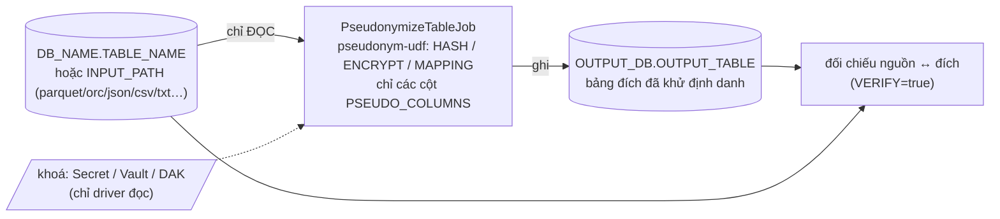

# pseudonymize-table-app

Spark job **khử định danh (giả danh hoá) một bảng hoặc một thư mục file**: nhận nguồn (tên DB + tên bảng, hoặc đường dẫn
file/thư mục + định dạng) và danh sách cột cần khử định danh — mỗi cột có thể dùng chế độ riêng; thay các cột đó bằng
định danh giả bằng lib [`pseudonym-udf`](../pseudonym-udf), ghi ra bảng đích.

- Giải thích cơ chế từng thuật toán kèm ví dụ: [docs/pseudonymization/ALGORITHMS.md](../docs/pseudonymization/ALGORITHMS.md)
- Thiết kế lib: [docs/pseudonymization/LIB_PLAN.md](../docs/pseudonymization/LIB_PLAN.md)
- Muốn **kiểm tra bảng đích** sau khi chạy (so với bảng nguồn): [`pseudonym-verify-utils`](../pseudonym-verify-utils/README.md)



## 1. Cấu trúc thư mục

```
pseudonymize-table-app/
├── README.md
├── Dockerfile                          # build context = GỐC REPO (cần jar của pseudonym-udf + key-prefix-lib)
├── pom.xml                             # lib = provided (nạp qua spark.jars); shade Delta + patch block token
├── k8s/
│   ├── pseudonymize-table.yaml         # SparkApplication
│   └── pseudonym-keys-secret.yaml      # mẫu Secret khoá (CRYPTO_PREFIX_SOURCE=file) — chỉ có chỗ trống
└── src/
    ├── main/resources/log4j2.properties
    ├── main/scala/vai/lakehouse/pseudonymizetable/
    │   ├── app/      PseudonymizeTableApp (main mỏng: execute -> exit code), SparkSessions
    │   ├── config/   JobConfig (đọc + validate env, gom mọi lỗi 1 lượt), OutputFormat
    │   ├── job/      PseudonymizeTableJob (đọc -> giả danh -> ghi -> đối chiếu)
    │   └── logging/  Log (logger "VLP")
    └── test/scala/...   13 test: cấu hình, và chạy app thật (HASH/ENCRYPT/MAPPING, append, DB đích khác, các mã lỗi)
```

Cùng khuôn với `spark-app`: `main` mỏng, cấu hình chỉ qua biến môi trường, patch block token Isilon, `Log` "VLP".

## 2. Build

Yêu cầu: JDK 11+ (đã kiểm chứng trên JDK 21), Maven 3.8+. Chạy ở **gốc repo**.

```bash
mvn -B -pl pseudonymize-table-app -am clean package                 # build + test (kèm key-prefix-lib, pseudonym-udf, spark-app)
mvn -B -pl pseudonymize-table-app -am clean package -DskipTests     # chỉ cần jar
# -> pseudonymize-table-app/target/pseudonymize-table-app.jar        (fat jar: app + Delta + patch; KHÔNG chứa lib giả danh)
# -> pseudonym-udf/target/pseudonym-udf-1.0-SNAPSHOT.jar
# -> key-prefix-lib/target/key-prefix-lib-1.0-SNAPSHOT.jar

IMAGE=hub.vtcc.vn:8989/hungvt0110/pseudonymize-table-app:v0.1
docker build -f pseudonymize-table-app/Dockerfile -t "$IMAGE" .      # context = gốc repo
docker push "$IMAGE"
```

Test (không cần cluster/Vault/HDFS): `mvn -B -pl pseudonymize-table-app -am test -DwildcardSuites=vai.lakehouse.pseudonymizetable`.
`PseudonymizeTableAppSpec` tạo bảng thật trong catalog của 1 SparkSession local, nạp khoá qua `spark.pseudonym.*` (nguồn
`file`) rồi chạy `execute` — đúng đường cấu hình của production.

## 3. Đầu vào / đầu ra

### 3.1. Biến môi trường của job (chỉ driver đọc)

| Biến | Mặc định | Ý nghĩa |
| --- | --- | --- |
| `DB_NAME` + `TABLE_NAME` | — | **Nguồn là bảng** trong catalog. Chỉ `[A-Za-z0-9_]`. Bắt buộc nếu không dùng `INPUT_PATH` |
| `INPUT_PATH` | — | **Nguồn là file/thư mục**, vd `/landing/vtt/lakehouse/vtt-core/f016-mpre-tot-charge-m/date=20261012/hour=18/` (đường dẫn tuyệt đối hoặc URI `hdfs://…`; glob được). Loại trừ với `DB_NAME`/`TABLE_NAME` (xem 3.5) |
| `INPUT_FORMAT` | (bắt buộc khi có `INPUT_PATH`) | `parquet` / `orc` / `avro` / `json` / `delta` / `csv` / `tsv` / `txt` (= `csv`, text phân tách ký tự) / `text` (mỗi dòng 1 cột `value`) |
| `INPUT_SCHEMA` | — | Schema DDL cho file không có schema sẵn, vd `isdn STRING, imei STRING, amount DOUBLE`. Không có thì csv/tsv/txt đặt tên cột `_c0, _c1, …` |
| `INPUT_OPTION_<tên>` | — | Option của Spark reader, vd `INPUT_OPTION_delimiter=\|`, `INPUT_OPTION_header=true`, `INPUT_OPTION_encoding=UTF-8` |
| `PSEUDO_COLUMNS` | (bắt buộc) | Cột cần khử định danh, phân cách bằng dấu phẩy, vd `isdn,imei`. Mỗi cột có thể kèm chế độ riêng: `isdn:HASH,imei:ENCRYPT` (xem 3.6). Không lặp, phải có trong nguồn |
| `PSEUDO_MODE` | `HASH` | `HASH` (một chiều) / `ENCRYPT` (giải mã lại được) / `MAPPING` (bảng ánh xạ). Chế độ **mặc định** cho cột trong `PSEUDO_COLUMNS` không ghi `:MODE` |
| `OUTPUT_DB` | `DB_NAME` (nguồn bảng); **bắt buộc** với nguồn file | Database bảng đích (tự `CREATE DATABASE IF NOT EXISTS`) |
| `OUTPUT_TABLE` | `<TABLE_NAME>_pseudonymized` (nguồn bảng); **bắt buộc** với nguồn file | Tên bảng đích. **Không được trùng bảng nguồn** (xem 3.3) |
| `OUTPUT_FORMAT` | `delta` | `delta` / `hive` (ghi Parquet) / `iceberg` (cần catalog Iceberg đã cấu hình) |
| `OUTPUT_MODE` | `overwrite` | `overwrite` (thay thế bảng đích) / `append` (ghi nối) |
| `VERIFY` | `true` | Đọc lại bảng đích và đối chiếu với nguồn (mục 5) |
| `MAPPING_TABLE_PATH` | — | Chỉ `PSEUDO_MODE=MAPPING`: đường dẫn bảng ánh xạ Delta (hoặc dùng `spark.pseudonym.mapping.path`) |
| `WAREHOUSE_PATH` | — | URI đầy đủ của warehouse, vd `hdfs://vailakehouse.datalakehla.viettel.com.vn:8020/prod8/warehouse`; đặt `spark.sql.warehouse.dir` (không phụ thuộc `fs.defaultFS`) — cùng quy ước với `crawler-streaming-app` |
| `ENABLE_HIVE_SUPPORT` | `true` | `true` để đọc bảng qua Hive metastore (như `spark-app`) |
| `APP_NAME` | `PseudonymizeTable` | Tên trên Spark UI |

Sai cấu hình → job **không dựng Spark**, in mọi lỗi một lượt và thoát với exit code `2`.

### 3.2. Đầu ra

- Bảng `OUTPUT_DB.OUTPUT_TABLE` có **cùng cột, cùng thứ tự** với bảng nguồn; các cột trong `PSEUDO_COLUMNS` đã được thay
  bằng định danh giả, các cột còn lại **giữ nguyên**.
- Định danh giả luôn là `STRING`: cột số (vd `BIGINT`) trong `PSEUDO_COLUMNS` sẽ thành `STRING` ở bảng đích.
- `NULL` vẫn là `NULL`. Cùng một giá trị gốc luôn ra cùng một định danh giả (nên vẫn join/đếm/gom nhóm được).

| Chế độ | Giá trị trong bảng đích |
| --- | --- |
| `HASH` | `k1_` + 32 ký tự hex |
| `ENCRYPT` | `e1_` + base64url (dài hơn bản gốc 16 byte) |
| `MAPPING` | `t_` + 32 ký tự hex ngẫu nhiên; cặp `(giá trị gốc, token)` nằm ở bảng ánh xạ |

### 3.3. Vì sao không ghi đè bảng gốc

Giả danh hoá `HASH` là **một chiều**: ghi đè bảng gốc là mất dữ liệu vĩnh viễn nếu có sai sót (nhầm cột, nhầm khoá).
Job chỉ **đọc** bảng nguồn và từ chối cấu hình `OUTPUT_DB.OUTPUT_TABLE == DB_NAME.TABLE_NAME`. Muốn thay thế bảng gốc,
làm bước riêng có kiểm soát sau khi đã kiểm tra bảng đích (đổi tên bảng / trỏ lại view).

### 3.4. Ví dụ

```text
DB_NAME=crm  TABLE_NAME=subscriber  PSEUDO_COLUMNS=isdn,imei  PSEUDO_MODE=HASH

crm.subscriber                                      crm.subscriber_pseudonymized
id | isdn        | imei            | province       id | isdn                                  | imei             | province
1  | 84903217465 | 352099001761481 | Ha Noi         1  | k1_3fe27d9b4727fb8a0f900bc4126c6164   | k1_e922fc35...   | Ha Noi
3  | 84903217465 | NULL            | Ha Noi         3  | k1_3fe27d9b4727fb8a0f900bc4126c6164   | NULL             | Ha Noi
```

(Giá trị `k1_...` minh hoạ với khoá thử nghiệm; khoá thật cho kết quả khác. Xem [ALGORITHMS.md](../docs/pseudonymization/ALGORITHMS.md).)

### 3.5. Nguồn là file / thư mục

Đặt `INPUT_PATH` + `INPUT_FORMAT` (thay cho `DB_NAME`/`TABLE_NAME`). Job chỉ **đọc**, kết quả vẫn ghi ra **bảng đích**
`OUTPUT_DB.OUTPUT_TABLE` (hai biến này bắt buộc vì không có tên bảng nguồn để suy ra mặc định).

```yaml
# Thư mục HDFS đang chứa file txt phân tách bằng '|', không header
- name: INPUT_PATH
  value: /landing/vtt/lakehouse/vtt-core/f016-mpre-tot-charge-m/date=20261012/hour=18/
- name: INPUT_FORMAT
  value: txt                     # csv/txt đều là text phân tách; text = nguyên dòng
- name: INPUT_OPTION_delimiter
  value: "|"
- name: INPUT_SCHEMA            # có schema thì dùng tên cột thật trong PSEUDO_COLUMNS
  value: "isdn STRING, imei STRING, amount DOUBLE"
- name: PSEUDO_COLUMNS
  value: isdn:HASH,imei:ENCRYPT
- name: OUTPUT_DB
  value: landing
- name: OUTPUT_TABLE
  value: f016_mpre_tot_charge_m_pseudonymized
```

Lưu ý:
- Trỏ thẳng vào thư mục `date=…/hour=…/` thì **không** có cột partition `date`/`hour` trong dữ liệu (Spark chỉ suy ra
  partition từ phần path *dưới* thư mục gốc đã cho). Cần cột đó thì trỏ vào thư mục cha hoặc dùng glob, vd
  `INPUT_PATH=/landing/.../f016-mpre-tot-charge-m/` kèm `INPUT_OPTION_basePath=/landing/.../f016-mpre-tot-charge-m`.
- Không có `INPUT_SCHEMA` và không `INPUT_OPTION_header=true` thì cột tên `_c0, _c1, …` và đều là `STRING`; có header thì
  dùng `INPUT_OPTION_header=true` (tên cột lấy từ dòng đầu). `PSEUDO_COLUMNS` dùng đúng tên cột đó.
- Chuỗi rỗng trong csv/txt được đọc là `NULL` (mặc định Spark) và vẫn `NULL` ở bảng đích.
- `avro` cần module spark-avro (image `apache/spark` có sẵn); các định dạng khác là built-in.
- Nguồn file không đổi được giữa hai lần đọc (job đọc lại nguồn để đối chiếu ở mục 5): đừng ghi thêm file vào thư mục
  trong lúc job chạy.

### 3.6. Mỗi cột một chế độ

`PSEUDO_COLUMNS` nhận `cột[:MODE]`, ví dụ `isdn:HASH,imei:ENCRYPT,customer_id`. Cột không ghi `:MODE` dùng `PSEUDO_MODE`
(mặc định `HASH`). Chỉ khoá của các chế độ **thực sự dùng** mới bị đọc: cả `HASH` và `ENCRYPT` thì cần cả
`pseudonym.hmac_v<N>` và `pseudonym.aes_siv_v<N>` (mục 4.2); có cột `MAPPING` thì cần `MAPPING_TABLE_PATH`.

Chọn chế độ theo nhu cầu từng cột: cột chỉ để nối/đếm (`isdn`) → `HASH`; cột cần khôi phục sau này theo quy trình được duyệt
(`imei`) → `ENCRYPT`. Xem [ALGORITHMS.md](../docs/pseudonymization/ALGORITHMS.md).

## 4. Env của `pseudonym-udf` cần truyền vào

Lib đọc cấu hình ở **driver** (khoá được đọc 1 lần rồi nằm trong closure của UDF gửi xuống executor), nên các biến dưới
đây chỉ cần khai ở `spec.driver.env`. Executor **không** cần khoá — chỉ cần 2 jar lib (`spark.jars`).

### 4.1. Cách lib tìm cấu hình

Mỗi tham số logic được tìm theo thứ tự, lấy giá trị đầu tiên có mặt:

1. **Spark conf** `spark.pseudonym.<tham số>` (khai trong `spec.sparkConf`).
2. **Biến môi trường** của driver (bảng 4.3).
3. Mặc định của lib.

Hai cách tương đương; dùng biến môi trường nếu muốn đồng nhất với `spark-app`/`cdr-crypto` (đã dùng `CRYPTO_*`,
`VAULT_*`, `DAK_*`), dùng Spark conf nếu cấu hình qua `sparkConf` thuận tiện hơn.

### 4.2. Tối thiểu cần gì theo từng chế độ

| `PSEUDO_MODE` | Phải có | Không cần |
| --- | --- | --- |
| `HASH` | nguồn khoá + khoá **`pseudonym.hmac_v<N>`** (32 byte) | khoá AES, bảng ánh xạ |
| `ENCRYPT` | nguồn khoá + khoá **`pseudonym.aes_siv_v<N>`** (64 byte) | khoá HMAC, bảng ánh xạ |
| `MAPPING` (bất kỳ cột nào) | **`MAPPING_TABLE_PATH`** (hoặc `spark.pseudonym.mapping.path`) + session có Delta (app đã tự bật) | nguồn khoá, khoá |

Chỉ khoá của chế độ đang dùng mới bị đọc: chạy `HASH` mà thiếu khoá AES vẫn thành công.

### 4.3. Bảng env / conf

| Tham số | Biến môi trường (driver) | Spark conf | Mặc định | Ý nghĩa |
| --- | --- | --- | --- | --- |
| nguồn khoá | `CRYPTO_PREFIX_SOURCE` | `spark.pseudonym.source` | `file` | `file` / `vault` / `dak`. Ghép `file,vault` được (thử lần lượt); **`dak` không được ghép** với nguồn khác |
| **File** — thư mục khoá | `CRYPTO_KEY_PREFIX_DIR` | `spark.pseudonym.file.dir` | `conf/key-prefix` | Thư mục mount Secret; mỗi khoá 1 file đúng tên khoá |
| **Vault** — địa chỉ | `VAULT_ADDR` | `spark.pseudonym.vault.addr` | — (bắt buộc khi dùng vault) | URL Vault |
| Vault — kiểu xác thực | `VAULT_AUTH_METHOD` | `spark.pseudonym.vault.authMethod` | `kubernetes` | `kubernetes` / `token` |
| Vault — token tĩnh | `VAULT_TOKEN` | `spark.pseudonym.vault.token` | — | Bắt buộc khi `authMethod=token` (nên lấy từ `secretKeyRef`) |
| Vault — role | `VAULT_ROLE` | `spark.pseudonym.vault.role` | — | Bắt buộc khi `authMethod=kubernetes` |
| Vault — mount xác thực | `VAULT_AUTH_MOUNT` | `spark.pseudonym.vault.authMount` | `kubernetes` | |
| Vault — mount KV | `VAULT_KV_MOUNT` | `spark.pseudonym.vault.kvMount` | `kv` | KV v2 |
| Vault — đường dẫn gốc | `VAULT_KV_PATH` | `spark.pseudonym.vault.kvBasePath` | — (bắt buộc) | Khoá ở `<kvMount>/data/<kvBasePath>/<tên khoá>` |
| Vault — tên field | `VAULT_KEY_FIELD` | `spark.pseudonym.vault.keyField` | `keyPrefix` | Field trong secret chứa giá trị khoá |
| Vault — JWT SA | `VAULT_JWT_PATH` | `spark.pseudonym.vault.jwtPath` | `/var/run/secrets/kubernetes.io/serviceaccount/token` | |
| **DAK** — địa chỉ | `DAK_ADDR` | `spark.pseudonym.dak.addr` | — (bắt buộc khi dùng dak) | `https://...` |
| DAK — token endpoint | `DAK_TOKEN_URL` | `spark.pseudonym.dak.tokenUrl` | — (bắt buộc) | Keycloak của realm tenant, `https://...` |
| DAK — client | `DAK_CLIENT_ID` | `spark.pseudonym.dak.clientId` | — (bắt buộc) | Client Keycloak của team |
| DAK — secret | `DAK_CLIENT_SECRET` | `spark.pseudonym.dak.clientSecret` | — (bắt buộc) | **Nhạy cảm**: dùng `secretKeyRef`, không ghi thẳng giá trị |
| DAK — cho phép http | `DAK_ALLOW_INSECURE_HTTP` | `spark.pseudonym.dak.allowInsecureHttp` | `false` | Chỉ để test với `dak-mock` |
| cache khoá (giây) | `CRYPTO_CACHE_TTL_SECONDS` | `spark.pseudonym.cacheTtlSeconds` | `300` | `0` = tắt cache |
| version khoá HMAC | *(không có env)* | `spark.pseudonym.hmac.version` | `1` | Đọc khoá `pseudonym.hmac_v<version>`; số nguyên ≥ 1 |
| version khoá AES-SIV | *(không có env)* | `spark.pseudonym.aes-siv.version` | `1` | Đọc khoá `pseudonym.aes_siv_v<version>` |
| bảng ánh xạ | `MAPPING_TABLE_PATH` *(của app)* | `spark.pseudonym.mapping.path` | — | Chỉ `MAPPING`. Nếu cả hai có mặt thì env của app thắng |

> **Lưu ý đã kiểm chứng:** tên khoá là `pseudonym.hmac_v1` / `pseudonym.aes_siv_v1` (dùng `_` chứ không phải `.` ở phần
> version) vì nguồn `dak` chỉ chấp nhận tên dạng `<database>.<table>` đúng 2 phần. Version khoá **không** có biến môi
> trường: muốn khác `1` phải đặt qua Spark conf.

### 4.4. Khoá nằm ở đâu theo từng nguồn

| Nguồn | Khoá `pseudonym.hmac_v1` ở đâu |
| --- | --- |
| `file` | File `<CRYPTO_KEY_PREFIX_DIR>/pseudonym.hmac_v1` (key của K8s Secret, xem `k8s/pseudonym-keys-secret.yaml`) |
| `vault` | KV v2 tại `<VAULT_KV_MOUNT>/data/<VAULT_KV_PATH>/pseudonym.hmac_v1`, field `<VAULT_KEY_FIELD>` |
| `dak` | `GET <DAK_ADDR>/api/v1/keys/pseudonym/hmac_v1` — database `pseudonym`, table `hmac_v1`; team phải được cấp quyền |

Giá trị khoá là chuỗi `base64:<...>` hoặc `hex:<...>`; HMAC đúng **32 byte**, AES-SIV đúng **64 byte**; từ chối khoá
toàn byte 0. Sinh khoá:

```bash
echo "base64:$(openssl rand -base64 32)"                      # pseudonym.hmac_v1
echo "base64:$(openssl rand -base64 64 | tr -d '\n')"         # pseudonym.aes_siv_v1
```

### 4.5. Ví dụ cấu hình

**Secret mount (mặc định của manifest):**

```yaml
env:
  - { name: CRYPTO_PREFIX_SOURCE,   value: file }
  - { name: CRYPTO_KEY_PREFIX_DIR,  value: /etc/pseudonym-keys }
volumeMounts:
  - { name: pseudonym-keys, mountPath: /etc/pseudonym-keys, readOnly: true }
```

**Vault (xác thực Kubernetes):**

```yaml
env:
  - { name: CRYPTO_PREFIX_SOURCE, value: vault }
  - { name: VAULT_ADDR,           value: "https://vault.example.internal:8200" }
  - { name: VAULT_ROLE,           value: pseudonymize-table }
  - { name: VAULT_KV_PATH,        value: pseudonym }
```

**DAK:**

```yaml
env:
  - { name: CRYPTO_PREFIX_SOURCE, value: dak }
  - { name: DAK_ADDR,             value: "https://dak.example.internal" }
  - { name: DAK_TOKEN_URL,        value: "https://sso-lakehouse.cyberspace.vn/realms/<realm>/protocol/openid-connect/token" }
  - { name: DAK_CLIENT_ID,        value: team-de-ws8 }
  - name: DAK_CLIENT_SECRET
    valueFrom: { secretKeyRef: { name: spark-dak-client, key: clientSecret } }
```

**Chế độ MAPPING (không cần khoá, cần đường dẫn bảng ánh xạ):**

```yaml
env:
  - { name: PSEUDO_MODE,         value: MAPPING }
  - { name: MAPPING_TABLE_PATH,  value: "hdfs://<namenode>:8020/<path>/_restricted/pseudonym_map" }
```

Bảng ánh xạ chứa **giá trị gốc** → đặt ở vùng HDFS riêng, phân quyền như dữ liệu gốc, **không** đặt cạnh bảng đích.

### 4.6. Lỗi thường gặp

| Thông báo | Nguyên nhân |
| --- | --- |
| `Key '...' must start with 'base64:' or 'hex:'` | Giá trị khoá không có tiền tố mã hoá |
| `Key '...' must be 32 bytes but is N bytes` | Dùng nhầm khoá HMAC (32) cho AES-SIV (64) hoặc ngược lại |
| `PSEUDO_MODE=MAPPING cần đường dẫn bảng ánh xạ` | Thiếu `MAPPING_TABLE_PATH` / `spark.pseudonym.mapping.path` |
| `Invalid ...: must be a comma-separated list of file, vault, dak` | `CRYPTO_PREFIX_SOURCE` sai giá trị |
| `'dak' cannot be combined with other sources` | Khai `dak,vault` — lib từ chối vì fallback sẽ bỏ qua phân quyền DAK |
| `Missing required setting: VAULT_ADDR` (hoặc `DAK_*`) | Chọn nguồn nhưng thiếu biến bắt buộc của nguồn đó |

## 5. Đối chiếu nguồn ↔ đích (`VERIFY=true`)

Sau khi ghi, job đọc lại bảng đích và kiểm, **theo từng cột** trong `PSEUDO_COLUMNS` (mỗi cột theo chế độ riêng của nó):

| Kiểm | `overwrite` | `append` |
| --- | --- | --- |
| Số dòng đích == nguồn | ✔ | đích ≥ nguồn (đích còn dữ liệu các lần trước) |
| Số `NULL` không đổi | ✔ | — |
| Số giá trị khác nhau không đổi (ánh xạ 1-1, không va chạm) | ✔ | — |
| **Không còn giá trị gốc nào** trong cột đích | ✔ | ✔ |

Đạt → `JOB SUCCEEDED`, exit `0`. Không đạt → bảng đích **đã được ghi** nhưng job báo
`JOB WRITTEN BUT VERIFICATION FAILED`, exit `3`: **đừng dùng** bảng đích đó.

> Đây là kiểm tra nhanh trên chính dữ liệu của bạn. Chứng minh lib khử định danh đúng về mặt thuật toán (chống từ điển,
> sai khoá, rò rỉ khoá...) là việc của [`pseudonym-verify-utils`](../pseudonym-verify-utils/README.md) (chạy độc lập sau job).

### Exit code

| Code | Nghĩa |
| --- | --- |
| 0 | Xong; đối chiếu đạt (hoặc `VERIFY=false`) |
| 1 | Lỗi khi chạy: bảng nguồn không tồn tại, cột không có trong bảng, khoá/Vault/DAK lỗi, lỗi HDFS... (kèm cây nguyên nhân) |
| 2 | Sai cấu hình biến môi trường (mọi lỗi in một lượt, tiền tố `CONFIG`) |
| 3 | Đã ghi bảng đích nhưng đối chiếu **không đạt** |

## 6. Chạy trên K8s

```bash
NS=vlp-tenantw1xjixm-wsw7vtwvi-teamtscauiy
# 1. Secret khoá (nguồn file) — tạo bằng lệnh trong k8s/pseudonym-keys-secret.yaml, KHÔNG commit khoá thật
# 2. Sửa DB_NAME / TABLE_NAME / PSEUDO_COLUMNS / PSEUDO_MODE trong k8s/pseudonymize-table.yaml, rồi:
kubectl apply -f pseudonymize-table-app/k8s/pseudonymize-table.yaml
kubectl logs -f pseudonymize-table-driver -n $NS
# Chạy lại: kubectl delete sparkapplication pseudonymize-table -n $NS rồi apply
```

Chuẩn bị giống `crawler-streaming-app` (cùng namespace `teamtscauiy`, cụm `datalakehla`, principal `presto`): ConfigMap `teamtscauiy-hadoop-conf` (cụm `datalakehla`), ServiceAccount `spark-application-sa`, keytab trên
pod Spark Operator, quyền **đọc** bảng nguồn và **ghi** DB đích cho principal `presto@VAILAKEHOUSE.VIETTEL.COM`. Image/tài nguyên trong manifest là giả
định — chỉnh theo registry và ResourceQuota thật.

Trong log (logger `VLP`) theo thứ tự `1. CONFIG` → `2. SPARK SESSION` → `3. ĐỌC BẢNG NGUỒN` → `4. GHI BẢNG ĐÍCH` →
`5. ĐỐI CHIẾU` → `KẾT THÚC`. Log **không** in giá trị cột hay khoá, chỉ số liệu tổng hợp.

Kiểm tra nhanh bảng đích bằng Spark SQL:

```sql
SELECT * FROM crm.subscriber_pseudonymized LIMIT 10;
SELECT count(*) AS dong, count(isdn) AS isdn_khac_null, count(DISTINCT isdn) AS isdn_khac_nhau
FROM crm.subscriber_pseudonymized;          -- so với cùng truy vấn trên crm.subscriber: phải bằng nhau
```

## 7. Giới hạn cần biết

- **Đồng nhất định dạng trước.** Lib băm/mã hoá *nguyên trạng* giá trị: `0903217465` và `84903217465` ra hai định danh giả
  khác nhau. Cột phải được chuẩn hoá ở bước trước khi khử định danh.
- **Chỉ khử các cột bạn liệt kê.** Cột định danh gián tiếp (ngày sinh, tỉnh, giới tính...) vẫn còn; kết hợp chúng có thể
  chỉ mặt một người. Dữ liệu giả danh **vẫn là dữ liệu cá nhân**.
- **Cùng khoá + cùng chế độ cho cùng một cột ở mọi bảng**, nếu không các bảng không join được với nhau.
- **Đổi khoá = mọi định danh giả đổi**; mất khoá `ENCRYPT`/`HASH` = mất khả năng tái định danh. Sao lưu khoá.
- `OUTPUT_FORMAT=iceberg` chỉ chạy khi cluster đã cấu hình catalog Iceberg (app không tự cấu hình).
- Bảng đích do `saveAsTable` tạo: không giữ partition/bucket/ràng buộc của bảng nguồn.
- Chưa kiểm chứng trên cluster thật (HDFS Isilon + Kerberos, image Docker, Vault/DAK); đã kiểm chứng bằng test local.
